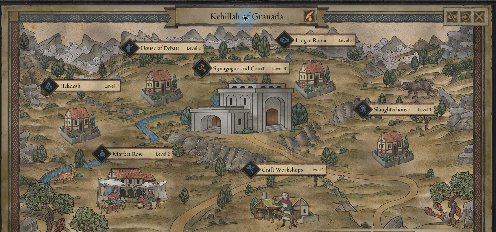
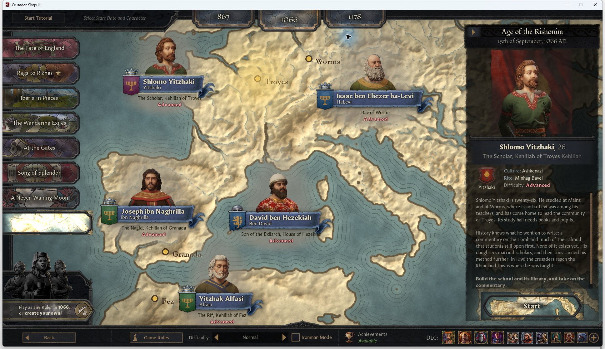
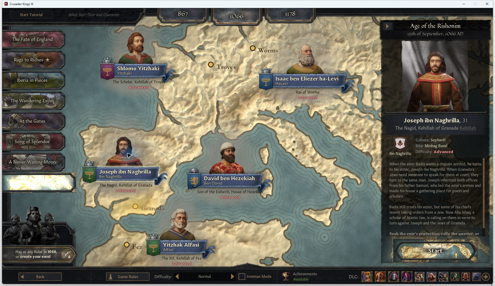
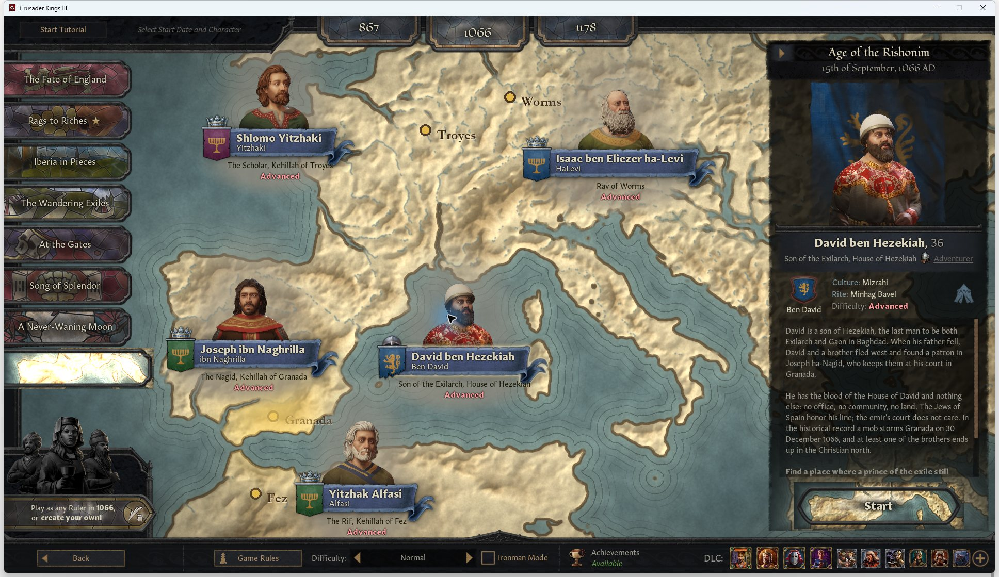
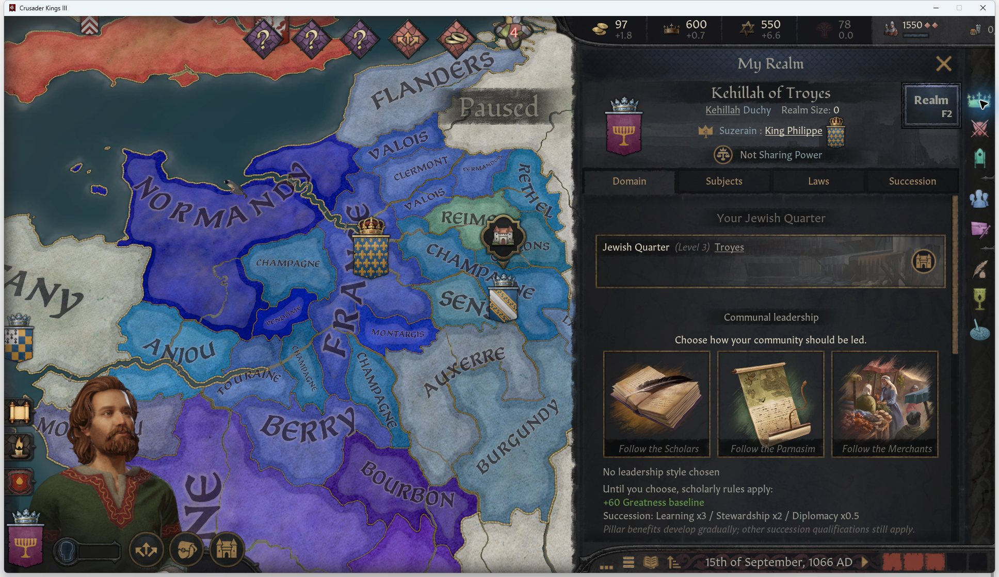
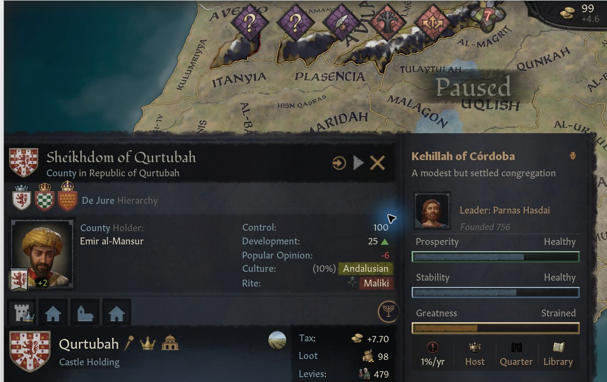
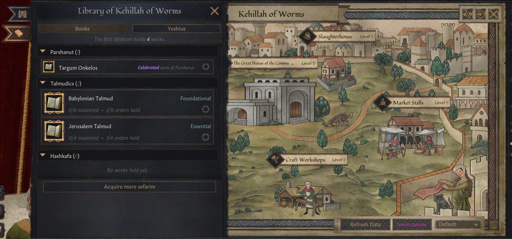
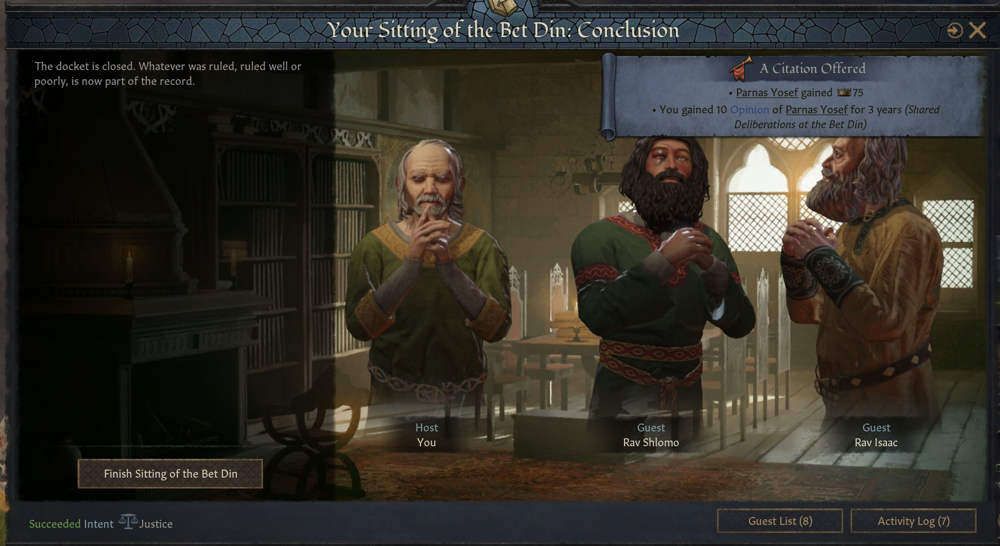

# Jewish Communities — Kehillah

**Pre-alpha for Crusader Kings III 1.20.x · Roads to Power required**

Lead a Jewish community inside a medieval Christian or Muslim realm. Your home is a Jewish Quarter; your strength comes from its families, scholars, officers and host ruler. Build a place worth preserving, then guide it through political favour, difficult judgments and danger at its gates. When your leader dies, continue as the successor the community appoints.

## Choose your story

The **1066 Age of the Rishonim** bookmark offers five characters. These three show different sides of the mod:

| Start | The story | First ambition |
| --- | --- | --- |
| **Rashi · Troyes** | A young scholar leads a small, poor Kehillah. His great commentaries have yet to be written. | Build a school and library, then write. |
| **Joseph ibn Naghrilla · Granada** | The emir's vizier is also Nagid of his realm's Jews. His influence brings opportunity and enemies. | Strengthen the Quarter before the gathering threat breaks over it. |
| **David ben Hezekiah · Granada to Baghdad** | An exiled son of the Exilarch starts as a landless adventurer with a claim to Baghdad's community. | Reach Baghdad, press the claim, then seek separate recognition as Exilarch. |

  
  
  

For an easier introduction, **Isaac ha-Levi of Worms** begins with an established yeshiva. **The Rif in Fez** offers another scholar's journey. There are also **867 Age of the Geonim** and **1178 The Paths of Torah** start screens; those dates have received less campaign testing. See [Amram Gaon and the Rambam in the gallery](docs/wiki/gallery.md#other-centuries).

[Choose a start and plan your first moves →](docs/wiki/three-starts.md)

## See the community

The custom **Domain** screen brings together the Jewish Quarter, the host charter and three pillars of communal life: **Prosperity** for people and trade, **Stability** for cohesion and protection, and **Greatness** for learning and renown. Each pillar has a readable breakdown and rises from Crisis to Legendary. Choose a Scholarly, Political or Commercial leadership style to shape the community's direction.

Grow the **Quarter** through nine building lines, from synagogue and Beit Midrash to countinghouse, mikvah, Hekdesh and workshops. The **library** and **Sefarim Ledger** let you browse historical works, see how your rite values them, acquire copies, study and eventually write your own. Jewish map modes and community cards reveal other Kehillot across the world.

## Lead people and face danger

Seat a five-member council, appoint officers, support householder families and convene a **Bet Din** to judge disputes. A yeshiva can train students under a Rosh Yeshiva and ordain the next generation of rabbis. Succession is by **appointment**: candidates have visible scores, and you can endorse one, while the community makes its choice.

Your host's settlement policy and charter affect what the community may do. Loans, contracts and the Nagid's court office can create influence. When hostility grows, a **crisis** becomes a visible race between the Armed Host and the effort to spare the Quarter. Prepare the watch, seek protection, answer accusations and live with the aftermath.

Jewish rites and tenets, Karaite communities, holidays, ancestral sites, patronyms, and Kohen, Levite and Ben David lineages give each campaign more texture. The [feature guide](docs/wiki/features.md) shows where to find the systems and what their screens tell you.

## Install and play

1. Use **Crusader Kings III 1.20.x** with **Roads to Power** enabled. Other DLC adds some content but is optional.
2. For the private pre-alpha, subscribe using the Workshop link shared with your test group. Add **Jewish Communities (Pre-Alpha)** to a launcher playset by itself.
3. Under **Play**, select a Kehillah bookmark. Start with Worms for a tour, or choose Rashi, Granada or David for one of the stories above.

For a source install, place this checkout under `Documents/Paradox Interactive/Crusader Kings III/mod/jewishcommunities`, register `descriptor.mod` in the launcher and enable **Jewish Communities**. Do not enable the source and pre-alpha copies together.

## This is a pre-alpha

The core community, Quarter, council and Bet Din have been played live. Many newer systems and the 867 and 1178 starts have had only focused checks or source validation. Expect rough balance, occasional missing text and bugs. **Saves may not survive updates**; begin a new campaign after each build. Play without other mods while testing.

Please report what happened, your start and in-game date, a screenshot if useful, and `Documents/Paradox Interactive/Crusader Kings III/logs/error.log` for crashes or broken interactions. Copy the log before relaunching; CK3 rewrites it. Confusing moments and memorable stories are useful feedback too.

## Guides and project notes

- [Player guide home](docs/wiki/Home.md)
- [In-game gallery](docs/wiki/gallery.md)
- [Quick start: Rashi, Granada and David](docs/wiki/three-starts.md)
- [Feature guide: screens and systems](docs/wiki/features.md)
- [Testing and feedback](docs/wiki/testing-and-feedback.md)
- [Development status and verification](ROADMAP.md)
- [Design and implementation notes](docs/spec/v1-kehillah-community.md)

Mod version: **0.1 pre-alpha**. [Repository](https://github.com/Steinbeard/jewishcommunities).
