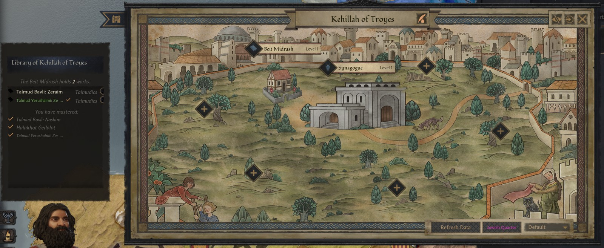
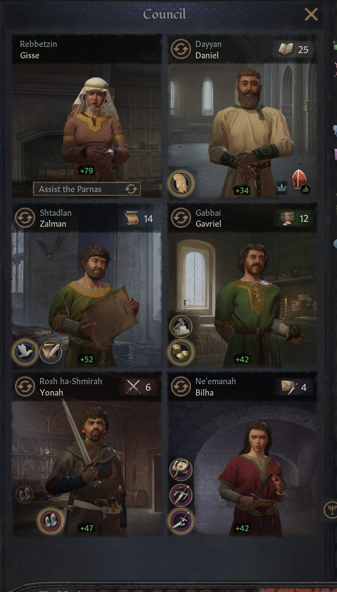
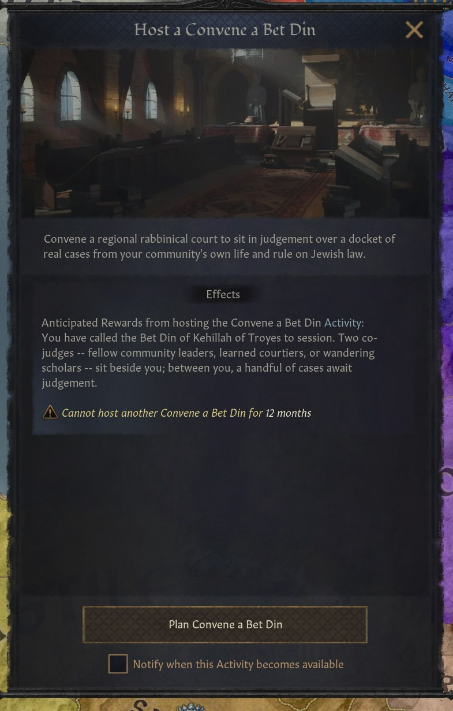

# Jewish Communities

A Crusader Kings III mod about the Jewish communities of medieval Europe and the Near East. You
play as the leader of a **Kehillah**, a self-governing Jewish community living inside a Christian
or Muslim host realm. You hold no land. You build up the community's Jewish Quarter, seat its
council and its rabbinic court, train and ordain rabbis, and keep the community alive through its
host's favour and through changes of leadership.

## Current Version

- Mod version: `0.1`
- CK3 version: `1.20.0.4` (`Crozier`)
- Start date: 1066, with 19 historical communities from Paris and Toledo to Baghdad

## Playable characters

The 1066 bookmark offers three ways to play:

- **Isaac ben Eliezer ha-Levi, Rav of Worms**: leads a well-established Rhineland community with
  its own yeshiva.
- **Shlomo Yitzhaki (Rashi), the Scholar of Troyes**: young, learned, and rabbi of a small, poor
  community in Champagne.
- **Yosef ben Menahem, the Financier of Rouen**: a landless trader with no community of his own.
  After the Norman Conquest he can found a community in England and lend money to the new king.

## Features

### The Kehillah government

- A **landless government** for Jewish communities. The community is a title with no land, and
  its seat is a **Jewish Quarter** in the host's city.
- Leaders are styled **Parnas**, or **Rav** if they are an ordained rabbi. A rabbi earns the title
  **Rabbenu** at high piety.
- **Leadership passes by appointment, not inheritance.** Candidates are scored on merit and on
  their family's standing, and a leader can endorse a successor. When the player's leader dies,
  the game offers "Continue as" the new leader.
- A leader can **step down and take to the road** as a landless adventurer. A landless Jewish
  adventurer can **found a new community** where they stand.

### Prosperity, Stability and Greatness

- Three pillars measure the community's health: **Prosperity** (economy, buildings, income),
  **Stability** (cohesion, justice, protection) and **Greatness** (learning, piety, renown).
- Each pillar sits in one of five bands, from **Crisis** to **Legendary**. Each band gives its own
  modifier, and tooltips break each pillar down by source.
- If Stability falls too low, the community is warned. If it stays that low for a year, the
  community collapses.

### The Jewish Quarter

Nine building lines, 25 tiers in all. Higher tiers need the community's pillars to reach higher
bands.

- **Synagogue**, from a single room up to the Great House of the Community
- **Beit Midrash**, which becomes the House of Debate and then a Yeshiva
- **Countinghouse**, **Market Stalls** and **Workshops**, for income
- **Mikvah**, **Hekdesh** (the communal hospice), **Sofer's Workshop** and **Slaughterhouse**

### Council, officers and householders

  

- A **communal council** with five seats: Shtadlan (the community's advocate), Gabbai (treasurer),
  Rosh ha-Shmirah (head of the watch), Ne'eman (trustee) and Dayyan (judge, who must be a rabbi).
  The seats have their own tasks: Raise Communal Revenue, Oversee Construction, Petition the
  Host, Keep the Night Watch, Prepare the Bet Din, and others.
- **Court positions:** Rosh Yeshiva, Sofer, Shochet, Gabbai Tzedakah and Mikvah Attendant.
- **Registered householder families (ba'alei batim)** with their own standing. Families arrive
  from other communities and leave for them, usually nearby ones. Leading families compete for
  the leadership.

### Rabbis, study and the yeshiva

- A **Rabbi** trait, separate from vanilla's learning traits, with study tracks in Talmud,
  Torah commentary and Jewish thought. The rabbinic faith organization is the **Hakhamim**.
- A **community library**. Commission copies of real works for the Beit Midrash, study them
  with **Learn Torah** or the **Study Torah** scheme, donate them, or **write a sefer** of your
  own.
- **Ordination** comes mainly through a yeshiva (below). A child raised as a rabbi's ward can earn
  his endorsement for yeshiva study, and a Bet Din can invite a scholar to be ordained.
- **Yeshivot.** A rare decision founds a yeshiva, which appears as a building on the map and is
  led by a Rosh Yeshiva. Young scholars enrol and travel there over time. They study under a
  rebbe and with a study partner (chavruta), and are ordained after two years. A yeshiva's
  renown adds to its community's Greatness. Worms, Narbonne and Baghdad start with one.
- **Seek a Rabbi** to fill an empty Dayyan seat.

### The Bet Din and responsa

  

- **Convene a Bet Din**, an activity where three judges hear a docket of cases: a captive's
  ransom, a silversmith's dispute, a contested dowry, and more. Judges who have mastered the
  relevant texts can make better arguments.
- When none of the judges knows the source, they can **write to a rabbi in another community**
  and wait for his responsum.
- **Gather the Responsa**: collect a rabbi's rulings into a single volume.

### The host realm

- Each community holds a **charter** from its host, with different terms under Christian and
  Muslim rulers: the right to build, security, jurisdiction, market access, the right to lend
  at interest, a walled quarter, and the freedom to study the Talmud.
- Every realm has a **Jewish Settlement Policy** (Discouraged, Allowed or Encouraged). It decides
  whether new communities may be founded there and what charter terms they get. Non-Jewish
  rulers can raise or lower it by decision.
- **Contracts:** lend to a neighbouring ruler, commission a translation, or tutor a noble in
  Hebrew. Each is a chain of challenges that can succeed or fail.
- **The Norman Conquest** brings an invitation to settle in England, followed by royal loans to
  the new king.

### Community life

- **Community decisions:** Distribute Tzedakah, Secure Construction Permission, Review the
  Householders, and **Set the Community's Goal**, which gives the community ten years to reach
  one of four goals.
- Yearly **family disputes** for the leader to rule on, and **protection events** when the
  community is threatened.
- A **community map view** with a roster of every Kehillah and a breakdown of its pillars.

### Faith, family and culture

- **Holiday events** for Rosh Hashanah, Pesach, Hanukkah and Purim.
- New **Interfaith Marriage** and **Jewish Descent** doctrines. Jewish faiths start with
  marriage outside Judaism forbidden and matrilineal descent.
- **Patronyms** ("ben" and "bat") for Israelite cultures.
- **Kohen** and **Levite** traits, passed from father to son, each with a small monthly
  prestige bonus.
- An **Apostate** trait for characters who leave Judaism.
- Historical and generated Jewish dynasty names.

## Installation

1. Copy or clone this repository into the CK3 mod directory:

   `Documents/Paradox Interactive/Crusader Kings III/mod/jewishcommunities`

2. Create or enable a launcher entry for the mod using `descriptor.mod`.
3. Enable **Jewish Communities** in the CK3 launcher.
4. Start a game from the **1066 Kehillah** bookmark.

The mod targets CK3 `1.20.0.4`. Other game versions may need script or GUI updates.

## Status

The mod is in active development, and not every system has been playtested to the same depth.
The government, succession, Jewish Quarter, council, Bet Din, ordination and yeshiva systems
have all been tested in the live game. The newest additions are less well covered. They
include the patronyms and priestly lines, parts of the yeshiva's student life, and the
responsa letter exchange. [ROADMAP.md](ROADMAP.md) has the detailed state of each feature.

## Design

The design specs are in [docs/spec/](docs/spec/), starting with
[v1-kehillah-community.md](docs/spec/v1-kehillah-community.md). Where the build differs from the
specs, [the implementation notes](docs/implementation/v1-kehillah-implementation.md) explain
why. Live playtest logs are in [docs/testing/](docs/testing/).

## Editing localization

Run `python scripts/kehillah_loc_editor.py` for a searchable, local editor of
English text. It saves changes back to the existing `.yml` files. See
[scripts/README.md](scripts/README.md) for usage and safeguards.

## Repository

[github.com/Steinbeard/jewishcommunities](https://github.com/Steinbeard/jewishcommunities)
