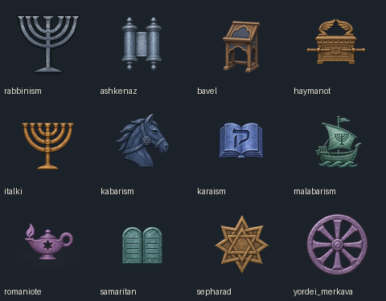
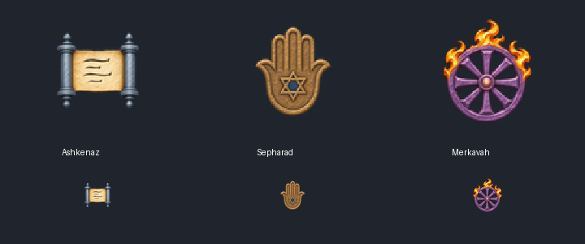
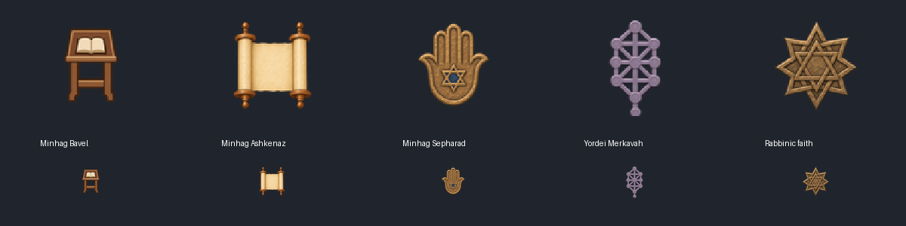
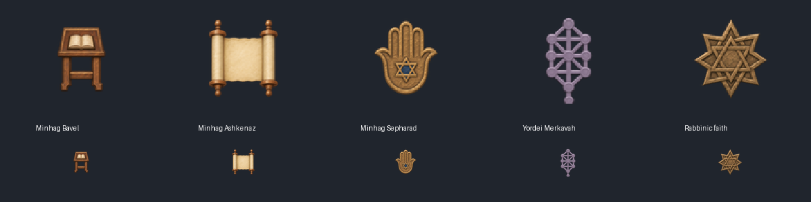
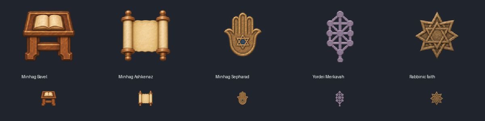

# Jewish rite icons and names

**Status: built 2026-11-12; source and xTiger checked, live UI check pending.**
Follows the medieval minhag build and Daniel's twelve-symbol art direction.

## Names and descriptions

- The faith stays Rabbinic Judaism. Its mainline rite, internal key `rabbinism`, displays as
  **Minhag Bavel**. It now has a rite description centered on Sura, Pumbedita, the Bavli and
  Geonic teaching.
- Minhag Yerushalmi and Minhag Sepharad each have their own description. The Yerushalmi text
  covers the Palestinian-rooted practice represented in 867 Italy and Byzantium as well as the
  Land of Israel.
- The `merkabah` rite displays as **Yordei Merkavah**, with a description of its mystical path.
- The prior `kehillah_minhagim_l_english.yml` began with literal `\xef\xbb\xbf` characters,
  and the Bavli replacement file had no actual BOM. Both now start with a real UTF-8 BOM, as
  CK3 localization files require. This addresses the raw keys visible in Daniel's screenshot.

## Icon set

All new files are transparent 100×100 RGBA DDS files under `gfx/interface/icons/faith/`.
The built-in image generator used vanilla CK3 Jewish faith icons as a style reference: isolated,
centered silhouettes with a restrained metal or wood palette, small bevels, no border or words.
The icons were downsampled and centered within 82×82 pixels for readability in rite lists.

| Rite or faith | Icon | Assignment |
| --- | --- | --- |
| Minhag Bavel | Lectern / shtender | Mainline rite |
| Minhag Yerushalmi | Vanilla seven-branched menorah (`rabbinism.dds`) | Rite |
| Minhag Ashkenaz | Torah scroll | Rite |
| Minhag Sepharad | Ornate geometric star | Rite |
| Yordei Merkavah | Chariot wheel | Rite |
| Karaism | Open book with qof | Faith and rite |
| Haymanot | Ark of the Covenant | Faith and rite |
| Samaritanism | Stone tablets | Faith and rite |
| Khazar Judaism / Kabarism | Horse with Jewish medallion | Faith and rite |
| Malabarism | Ship with menorah sail | Faith and rite |
| Italki | Arch-of-Titus-inspired menorah | Asset ready; Italki is a culture, not a separate rite |
| Romaniote | Purple oil lamp with star | Asset ready; Romaniote is a culture, not a separate rite |

The shared image prompt specified a single CK3 faith emblem, compact hand-painted metal or wood,
one main color, a transparent square background and readability at 32 pixels. Each requested
symbol in the table supplied the subject prompt. The Yerushalmi icon uses the installed vanilla
asset itself, preserving Paradox's exact menorah silhouette. This keeps the faith-level Rabbinic
star distinct from the mainline rite's lectern.

Haymanot and Malabarism faith definitions and their mainline rites are copied from installed
CK3 1.20.1.2, changing only the icon fields; refresh them if vanilla changes. Existing Karaite,
Samaritan and Khazar overrides received matching icon references. The 867 Italian and Byzantine
communities continue using Minhag Yerushalmi, so the Italki/Romaniote art is deliberately unused
until those communities gain separate rites.

## Verification

- xTiger 1.6.10: 0 fatal, 16 baseline errors, 107 warnings; no new changed-file errors.
- Source audit: all icon names resolve to a 100×100 RGBA DDS, except `rabbinism`, which resolves
  to the installed vanilla icon. Thumbnail atlas inspected at native size.
- Live UI check pending under the repository's Luna-only game-control rule. Verify names,
  descriptions and silhouettes on the Rites screen after a fresh CK3 restart; inspect
  `error.log` against the boot baseline.

## Second icon pass and faith-row follow-up (2026-11-12)

Daniel's in-game screenshot showed that the first Ashkenaz scroll read mostly as two metal
rollers, the Sepharad geometric star could be more regionally distinctive, and the Merkavah
wheel lacked the fire of the chariot vision. The second-pass proposals were:
an open parchment scroll with dark ink strokes, a brass hamsa with a small blue Magen David,
and a violet eight-spoke wheel with amber flames. The preview below includes large and
rite-list-size samples; only the Sepharad hamsa was selected from this pass.

The same screenshot still displayed `Merkabah` and vanilla-style stars in the faith rows.
The Merkavah rite now points to a mod-unique localization key in a BOM-encoded file, avoiding
reliance on replacement of the vanilla key. Whether this and the existing faith-level icon
overrides display in a fresh game remains an open live UI check. The faith and rite icon fields
are separate in the installed CK3 1.20.1 definitions: `rabbinic_faith` has
`faith_details.icon = judaism_01`, while its `rabbinism` main rite has its own icon field.
Catholic and Orthodox faiths also define a main rite separately. A distinct umbrella emblem
for each faith is therefore a supported visual design choice, not a requirement to reuse its
mainline rite emblem. The third-pass mod override changes the Rabbinic faith's icon to the
ornate star without changing the Bavel lectern.

## Third icon pass (2026-11-12)

Daniel selected the second-pass hamsa for Sepharad, and the previous ornate Sepharad star now
serves as the Rabbinic faith icon. A new schematic shtender with an open book replaces the more
realistic Bavel lectern. Ashkenaz has a new Torah scroll drawn from scratch with warm parchment,
wooden rollers, and symbolic square Hebrew letters. The Merkavah rite uses a mystical Tree of
Life motif in place of either wheel proposal. The Tree is artistic shorthand rather than a claim
that the later standard Kabbalistic sefirot diagram was the emblem of early Merkavah mystics.
The earlier DDS icons remain as comparison assets; only the selected versions are referenced.

The second-pass preview remains above to preserve the visual review record; its Ashkenaz and
wheel designs were rejected and were not added as game assets.

## Fourth icon pass (2026-11-12)

Daniel asked for a front-facing shtender with flatter shading, a Torah scroll without ink or
decorative star bands, and a less bright Tree of Life. The active Bavel icon now faces the viewer
with a small open book, Ashkenaz uses a blank parchment between plain wooden rollers, and the
Merkavah Tree uses a single muted pewter-lavender material with thicker bars for readability on
the dark UI. The previous DDS versions remain available for comparison. Sepharad's hamsa and
the Rabbinic faith's ornate star stay as selected in the third pass.

## Fifth icon pass (2026-11-12)

The fourth-pass Bavel and Ashkenaz forms were close, but their flat rendering differed from
the installed vanilla icon set. Their new versions preserve the front-facing shtender with its
open book and the blank, undecorated Torah scroll. Subtle carved wood, parchment texture, bevels
and soft shading bring them closer to vanilla's hand-painted religious emblems. The muted
single-material Merkavah Tree of Life remains selected without changes.

## Sixth icon pass (2026-11-12)

Daniel's character-list screenshot showed that the Bavel shtender and Ashkenaz scroll looked
small beside the Sepharad hamsa. The active Bavel art now has a broader desk, larger book,
thicker supports and less empty space. The Ashkenaz scroll has thicker wooden rollers and a
broader, more opaque blank parchment. Both retain their front-facing silhouettes and the
hand-painted vanilla-style materials. The hamsa, Tree of Life and Rabbinic faith star remain
as selected. The preview includes the actual smaller list-size samples.

