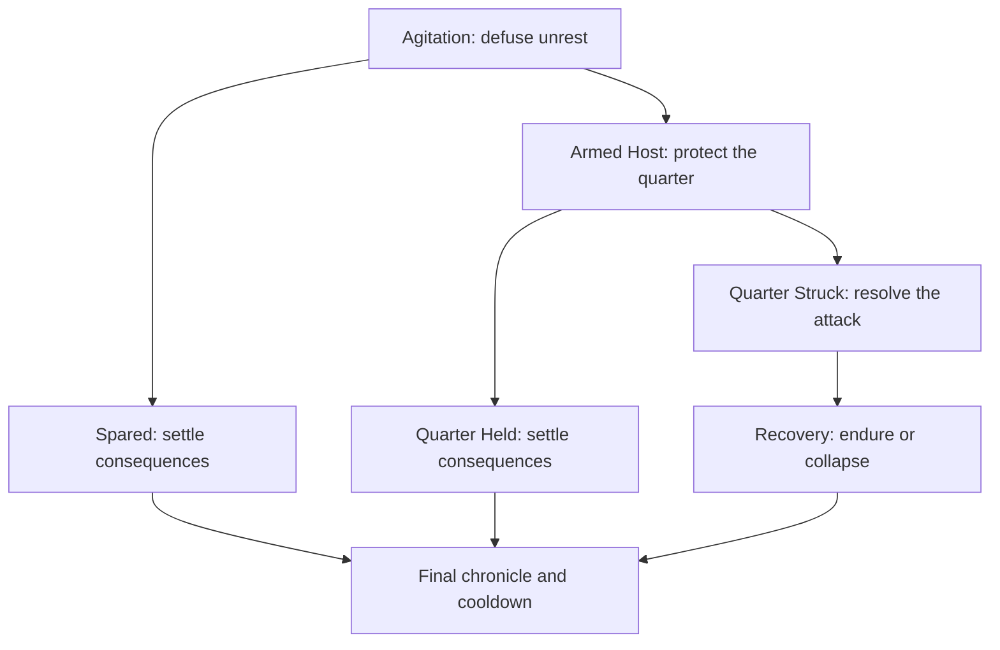

# Kehillah crisis responses: revised design

**Status:** approved design, 2026-11-06; implementation in progress. Supersedes the phase/action rules in [2026-11-01-three-standing-actions.md](2026-11-01-three-standing-actions.md) and the earlier proposal. The implementation status is tracked in ROADMAP.md.

## Crisis structure

A crisis belongs to the **community title**, so it survives a leader's death or forced conversion. Its intrinsic **threat grade**—Contained, Serious, Grave, or Catastrophic—is distinct from its changing race tracks. Grade governs how difficult a particular threat is to defuse, the price of buying off an armed host, and how many harm scenes can unfold if the quarter is struck. A great crusading host may be Catastrophic; a localized riot may be Contained. Display grade, its reasons, and its mechanical implications in the situation tooltip.

**Leader peril, 2026-11-07 refinement.** A player leader's fatal injury or conversion must arise from a visible attack or captivity scene with a corresponding consequence. The final casualty calculation can kill other community members and resolve building losses, but cannot secretly mark the player leader for death and announce an unseen injury in the attack report. AI leaders may continue to use an abstract severity roll. If Granada needs a stronger chance of Joseph's historical death, stage a specific confrontation during the attack rather than restoring a hidden post-scene roll.

**Attack report, 2026-11-08 refinement.** Report only recorded deaths, forced conversions, damaged buildings, martyrs, and captives that occurred. A zero-loss report still explains the interruption to trade and communal confidence behind separate pillar losses; avoid raw pillar penalty labels in its prose. Host titles and war names shared by Christian and Muslim crises should be religiously neutral.

**Agitation and Armed Host each give the player three category buttons, one use per button in that phase.** Clicking a button opens an adviser-framed event with three eligible, partially randomized proposals. The adviser supplies expertise and a perspective; the player chooses. That selection opens the chosen measure's own interactive event. Looking at proposals does not consume the button. Reopening it shows the same saved three, so it cannot be rerolled or stacked; selecting one commits the category. A category used in Agitation does not exhaust any Armed Host category. Remove the separate Suggested Actions decision. If filtering leaves few candidates, include a modest always-available measure rather than presenting three grayed-out options. Proposal weighting responds to crisis cause, personalities, relationships, grade, prior developments, faith/culture, and available characters. The obvious ruler appeal should reliably appear where it is feasible, with different odds, dialogue, and terms.

| Phase/purpose | Preferred button | Alternatives | Meaning |
|---|---|---|---|
| Agitation: authorities | **Call for Restraint** | Rally the Authorities; Demand Condemnation; Appeal to the Powers | Get people with authority to halt incitement before there is an army. |
| Agitation: internal response | **Steady the Kehillah** | Calm the Quarter; Keep the Peace; Tend to Our Own | Address fear, divided opinion, everyday safety, and hardship. |
| Agitation: public opinion | **Make Our Case** | Answer the Accusers; Defend Our Name; Win Our Neighbors | Contest the actual accusation where it is spreading. |
| Armed Host: official help | **Seek Protection** | Secure the Lord's Aid; Call on Our Protectors | Obtain troops, refuge, escort, or enforceable protection. |
| Armed Host: physical safety | **Defend the Quarter** | Prepare the Quarter; Secure the Gates | Protect people, exits, buildings, and supplies. |
| Armed Host: enemy leadership | **Parley with the Host** | Negotiate with the Host; Deal with Their Leaders | Bargain with the named leader or captains, divide them, or buy time. |

The first three labels name different constituencies and do not imply a siege during Agitation. The Armed labels intentionally sound more immediate. I prefer **Parley with the Host** to "Negotiate with Our Enemies": it is shorter and points to a specific approaching force. Recovery uses a conditional **needs docket**, discussed below, rather than another three random draws.

**Adviser framing, 2026-11-06 addendum.** Steady the Kehillah is presented by the Dayyan; Call for Restraint by the Shtadlan; Make Our Case by the Ne'eman, whose knowledge of records and rumor gives the public response a different voice. During Armed Host, the Shtadlan presents Seek Protection, the Rosh ha-Shmirah presents Defend the Quarter, and the Ne'eman presents Parley with the Host. The player chooses the measure. A missing officeholder uses neutral narration. Proposal tooltips identify a relevant person where there is one and preview the next scene's cost, skill, and possible consequence without claiming that opening a proposal has already taken effect.

## Shared rules: cost, chance, personality, and payment

An interactive measure normally has one visible principal roll, with a base around 55% (40% difficult; 70% favorable), clamped to 10–90%. As a tuning starting point, relevant leader skill contributes `2% × (skill − 10)` within ±20%; adviser skill contributes `1% × (skill − 10)` within ±10%; relationship to the actual decision-maker contributes up to ±15%; their disposition and the particular demand up to ±20%; evidence/preparations up to +15%. These are proposals for balance, not a promise that every ruler appeal uses the same formula. A guaranteed bargain can instead display its exact cost and consequence. Avoid a hidden second roll after a displayed chance.

Use CK3's income-sensitive `minor_gold_value`, `medium_gold_value`, and `major_gold_value` pricing conventions already used elsewhere in the mod, never fixed 10/20/50 gold for ordinary actions. Show the current payer's actual price before commitment. Give AI the same costs, flags, and outcomes. Some choices spend prestige, opinion, time, or a favor as well as or instead of gold.

Traits make a **particular argument** more effective and alter stress independently. A Just ruler responds to documented obligations, a Greedy ruler to a priced bargain, a Compassionate ruler to vulnerable refugees, a Craven ruler may refuse to send men against a large host, and an Arbitrary ruler is less bound by precedent. A Zealous agitator may resist money and heed clergy; a Greedy captain may accept payment yet fail to restrain followers. A Brave leader can speak before a crowd more comfortably; a Craven one might take 10–20 stress. A Compassionate leader who refuses shelter or a Greedy leader who gives substantial charity might incur stress. The tooltip says why, and stress does not secretly change the result. Do not make any trait universally best.

Two earlier shorthand modifiers need clearer definitions. **A real promise** is an explicit, recorded commitment by a named authority to send men, open a specified refuge, enforce safe passage, or uphold a covenant. Warm opinion and vague reassurance do not qualify. Record whether that promise was fulfilled; a broken one matters later. **Late urgency** is the host's approach stage compared with the lead time of a measure. A distant petition or elaborate work may become unavailable, while an emergency appeal to a sympathetic ruler can become *more* compelling. There is no universal “late” penalty to all actions.

### Armed Host gold contribution

Only **Armed Host** has a contribution control. Its label reads **“Contribute X gold (+1 Held)”**, or the compact **“+X gold”** with an equally clear tooltip, where X is the exact current marginal cost of **one Quarter Held point**. It starts with zero contributions. Each click charges X, immediately adds one point, recomputes X, and updates the label. The narrative names the intermediary or recipients—captains, local brokers, provisions, transport—rather than implying that money mysteriously erases attackers. There is no contribution control during Agitation.

Illustrative formula: `X = ceil(B × (1 + n/6) × approach_stage × negotiated_terms)`. Here `n` is points already bought, `B` is a modest share of the contributor's `minor_gold_value` multiplied by grade (initial factors 1 / 1.5 / 2.5 / 3.5) and host size, stage rises as the host nears the gate, and negotiated terms start at 1.0. A successful **Parley with the Host** may lower future costs to about 0.7; earlier payments are not refunded. Display and charge the same computed X. Cap purchased points at an initial 25 of the 100-point race so coin alone cannot guarantee safety. Tune against real CK3 incomes. The contribution is possible through captains or brokers even without one centralized host leader, although the flavor and discount opportunities differ.

AI leaders review whether to pay on a limited interval using the same marginal price and effect, weighing reserves, income, danger, personality, and expected value. They must not spend below a sensible reserve or receive free hidden Held progress. An AI host leader can accept or reject an actual bargaining event.

## Agitation: three action pools

The race is **Spared versus Armed Host**. Actions aim at de-escalation and cohesion; there is no full barricade or host buy-off yet. These are potential proposals within each category, not fifteen visible rows. A successful action usually adds roughly 6–20 Spared progress and a specific future flag; a failure may add roughly 6–12 Armed momentum or cost trust. Grade changes how difficult it is to persuade the actual actor and how powerful the hostile development is, not every action by a flat amount. Each measure has its own follow-up event and contextual choices.

### Call for Restraint — shtadlan, magistrate, or dayyan

| Proposed measure and sample event | Player choices and cost | Consequence and dynamic factors |
|---|---|---|
| **Ask the lord to condemn incitement.** “The verses are sung in the tavern. Silence from Badis has begun to sound like permission.” | Invoke the covenant, prior service, a personal favor, or a `medium_gold_value` gift. | A public condemnation gives +12–20 Spared and a named `lord_condemned` fact; equivocation gives less, refusal +Armed and perhaps lower opinion. Just/Arbitrary, opinion, dependence on Jewish officers, and political danger matter. This is not yet a troop promise. |
| **Ask the religious authorities to reject violence.** “The scholars will hear you; will they denounce the verse or only counsel patience?” | Present a legal case or ask a sympathetic scholar privately; possible minor expense. | +10–18 Spared and an actual condemnation if they speak; a cautious warning gives less. Learning, piety, relations, and the authority's faith/traits matter. Use appropriate clergy in Christian settings, ulama only where applicable. |
| **Enlist town officers.** “The reeve can forbid armed gatherings if he will enforce his own order.” | Present witnesses or pay legitimate officer costs (`minor_gold_value`). | +8–15 Spared; later vandalism is easier to contain. A corrupt officer may take coin without enforcement. Officer opinion, town autonomy, Intrigue/Stewardship matter. |
| **Petition the overlord.** “Your messenger may reach the higher court before the speakers recruit a host.” | Messenger `medium_gold_value`, prestige, possible local-lord resentment. | +12–20 Spared or binding order if it arrives; delay weakens it. Jurisdiction, distance, authority, and relationship matter. |
| **Pressure the agitator's patron.** “The speaker is loud because a powerful household lends him a hall.” | Privately bargain, expose the patron, or appeal to self-interest. | +8–16 Spared and withdraws the venue; reckless exposure can backfire. Needs a recorded patron; evidence and political ties matter. |

### Steady the Kehillah — dayyan, gabbai, or security officer

| Measure and sample event | Choices and cost | Consequence and dynamic factors |
|---|---|---|
| **Address frightened families.** “Some wish to leave tonight; others call retreat shameful.” | Speak openly, convene elders, or fund household aid (`minor_gold_value`). | +8–14 Spared, preserve Stability and reduce premature flight; dismissiveness increases division. Diplomacy/Learning and trust matter. |
| **Mediate an internal dispute.** “The younger men accuse the elders of waiting for disaster.” | Dayyan-led mediation or a restrained compromise; time/prestige. | +6–12 Spared; failure records division that makes later evacuation harder. No armed barricade yet. |
| **Organize a discreet street watch.** “The shopkeepers ask that someone walk the lanes after dark.” | Volunteers or paid watch (`minor_gold_value`); choose visibility. | +6–10 Spared and a chance to deter an actual vandalism event. An ostentatious display can provoke +Armed. Martial, officer, local tolerance matter. |
| **Support households whose trade has stopped.** “Cupboards empty before any spear appears.” | Mutual aid or `medium_gold_value` support. | +6–10 Spared; prevents temporary Prosperity/Stability loss. Gabbai skill, resources, Compassionate/Greedy stress matter. |
| **Verify a rumor within the quarter.** “A false report of an attack has sent children running.” | Check publicly or use trusted households to relay facts. | +6–12 Spared and less future panic; concealment discovered later loses trust. Requires a rumor and credible messenger. |

### Make Our Case — shtadlan, sofer, or learned advocate

| Measure and sample event | Choices and cost | Consequence and dynamic factors |
|---|---|---|
| **Answer the charge in public.** “At the market arch, they repeat the verse; they will hear an answer if someone speaks.” | Reasoned defense, pointed rebuttal, or neighbor testimony. | +12–20 Spared and `charges_answered`; a poor showing adds Armed. Diplomacy/Learning, evidence, audience, and Brave/Craven stress matter. |
| **Gather respected neighbors' testimony.** “The baker remembers who fed the town last winter.” | Request public support, with minor travel expense if needed. | +8–16 Spared and a durable neighbor ally; an unwilling witness cannot be scripted to speak. Opinion, actual past aid, standing matter. |
| **Expose a false accusation.** “The alleged witness has never entered the quarter.” | Investigate quietly or reveal documents immediately (`minor_gold_value` for agents). | +10–18 Spared; an unsupported allegation backfires. Intrigue and evidence quality matter. |
| **Address a real grievance without collective blame.** “One debt dispute has become everyone's indictment.” | Mediate the actual debt or lawful restitution (`medium_gold_value` only if owed). | +8–16 Spared and removes that grievance from future weighting; broad concession can invite demands. Requires an actual grievance; dayyan and Stewardship matter. |
| **Circulate a counterargument.** “Your sofer can send a response through the streets carrying the poem.” | Carefully sourced appeal or direct denunciation; prestige/time/minor cost. | +8–15 Spared, or amplifies the polemic on failure. Literacy network, Learning, sofer, kind of propaganda matter. |

## Armed Host: three fresh action pools

The race is **Quarter Held versus Quarter Struck**. The actual host has a force estimate, leader or captains, approach stage, demands, and known loyalties. Agitation achievements seed its force, the lord's disposition, and communal cohesion **once** on entering Armed Host; replace overlapping existing seed awards rather than counting the watch or condemnation twice. All three Armed buttons are available even if every Agitation button was used.

### Seek Protection — shtadlan or marshal

| Measure and sample event | Choices and cost | Consequence and dynamic factors |
|---|---|---|
| **Obtain the lord's troops.** “Will Badis send men, or merely repeat that you are under his peace?” | Invoke covenant/service, warn of disorder, or pay for deployment (`major_gold_value`). | +18–28 Held and a specific troops promise; refusal or too few men adds Struck. Available forces, Just/Craven/Greedy, opinion, earlier condemnation matter. Record a promise that fails to arrive. |
| **Gain refuge and safe conduct.** “The citadel can take children and elders, though not every cart.” | Negotiate capacity, priority, escort (`medium_gold_value`). | +10–18 Held and fewer exposed people if breached. A shut gate is recorded. Compassionate, crowd size, time, opinion matter. |
| **Invoke a higher authority's order.** “A messenger must ride faster than the host.” | Pay envoy, call favor, or risk local anger. | +14–22 Held if enforceable and timely; late arrival gives limited mitigation. Distance, jurisdiction, relations matter. |
| **Seal a local protection agreement.** “The reeve can station a watch at the gate.” | Specify patrol and penalties; minor/medium price. | +10–18 Held, less breach harm if honored; vague reassurance has less effect. Reliability and prior enforcement matter. |
| **Evacuate under official escort.** “The road to the next town may be open one more day.” | Prioritize people/property and pay transport (`medium_gold_value`). | +8–16 Held and fewer deaths; temporary flight/Prosperity cost. Escort, route, stage, shelter capacity matter. |

### Defend the Quarter — security officer or gabbai

| Measure and sample event | Choices and cost | Consequence and dynamic factors |
|---|---|---|
| **Barricade approaches.** “Timber and overturned stalls could hold the narrow lane for an hour.” | Concentrate defense or keep an exit (`medium_gold_value`). | +12–20 Held and lower harm; a blocked exit can trap evacuees. Martial, officer, streets, stage matter. |
| **Provision shelters and an escape route.** “The stores beneath the synagogue can feed those unable to flee.” | Divide supplies between refuge and flight (`medium_gold_value`). | +10–16 Held, reduces injuries and dispersal; supplies can be seized. Stewardship, gabbai, existing refuge matter. |
| **Reinforce the watch.** “The volunteers know the alleys; the host has fought before.” | Hire guards (`major_gold_value`) or use volunteers at greater risk. | +12–20 Held; failed defense can injure defenders. Earlier discreet watch, manpower, Martial matter. |
| **Hide books and valuables.** “There is time to move some manuscripts, not the whole bet midrash.” | Prioritize books, treasury, scrolls, or vulnerable people; minor/medium cost. | +6–12 Held and specific asset protection, with visible opportunity cost. Books/buildings must actually exist. |
| **Organize disciplined retreat.** “If the gate gives, panic may kill more people than the first blow.” | Appoint guides and places of meeting. | +8–14 Held, fewer deaths/disappearances if struck. Stability, officer, route, blocked roads matter. |

### Parley with the Host — shtadlan, dayyan, or appropriate envoy

| Measure and sample event | Choices and cost | Consequence and dynamic factors |
|---|---|---|
| **Bargain down the host's demand.** “The captain names a sum no household can bear. Will he take less before sundown?” | Offer credible, bounded terms; messenger minor cost. | Success sets `negotiated_terms ≈ 0.7` for future `+X` purchases and +6–12 Held; failure may worsen stage or close talks with this captain. Diplomacy/Stewardship, Greedy/Zealous, trust and force matter. |
| **Divide the leadership.** “One captain wants plunder; another fears the emir's anger.” | Guarantee one group safe withdrawal or expose their rival orders; minor/medium cost. | +10–18 Held, lower force; exposure backfires. Intrigue, factions, lord stance matter. |
| **Invoke obligations.** “You have his word, and he has a lord.” | Cite law, service, or religious prohibition. | +10–20 Held or even withdrawal; fanatic rejects. Learning/Diplomacy, actual promise, leader traits matter. |
| **Buy time or safe passage.** “He will halt until dawn if your envoy returns with terms.” | Exact `medium_gold_value` bargain or limited promise. | Delay Struck ticks, +6–12 Held, open evacuation window; leader may fail to control followers. Stage and reinforcements matter. |
| **Offer face-saving withdrawal.** “He cannot leave empty-handed before those he has roused.” | Mediate a real grievance, bounded payment, or public hearing. | +12–22 Held/direct dispersal in fitting circumstances; an admission of collective guilt may worsen future standing. Proud/Zealous, evidence, lord power matter. |

**Parley follow-up choices, 2026-11-07 addendum.** In play, all four parley measures opened the same follow-up scene (`kehillah_crisis_phase_actions.0106`) with the same two choices: pay a minor sum for better odds, or go without, both on the Ne'eman's Intrigue. They felt identical. Each measure now has its own pair of choices, with a different cost, skill, and host trait:

| Measure | First choice | Second choice |
|---|---|---|
| Bargain down the price | Counter with a sum: `medium_gold_value`, 75% base, the leader's own Stewardship, a greedy host leader helps; a greedy leader takes stress. | Plead poverty: free, 45% base, the Ne'eman's Intrigue; deceitful helps, an honest leader takes stress. |
| Buy time | Pay for the night: `medium_gold_value`, certain. | Promise a hearing before the lord: free, 55% base, the Shtadlan's Diplomacy; failure also costs minor prestige. |
| Divide the captains | Safe conduct for one captain: `minor_gold_value`, 65% base, Ne'eman's Intrigue. | Expose their rival orders: free, 45% base, schemer helps; adds a further small Held push on success and a small Struck push on failure. |
| Invoke obligations | Read him the law and his oath: free, 55% base, the Dayyan's Learning; a just host leader +15, arbitrary −15; success gives minor piety. | Write to his lord: minor prestige up front, 70% base, the local lord's opinion and outlook. |

The host leader's opinion, zealous/patient traits, and threat grade apply to every choice except the two Ne'eman choices in Divide (`kehillah_crisis_parley_*_bonus_value` in `kehillah_crisis_phase_values.txt`). The success and failure results of each measure are unchanged.

A won bargain now halves every later Contribute Gold price (`kehillah_crisis_bargain_price_factor`, 0.5, was 0.7). The Contribute decision says so, and both bargain choices show it on success: the bargain's value is in that separate, uncapped-by-category control, which the follow-up scene previously did not mention.

**Other follow-up scenes, same date.** `.0101`–`.0105` received the same treatment. In each pair, one choice is usually the adviser's measure for a price; the other uses the leader in person (`kehillah_crisis_own_*_bonus_value`: 2 per skill point above 10, within ±20), another officer, the other party's traits, or a pillar cost instead of gold:

| Measure | First choice | Second choice |
|---|---|---|
| Aid | Open the communal stores: minor Prosperity, 75%, Dayyan | Households take in neighbours: free, 50%, own Diplomacy, compassionate; Stability +/− on the result |
| Mediate | Formal hearing: minor gold, 70%, Dayyan | Settle it yourself: free, 50%, own Diplomacy, just/arbitrary; prestige on success, stress on failure |
| Lord | Gift with the petition: medium gold, 70%, greedy lord | His own charter: free, 50%, just/arbitrary lord; prestige loss on refusal |
| Scholars | Dispute the law: free, 50%, Dayyan's Learning, theologian; piety on success | Sympathetic scholar privately: minor gold, 70%, Shtadlan |
| Overlord | Messenger with gifts: medium gold, 65% | Ride to court: free, stress, 55%, own Diplomacy as well; prestige on success |
| Evidence | Quiet inquiry: minor gold, 70%, Ne'eman | In the market today: free, 45%, own Learning, brave/craven; an extra small push either way |
| Neighbours | Ask them to speak: free, 50%, own Diplomacy, gregarious/shy | Repay old kindnesses: minor gold, 70%, Ne'eman |
| Refuge | Provisions: medium gold, 75% | Lord bears the burden: free, 45%, compassionate/callous lord |
| Patrol | Provision the patrol: medium gold, 65% | Hold him to his promise: free, 45%, just/craven lord |
| Escort | Pay the riders: minor gold, 65% | Our own guides: free, 55%, Rosh ha-Shmirah; Stability loss on failure |
| Guards | Hire guards: medium gold, 75%, Rosh ha-Shmirah | Arm the households: minor Prosperity, 55%, own Martial, brave |
| Retreat | Paid guides: minor gold, 70% | Drill by night: minor Stability, 70%, patient |

The **emergency gate event** means a reactive confrontation when the host reaches the quarter. The player can hold the gate, plead, evacuate, or make an immediate limited offer using *recorded* defenses, promises, gold, and host terms. It is neither a fourth category nor a repeat of a completed negotiation. It resolves once, with an epoch guard, before the race outcome is applied.

## Dynamic hostile events and Quarter Struck

Developments are hostile counterparts to measures: something specific happens; the player can mitigate it; the bad track generally still moves because the underlying danger is real. Show the default and altered track effects. Select eligible events without repetition, reflecting the cause, venue, named actor, and prior resolutions. Granada-only verses and Badis cannot leak into a generic crisis.

**Agitation presentation, 2026-11-06 refinement.** A substantial incident applies its unavoidable Armed Host pressure when its scene opens. The choices then represent mitigation or further escalation, with their own odds, costs, and consequences; their tooltips do not repeat the already-applied pressure. Show track changes as small, moderate, or large pushes, as in *Sinister Verses*, while the situation UI retains exact totals. Minor incidents may instead resolve off camera with a named catalyst notification and a ledger entry for the next phase's chronicle.

| Agitation development / sample line | Reaction and actual result |
|---|---|
| **Verses spread.** “The singer has learned the refrain; patrons repeat it beyond the tavern.” | Ask proprietor or neighbor to intervene, counter the verse. Usually +6–12 Armed, plus +Spared if rebutted. Only where propaganda/poem is a recorded cause. |
| **Preacher speaks.** “Yesterday's rumor has acquired a learned voice.” | Seek peer condemnation or testimony. +8–14 Armed, reduced by genuine earlier clergy condemnation. Appropriate faith-specific speaker. |
| **Vandalism.** “The crowd tests whether anyone will object to a shattered shop window.” | Call officers, protect shopkeeper, confront vandals. +6–12 Armed; a discreet watch can deter damage and record exactly that. |
| **Charge reaches the lord.** “The petition now lies on his table.” | Present records or witnesses. +8–15 Armed and possible +Spared; if the charge was already answered, acknowledge that and ask whether he accepts the answer. |
| **Merchants shut doors.** “Fear has become a material hardship.” | Mutual aid or neighbor guarantee. +5–10 Armed and conditional Prosperity/Stability loss. Requires actual market exposure. |
| **Young men assemble.** “Their leaders speak of defending the town.” | Seek a ban, persuade families, monitor them. +10–18 Armed, modified by lord condemnation and cohesion. |
| **False alarm.** “Families load carts in the dark.” | Verify or organize aid. +5–10 Armed and possible Stability loss; trusted communication mitigates it. |
| **Patron lends a hall.** “A powerful household gives the speakers a place to gather.” | Pressure patron or counter meeting. +8–14 Armed; impossible if patron already withdrew. |
| **Reeve looks away.** “He sees no unlawful gathering.” | Escalate, ask neighbors, or prepare evidence. +7–13 Armed; only if such an officer exists and is not already committed. |

| Armed Host development / sample line | Reaction and actual result |
|---|---|
| **Recruits join.** “Men from the next town join the march.” | Seek a roadblock or divide captains. +8–14 Struck and increased force; prior division mitigates. |
| **Promised help stalls.** “The men promised at the citadel have not moved.” | Remind issuer or find shelter. +8–15 Struck if truly unfulfilled; must have an actual promise. |
| **Captain demands payment.** “He claims he can turn his men aside for a price.” | Accept a specific priced bargain or refuse. +6–12 Struck from danger, possible +Held; no duplicate unrestricted fund discount. |
| **Road is cut.** “The escorted carts return.” | Seek another route or shelter. +8–15 Struck; requires a useful route/refuge. |
| **Outer shop attacked.** “Smoke rises before the main gate is touched.” | Save people or stock; call patrol. +8–14 Struck; record actual damage once. |
| **Neighbor warns of breach.** “She has heard which gate they mean to test.” | Trust, verify, or ignore. +5–10 Struck from urgency and +Held if prepared; requires a credible neighbor. |
| **Cleric blesses or condemns march.** “The host waits for the scholar's answer.” | Cite earlier condemnation or answer the claim. +6–14 Struck, or substantial Held if host fractures. Faith appropriate. |
| **Terms are broken.** “Despite coin and seal, the captain advances.” | Demand enforcement or shelter civilians. +10–16 Struck and `promise_broken`; only if accepted terms existed. |

**Quarter Struck** is a short attack sequence, not a single numerical penalty. On breach, snapshot who and what were exposed, what was sheltered, buildings/books present, host force, and fulfilled promises. Draw **distinct eligible harm scenes** by grade: Contained **1**, Serious **2**, Grave **3**, Catastrophic **4**. The count is a cap if fewer distinct eligible harms exist; never invent forced converts or lost books to fill it. Scene pool: breach and flight, fire/building damage, deaths and wounded, captives/ransom, coerced conversions, manuscript loss, stolen treasury/market wreckage, protector's betrayal. Each scene gives a triage choice, such as people versus property, wounded versus stores, or captives versus secure refuge. Calculate the harm budget **once** and allocate its effects to these scenes; do not roll deaths or destruction in a base breach effect and again in an event. Good preparation reduces severity even when four narrative scenes occur. A poorly prepared Contained crisis can still have one grave event.

## Carryover and visible residual consequences

At a transition, snapshot both race tracks and translate unfinished momentum into **bounded, specific effects once**. Use displayed low/substantial/near-threshold bands (illustratively <40 / 40–74 / 75–99) and an exact tooltip: “Scholars condemned the march: host force −10”; “Escorted refuge: fewer people exposed.” Do not award the existing Armed seed for a watch or condemnation and then award it again from this system.

| Transition | Consequence of the losing track and recorded facts |
|---|---|
| Agitation → Armed Host | Spared progress and condemnations reduce host force, preserve Stability, delay assembly, or improve official response, within a cap. Armed momentum sets force and urgency. “The scholars' warning kept some townsmen away, though a host formed.” |
| Agitation → Spared | Near-Armed momentum leaves fear, closed trade, strained neighbor relations, and possibly a lord reviewing policy. Strong cohesion offsets the Stability loss. No Collapse race. |
| Armed → Quarter Held | Near-Struck momentum causes actual limited injury, outer-shop damage, flight, or broken trust, according to incidents recorded; defenses/real shelter mitigate it. No invented massacre and no Recovery. |
| Armed → Quarter Struck | Held progress and specific preparations reduce exposure and the attack harm budget, protect designated people/assets, and seed later Endure. High Struck momentum and broken protection aggravate loss. Preparation is useful even when the gate falls. |
| Struck → Recovery | Compare pre-crisis pillars to current pillars, casualties, displaced people, books/buildings lost, fulfilled promises, treasury and ruler stance. These seed Endure/Collapse and the actual needs docket. |

Preserve the pre-crisis pillar snapshot and show the final change. Enduring does not reset values. A ruler's later hostility can worsen recovery even if the quarter's defenders performed well; a good ruler can support recovery after failed defenses.

## Dynamic phase opener and final memory

Every phase begins with **one narrative opener** after a short milestone toast. The toast announces the transition and opens the situation; it cannot carry the entire chronicle. A persistent **incident ledger** on the community title records crisis/epoch, grade, place, opening cause, hostile developments, chosen measures/results, named actors, actual commitments and fulfillment, contributions and negotiated price, phase track snapshots, damage and pillar baseline, lord judgment, agitator fate, and final outcome. Snapshot names/titles when needed to survive death or changed office. Record fact IDs and chronology rather than trying to recover prose from whatever random event is eligible now.

The opener assembles: **cause and cast → one or two decisive escalations → up to three distinct interventions and their actual outcomes → transition and carryover → immediate question**. Select by salience/mechanical impact; omit repetitive small payments. Use coherent connective wording for failure (“despite”), and never describe an offered but unchosen action as done. Keep the displayed event about 120–180 words, with exact calculations in tooltips. Crisis-family text and safe generic fallback prevent Granada details from leaking. A player choice that causes the transition records its specific catalyst rather than drawing an unrelated random notification line.

> **Spared, Granada example.** Abu Ishaq's verse was sung in the town's busiest tavern, and a preacher urged his listeners to strip the Jews of influence. You won the ulama's condemnation of violence; the watch you organized turned vandals away from a Jewish shop; and your answer to the charges reached the market before the crowd gathered again.
>
> No armed host emerged. Yet the call to violence came dangerously close to finding one. The quarter is shaken, and Emir Badis is reconsidering the terms on which he protects it. What he does with the preacher—and with your covenant—will determine what peace now means.

> **Armed Host example.** The accusation spread from the market to the roads, and men now gather under their leader. The scholars condemned violence and some neighbors refused to join, but the reeve failed to forbid the march. Your households remain united, giving the quarter time to prepare. Badis has not promised soldiers.

> **Quarter Held example.** The emir's men arrived as the host reached the western lane. Barricades held while families entered refuge, though an outer shop burned. The host has broken apart; its leader remains at large. The injured shopkeeper and Badis's next decree still require answers.

> **Recovery example.** The gate was forced before the promised patrol arrived. The organized retreat saved the children and hidden books, but households lost members and the market stalls were ruined. Survivors need care, news of the missing, and a judgment against the host's leader. The kehillah must hold together while the ruler decides whether to help or tighten his rule.

All three routes culminate in **one whole-crisis closing event**: cause, escalation, decisive player action, losses avoided/suffered, agitator's fate, lord's policy, neighbors, present pillars relative to baseline, and unresolved claims. Its language says “endured” if a diminished kehillah survived. Create a durable **character memory** for the current leader, and for the original leader if alive and appropriate; a successor can remember inheriting the crisis. The mod already uses `create_character_memory` and distinct memory types. Memory descriptions may be reevaluated after the situation disappears, so choose an outcome-specific, fixed memory type at creation and bind safe participants; retain detailed facts on the title/chronicle. Verify engine support before promising fully variable prose inside the memory itself. A memory might recall saving Garnatah's gate under an upheld covenant while losing the market, using recorded outcome variants.

## Spared and Quarter Held: terminal settlements

**Spared** asks who stopped the agitation, what becomes of its leader, whether the lord changes policy, and what fear remains. **Quarter Held** asks what damage occurred despite the defense, whose promise held or failed, the attacker's fate, and whether the lord compensates or constrains the kehillah. Both are **short, fact-driven settlement phases**: opener, a few mandatory conditional beats, final chronicle. No Endure/Collapse race and no Recovery. Player advocacy matters; other actors retain agency. Resolve outcomes from recorded violence, traits, power, relationship, evidence, promises, and earlier actions, rather than a fresh generic random pool.

| Required question/event | Possible outcomes and sample beat |
|---|---|
| **Agitator's location and fate.** Check whether the named person is actually alive, captured, or within jurisdiction. | Withdraws, repents, flees, is fined/arrested/exiled/executed by an empowered lord, is protected by a patron, or threatens another community later. “The preacher's room is empty; neighboring kehillot have been warned.” No execution of a dead or unreachable actor. |
| **Ruler's judgment.** Mandatory even if player made no petition. | Reaffirms covenant, increases patrols, pays restitution, leaves policy unchanged, imposes paid protection, restricts office/trade/residence, or issues a visible expulsion edict. “Badis calls the verses dangerous, yet says Jewish prominence invited resentment. His seal stays on the covenant, with a new levy.” A threatened edict hands off to existing expulsion mechanics; it does not silently start Recovery. |
| **Community and neighbors.** Conditional on fear, injured people, flight, damage, or division. | Gather to reassure, allocate immediate aid, thank loyal neighbors, reopen trade, challenge levy, reconcile factions, or memorialize a loss. “The shopkeepers wish to reopen; families who fled ask whether it is safe.” Apply Stability, opinion, treasury, and actual continuing policy changes. |
| **Claim for redress.** Especially after a held gate with injured people or an outer shop burned. | Seek inquiry, restitution, punishment for broken promise, or accept incomplete peace. “The gate held, but the reeve watched the outer stalls burn. Whose loss will the town acknowledge?” |

A cold or exploitative ruler can leave Spared or Held politically worse than before, but the community does not collapse from an attack that did not strike it. A later expulsion order is an explicit new legal consequence, routed to the relevant existing mechanics, rather than a hidden violent-collapse roll.

## Recovery: only after Quarter Struck

Recovery opens with the true accounting and an **Endure versus Collapse** race. Seed it from surviving Stability, actual loss in all pillars, deaths, flight, damaged assets, broken/kept promises, treasury, solidarity, and lord stance. Ongoing hunger, departure, hostile policy, and unresolved captives push Collapse; relief, reunification, credible protection, and justice push Endure. Show the forecast and causal modifiers. Endure can win with a poorer community and harsher Jewish law; “Restored” is not the victory label. Set a bounded recovery window and deterministic end rule for a stalled race, based on remaining Stability/cohesion. All prevention occurs **during Recovery**, never in a last-chance event after Collapse triggers.

The phase has **mandatory scenes within its first few beats**: (1) account for actual dead/wounded/displaced/missing, books and buildings lost; (2) ruler's hearing, including whether a previous promise was honored, with support, indifference, restrictions, levy, or edict all possible; (3) agitator's actual whereabouts, prosecution or impunity; (4) the community's response to grief, leadership, forced converts, and neighbor behavior. The ruler makes a real decision even if the player never petitions. If he already acted during the attack, the hearing accounts for that action. The player can argue and request a specific remedy, not freely reroll his whole disposition.

Recovery's situation shows a **needs docket**, not a random three-option council roll. Suggested headings: **Seek Relief**, **Reunite the Community**, **Settle the Reckoning**. Under each appear only cases justified by recorded losses or unresolved policy. Each case has its own event, recipient, resolution flag, and reasonable cooldown; it is not repeatable gold farming. Other Kehillot that receive requests get actual ruler events and may give generous, limited, coordinated, or no support, with real expense and AI parity.

| Need-driven action | Sample event, choices, and result |
|---|---|
| **Request rebuilding funds from the lord** if property was damaged. | “Badis admits the quarter is broken, but his coffers are strained.” Invoke covenant, ask smaller sum, or offer matched funds. Transfer income-scaled aid to the community if granted and add Endure; refusal can worsen trust/Collapse. Player spends the money in ordinary building UI; no automatic building rebuild. |
| **Ask another Kehillah for tzedakah** if injured, widows, or orphans need help. | Recipient leader sees named request and own resources; send generous or modest funds, organize a wider appeal, or refuse. Transfer real funds, support households, raise Endure/Stability, give donor appropriate piety/opinion. Distance, kinship, wealth, obligations matter. |
| **Organize care and food** if wounded or trade disrupted. | Use hekdesh supplies, paid healers, or lean distribution at `minor/medium_gold_value`. Prevent attrition and raise Endure; partial help if funds are insufficient. Gabbai, existing institutions, Compassionate/Greedy stress matter. |
| **Ask other communities for books and a sofer** only if manuscripts were lost. | An actual recipient leader sends copies, a scribe, funds, or declines. Restore some Greatness capacity and Endure; do not repair the building automatically. Donor's books, sofer, distance, ties matter. |
| **Find or ransom captives** only if named captives exist. | Negotiate with actual captor, ask ruler, or raise `major_gold_value` ransom. Record return, continued captivity, or death explicitly. No conversion of a recorded death into a convenient captive. |
| **Support forced converts returning** only if coercion occurred. | Speak with households, ask religious authority or head of faith for support if reachable, seek legal protection from ruler. Some return openly, remain hidden, or leave; update family/Stability and risk. The contacted authority gets an event. Treat coercion as coercion, not disloyalty. |
| **Invite displaced families home** if flight occurred. | Offer housing and food, escorted return, or delay until safe. Raise Endure/population trajectory if assurances are credible; failed assurance harms trust. Current safety and treasury matter. |
| **Seek justice/restitution** if attackers, death, theft, or broken promise exist. | Present witnesses, demand inquiry/punishment or bounded reparations. Ruler may prosecute, pay, refuse, or impose restrictions. Agitator's whereabouts and official complicity constrain outcomes. |
| **Renew or improve covenant** if future protection is uncertain. | Request sealed reaffirmation, patrol, or legal protection for returnees; bargain over levy. A credible policy raises Endure; cynical ruler may tighten laws. Do not count vague words as troops. |
| **Appeal to a higher authority** if local lord hostile and a reachable authority exists. | Petition for intervention against an edict, inquiry, or aid, at messenger/political cost. Jurisdiction, travel time, relations, and local resentment govern the result. |

| Recovery ending | Causal event and lasting state |
|---|---|
| **Endured** | “The market is smaller, the graves are new, and the levy remains. Yet worship, charity, and leadership continue.” Keep actual pillar losses, damaged buildings, surviving people, policies, and unresolved claims. Ordinary rebuilding continues after crisis closure and one-year cooldown. |
| **Communal collapse** | Population, leadership, cohesion, and institutions fail: “The last gathering cannot find enough households to sustain its institutions.” Resolve title/government through existing dissolution logic and tell the actual story; do not delete a playable title mid-event. |
| **Expulsion** | A hostile ruler's recorded, enforceable edict displaces survivors. Show decree and route into existing expulsion flow before closing this crisis once. Preserve refugees, property outcomes, and memories. This is a specific cause of collapse/displacement, not a random failure label. |

## 2026-11-06 addendum: choosing a measure

Daniel asked that a player can see a measure's odds and go back. This refines "selecting one commits the category" in the phase action rules above. Selecting a proposal only considers it. The final choice in the measure's own scene commits the category, and a back option there reopens the same saved proposals at no cost. This replaces the measure scenes' "Let the opportunity pass", which spent the category by accident. Measures reached through the elders' counsel spend no category and keep their plain decline.

## Robustness and implementation sequence

Keep phase, incident ledger, category-spent flags, saved proposals, contributions, promises, and pending harm on the community title with a **crisis epoch ID**. Each queued event checks that epoch and the current title holder. On leader death, offer pending choices to the eligible successor without duplicating effects; spent categories remain spent. On forced conversion, use the existing leadership eligibility/succession rules, continue the title's situation with an eligible successor, and record the former leader as affected. If the community actually dissolves, close the crisis through exactly one explicit outcome. Simultaneous death, conversion, breach, and ruler response require scripted probes and a live test; succession/government code has a recorded crash history.

Suggested implementation slices: **(1)** incident ledger and coherent openers on existing phases; **(2)** phase-specific proposal buttons and dedicated action events; **(3)** Armed `+X` contribution and negotiated terms with AI parity; **(4)** hostile development selection and once-only Quarter Struck harm scenes; **(5)** fact-driven Spared/Held settlement and Recovery docket; **(6)** final memories, succession cases, balance, and UI polish. Update the dated design/ROADMAP record as decisions become implementation work, run xTiger against the edited checkout, audit duplicate track effects in source, and have the repository's prescribed Luna-only isolated live check validate event ordering, UI, and successor continuity. The design is approved; record implementation and human-test results separately.
