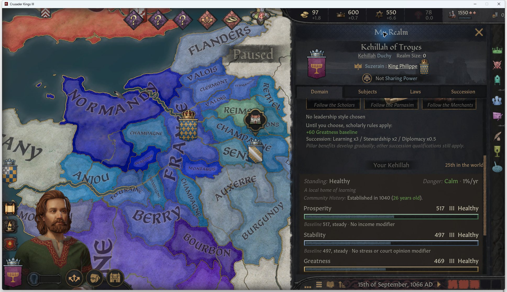
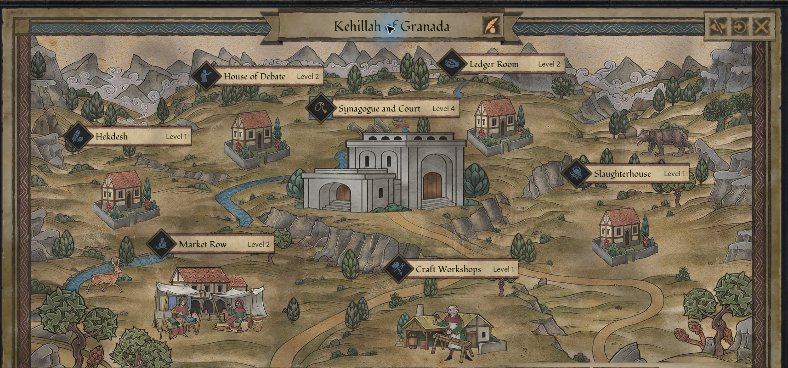
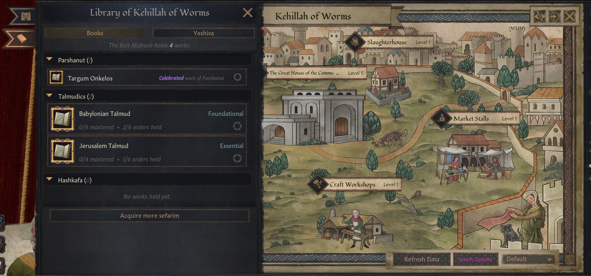
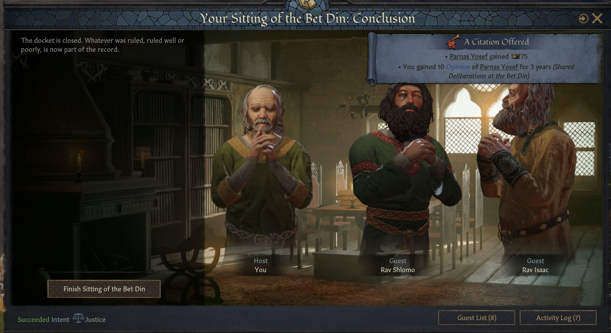
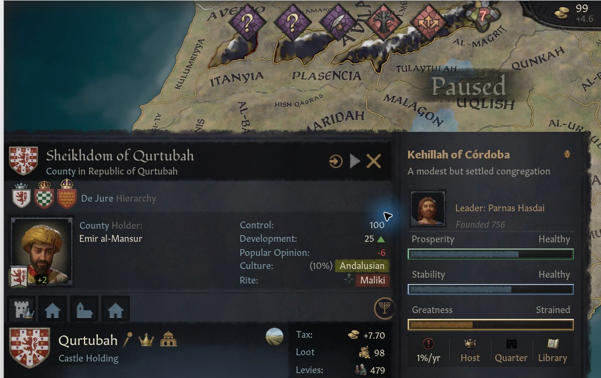

# Feature guide

**Status:** pre-alpha player guide, 2026-11-16. Based on the current implementation and [ROADMAP](https://github.com/Steinbeard/jewishcommunities/blob/master/ROADMAP.md); newer features described below have uneven live coverage.

Start with the [three 1066 stories](three-starts.md), or use this page as a tour of the custom screens.

## Domain: your community at a glance

A Kehillah is a community title inside a host realm. Open **My Realm → Domain**: the Quarter, charter and three pillars explain what you can build and why your community is thriving or struggling.

| Pillar | What feeds it | What to look at |
| --- | --- | --- |
| **Prosperity** | Families, trade, buildings and income | Treasury, building costs and room for more households |
| **Stability** | Cohesion, justice and protection | Host relations, safety and the risk of collapse at Crisis |
| **Greatness** | Scholarship, piety and renown | Books, rabbis, yeshiva and cultural influence |

Hover a pillar for its sources. Each has five bands, from **Crisis** to **Legendary**. Choose **Scholarly**, **Political** or **Commercial** leadership to tilt your baseline and the skills valued in succession. The mandate lasts ten years; this newest panel still needs wider UI and campaign testing.

## Jewish Quarter: a home you can improve

The Quarter has **nine building lines and 25 tiers**. The synagogue and Beit Midrash can grow into major communal institutions, while the countinghouse, market stalls and workshops support the economy. The mikvah, Hekdesh, Sofer's Workshop and slaughterhouse serve daily life. Higher tiers ask for stronger pillars, so read both the cost and the band gate before committing to a build.

## Library and Sefarim Ledger: knowledge travels

Open the library from the Quarter or a community card. It holds physical copies. The **Sefarim Ledger** ranges across roughly 170 historical works and evaluates them for the selected rite; it can compare other traditions and show the highest rank attainable. A known work may be acquired through a scholarly network even if no registered library owns a copy. Study what you hold, commission or acquire new texts, donate copies, and eventually write a sefer. Book reviews, approbations and bans are recent additions with limited campaign testing.

## Council, families and Bet Din: people make the place

The five council seats are **Shtadlan** (advocate), **Gabbai** (treasurer), **Rosh ha-Shmirah** (watch), **Ne'eman** (trustee) and **Dayyan** (judge). Councillors have tasks; householders and court officers contribute to the community's daily life. In a **Bet Din** activity, three judges hear cases, use learned sources and may write to another rabbi for a responsum. Yeshivot bring students, study partners and ordination into this network.

## Map modes and host politics: every seat has a setting

Use the **Jewish** category in the map-mode bar to locate communities and open their cards, libraries, rites and condition. A realm view shows its communities together. Your host grants a charter and sets a realm-wide **Jewish Settlement Policy** from Banned to Encouraged. Construction, protection, jurisdiction and trade can depend on those terms. A ruler may review policy; expulsion can force a community to negotiate, leave or face removal. The **Nagid** is a separate realm office for a community leader in a Muslim realm, especially relevant in Granada.

## Crisis: read the race, then act

A community threat opens a window on the map and in the **Situations** list, with two visible totals: **Armed Host** and **Spared**. The window names the sources and suggests possible responses. You can prepare a watch, lay in provisions, seek protection, answer an agitator, appeal beyond the local lord, mobilize neighbouring communities or spend gold. If violence begins, a second race decides whether the Quarter is held or struck. Its aftermath can affect buildings, pillars, charter terms and the host's outlook. This is one of the most important systems for pre-alpha feedback.

## Rites, lineages and the long game

Medieval Jewish rites, tenets and Karaite communities shape faith and the value of books. Holidays, synagogue life, ancestral places, patronyms, and Kohen, Levite and Ben David family lines give campaigns different identities. Leadership passes by appointment: open **My Realm → Succession** to review candidates and their scores. An endorsement is a recommendation. A leader may leave the seat for adventurer life; adventurers can found a community or, with a recorded claim, press for an existing one. The Exilarchate is a separate lifetime office for eligible Ben David community leaders.

For a concrete route through these systems, use the [quick start](three-starts.md). For rough edges and useful bug reports, see [testing and feedback](testing-and-feedback.md).
