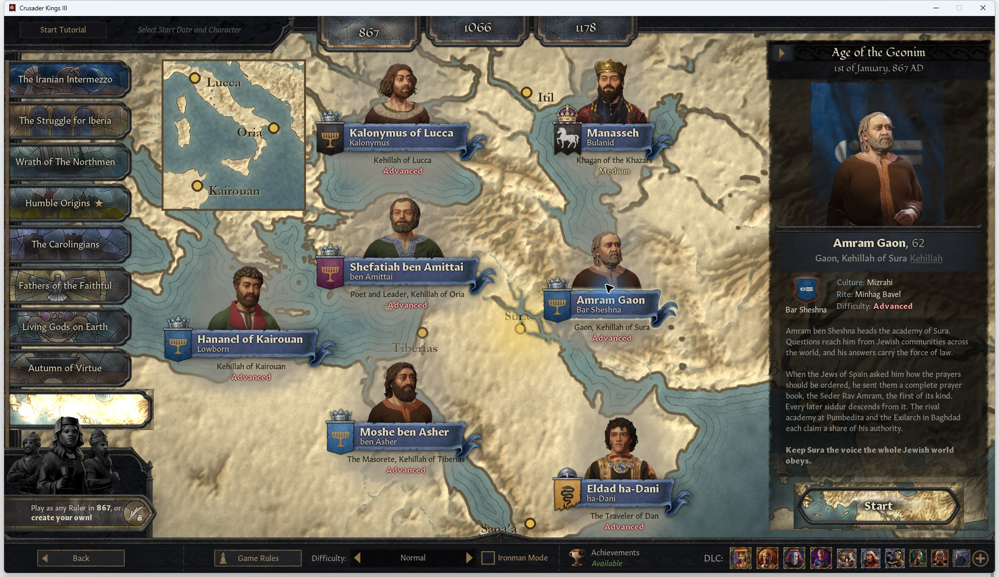

# In-game gallery

**Status:** pre-alpha screenshot gallery, captured in isolated CK3 sessions on 2026-11-16. Images show real game screens; exact values and portraits may vary in a later build. The 867 and 1178 bookmark art has had less campaign testing than 1066.

## The three 1066 stories

**Rashi of Troyes:** a young scholar returns to a modest community. [Quick start](three-starts.md#rashi-of-troyes--build-a-school).

**Joseph ibn Naghrilla of Granada:** vizier and Nagid, with a threatened Quarter to protect. [Quick start](three-starts.md#joseph-ibn-naghrilla-of-granada--hold-the-quarter).

**David ben Hezekiah:** an adventurer with a claim to Baghdad and a separate path to Exilarch recognition. [Quick start](three-starts.md#david-ben-hezekiah--reclaim-a-seat).

## A community you can see

**Troyes Domain:** Rashi can choose whom his community follows. The three illustrated leadership tiles sit beside the Quarter card.

The same Domain view shows where Troyes stands in Prosperity, Stability and Greatness.

**Granada's Jewish Quarter:** synagogue, house of debate, ledger room, market and other buildings have their own illustrated places. This JPG is cropped from a full-resolution game capture to remove debug map controls.

**Córdoba on the map:** a community card names its leader, age, pillar standings, danger and links to its host, Quarter and library.

## Other centuries

**867 · Age of the Geonim:** Amram Gaon leads Sura among scholars and travellers across the Jewish world.

**1178 · The Paths of Torah:** Moshe ben Maimon, the Rambam, writes in Fustat while other communities follow their own teachers.

The [feature guide](features.md) explains the screens. The [pre-alpha test log](https://github.com/Steinbeard/jewishcommunities/blob/master/docs/testing/2026-11-16-prealpha-screenshot-and-ui-log.md) records how the images were captured and which newer UI still needs a clean reshoot.
