<!--
  HOW TO FILL A PLACEHOLDER
  Every dashed frame below is a <figure class="shot shot--todo"> with the target file name in it.
  1. Save the capture as docs/images/<that file name> (full-window JPG, ~1936×1119, quality ~85;
     crop out debug map-mode buttons and ID hovers; downscale tall panels to ≤1400px high).
  2. Replace the whole 
…
 with:
       " alt="<one plain sentence describing the screen>" loading="lazy">
  3. Change class="shot shot--todo" to class="shot", and delete the ….
  Figures marked shot--old show real captures from an earlier build; swap the file if you reshoot.
  Search this file for "shot--todo" to see what is still open.
-->

# In-game gallery

**Status:** pre-alpha gallery, revised 2026-11-17. Images are real game captures; exact values, portraits and layouts may change in a later build. Frames marked **Earlier build** come from older live play and still show the Kehillah of Worms era UI. Dashed frames are screens still waiting for a capture.

<nav class="gallery-index" aria-label="Gallery sections">
  <a href="#the-1066-starts">1066 starts</a>
  <a href="#a-community-you-can-see">Domain &amp; Quarter</a>
  <a href="#books-and-learning">Books &amp; learning</a>
  <a href="#council-succession-and-decisions">Council &amp; succession</a>
  <a href="#activities">Activities</a>
  <a href="#the-jewish-year">Holidays</a>
  <a href="#host-politics-and-crisis">Host politics &amp; crisis</a>
  <a href="#art-and-icons">Art &amp; icons</a>
  <a href="#other-centuries">Other centuries</a>
</nav>

## The 1066 starts

Each 1066 seat begins a different story. See the [quick starts](three-starts.md) for how to play them.

<figure class="shot">
  
  <figcaption><strong>Rashi of Troyes.</strong> A young scholar returns to a modest community. <a href="three-starts.html#rashi-of-troyes--build-a-school">Quick start</a></figcaption>
</figure>

<figure class="shot">
  
  <figcaption><strong>Joseph ibn Naghrilla of Granada.</strong> Vizier and Nagid, with a threatened Quarter to protect. <a href="three-starts.html#joseph-ibn-naghrilla-of-granada--hold-the-quarter">Quick start</a></figcaption>
</figure>

<figure class="shot">
  
  <figcaption><strong>David ben Hezekiah.</strong> An adventurer with a claim to Baghdad and a separate path to Exilarch recognition. <a href="three-starts.html#david-ben-hezekiah--reclaim-a-seat">Quick start</a></figcaption>
</figure>

<figure class="shot">
  
  <figcaption><strong>Community leaders in character selection.</strong> The Unlanded Rulers view marks community leaders on the map with menorah banners, across France and the Empire.</figcaption>
</figure>

<figure class="shot shot--todo">
  
Screenshot needed<code>isaac-worms-start.jpg</code>1066 bookmark · Kehillah of Worms selected

  <figcaption><strong>Isaac ben Eliezer ha-Levi of Worms.</strong> The original playable Kehillah, on the Rhine. Capture: 1066 bookmark, select the Worms seat, full window.</figcaption>
</figure>

<figure class="shot shot--todo">
  
Screenshot needed<code>rif-fez-start.jpg</code>1066 bookmark · Yitzhak Alfasi at Fez selected

  <figcaption><strong>Yitzhak Alfasi, the Rif, of Fez.</strong> He leads a North African community of legal scholarship. Capture: 1066 bookmark, select the Fez seat, full window.</figcaption>
</figure>

## A community you can see

<figure class="shot">
  
  <figcaption><strong>Troyes Domain.</strong> Rashi chooses whom his community follows: three illustrated leadership tiles sit beside the Quarter card.</figcaption>
</figure>

<figure class="shot">
  
  <figcaption><strong>The three pillars.</strong> The same Domain view shows where Troyes stands in Prosperity, Stability and Greatness.</figcaption>
</figure>

<figure class="shot">
  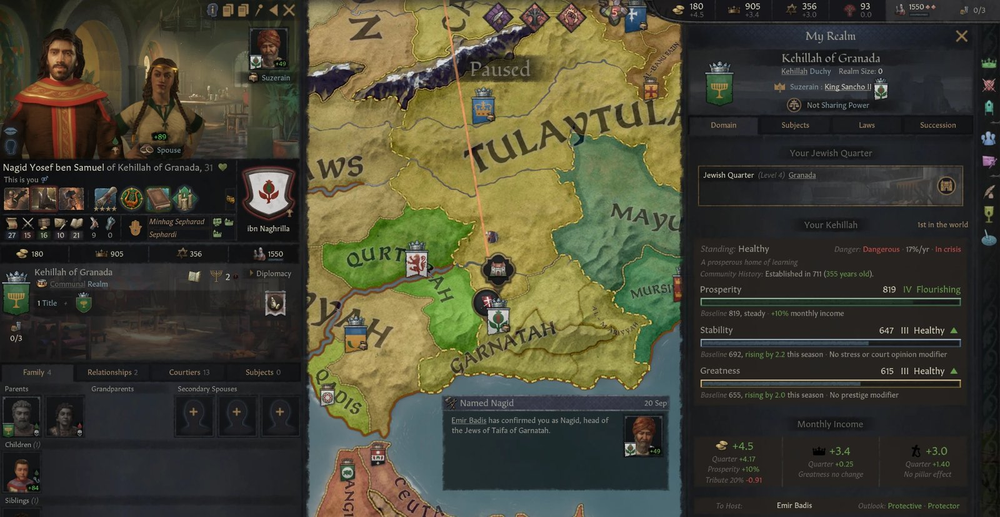
  <figcaption><strong>Granada under pressure.</strong> Nagid Yosef's community is prosperous and learned, but its Domain view flags it as Dangerous and in crisis. Income shows what the Quarter, Prosperity and tribute to the host each add or take.</figcaption>
</figure>

<figure class="shot">
  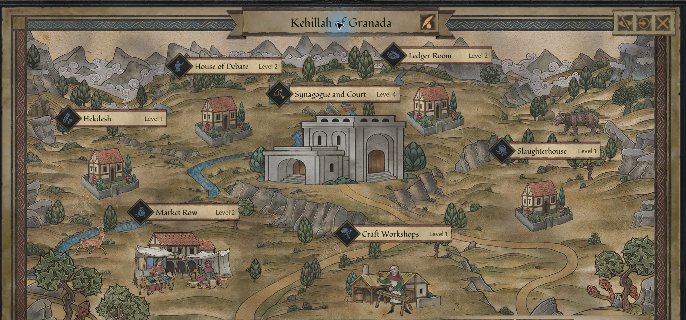
  <figcaption><strong>Granada's Jewish Quarter.</strong> Synagogue, house of debate, ledger room, market and other buildings each have an illustrated place. Cropped to remove debug map controls.</figcaption>
</figure>

<figure class="shot shot--todo">
  
Screenshot needed<code>quarter-building-tooltip.jpg</code>Quarter · hover a locked building tier

  <figcaption><strong>What a building needs.</strong> A higher tier's tooltip shows its cost and the pillar band it requires. Capture: open the Quarter, hover a tier that is gated by a pillar band; crop to the Quarter and tooltip.</figcaption>
</figure>

<figure class="shot">
  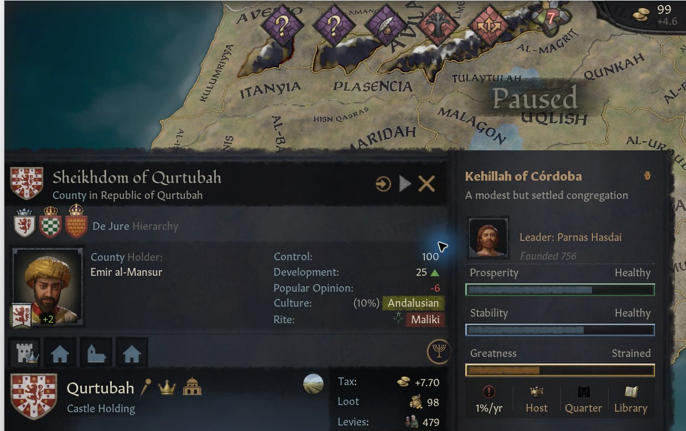
  <figcaption><strong>Córdoba on the map.</strong> A community card names its leader, age, pillar standings and danger, and links to its host, Quarter and library.</figcaption>
</figure>

<figure class="shot">
  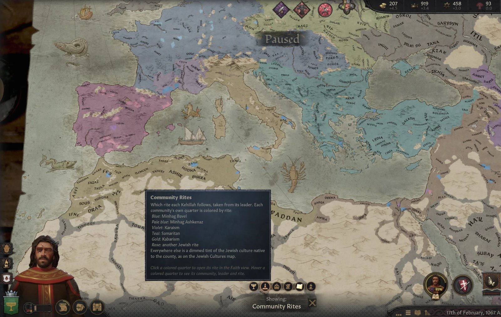
  <figcaption><strong>The Jewish world map.</strong> The Jewish map modes show communities, rites, crises, each realm's law on its Jews, libraries and native Jewish cultures. Here, Community Rites colours each quarter by the rite its leader follows.</figcaption>
</figure>

<figure class="shot">
  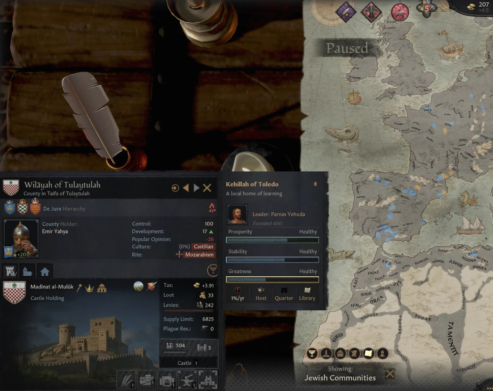
  <figcaption><strong>Communities on the map.</strong> Selecting a county with a community shows its card: Toledo's leader, founding date, pillars, yearly danger, and links to its host, Quarter and library.</figcaption>
</figure>

<figure class="shot">
  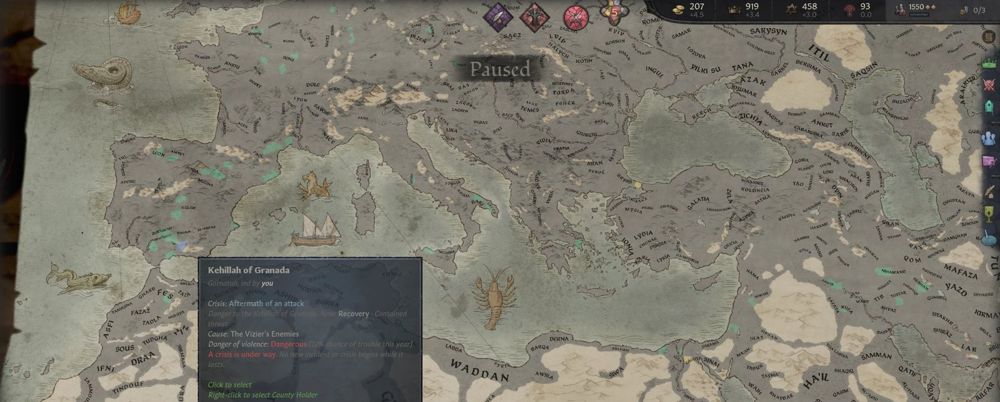
  <figcaption><strong>Community Crises.</strong> Hover a community to see its crisis, its cause and its danger of violence.</figcaption>
</figure>

<figure class="shot">
  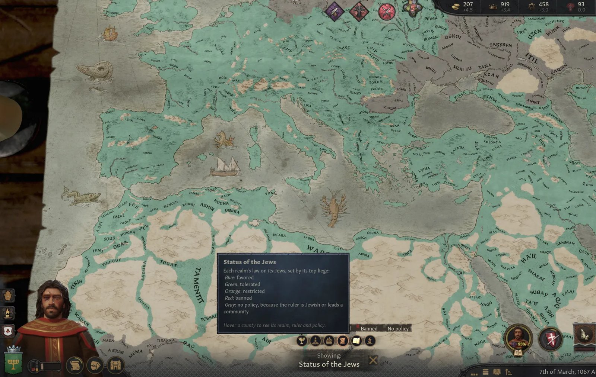
  <figcaption><strong>Status of the Jews.</strong> Each realm's law on its Jews, set by its top liege, from favored to banned.</figcaption>
</figure>

<figure class="shot">
  
  <figcaption><strong>Jewish Cultures.</strong> Each land is coloured by its native Jewish culture, from Iberia and the Rhineland to Central Asia.</figcaption>
</figure>

<figure class="shot">
  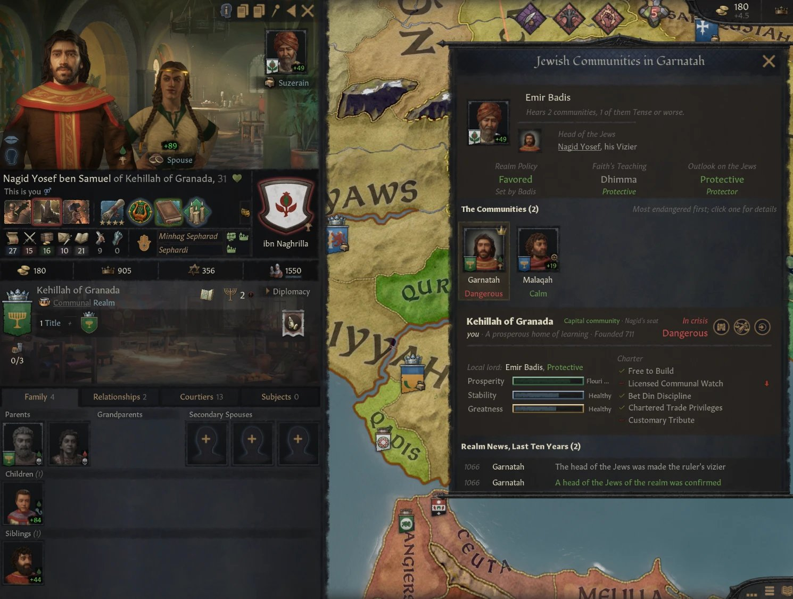
  <figcaption><strong>A realm's communities together.</strong> Garnatah's view shows Emir Badis, his policy and outlook, both of his communities (most endangered first), Granada's charter terms and ten years of realm news.</figcaption>
</figure>

<figure class="shot">
  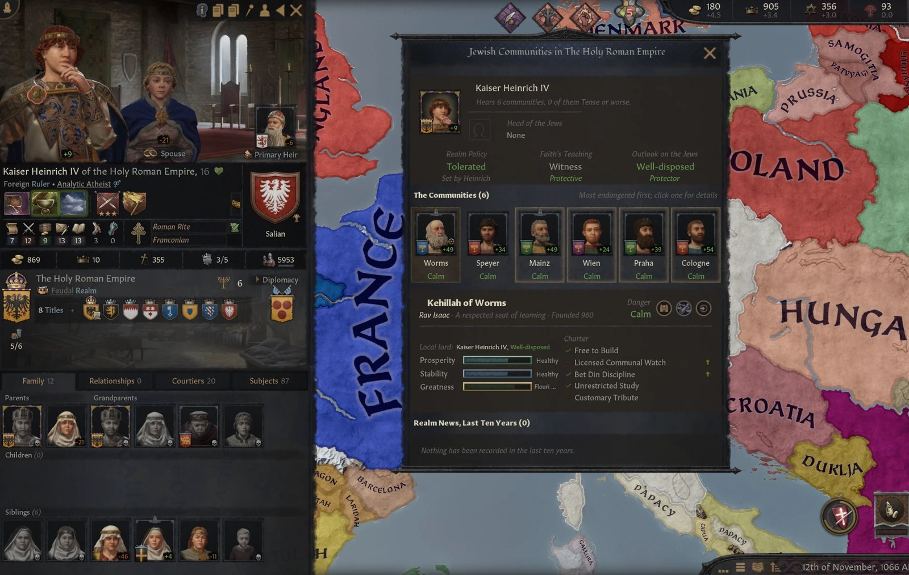
  <figcaption><strong>The Empire's communities.</strong> Kaiser Heinrich IV hears six communities, from Worms to Praha, all calm in 1066.</figcaption>
</figure>

<figure class="shot shot--todo">
  
Screenshot needed<code>world-ledger.jpg</code>Domain → Standing · World Ledger

  <figcaption><strong>The World Ledger.</strong> Every led community ranked by Standing or by any pillar. Capture: click the Standing line on the Domain tab; sort by one pillar so the column header is visibly active.</figcaption>
</figure>

<figure class="shot shot--todo">
  
Screenshot needed<code>danger-breakdown.jpg</code>Tooltip · community danger breakdown

  <figcaption><strong>Why a community is in danger.</strong> Capture: hover the danger value on a community card; crop tightly to the tooltip.</figcaption>
</figure>

<figure class="shot shot--todo">
  
Screenshot needed<code>language-breakdown.jpg</code>Tooltip · languages of the community

  <figcaption><strong>Languages spoken.</strong> Capture: hover the language line on the community view; crop tightly to the tooltip.</figcaption>
</figure>

## Books and learning

<figure class="shot">
  
  <figcaption><strong>The library shelf.</strong> Granada's Beit Midrash holds its physical copies, sorted by subject. Each book shows its canonicity, author, language and whether you have mastered it.</figcaption>
</figure>

<figure class="shot">
  
  <figcaption><strong>Parshanut.</strong> The Torah sits in its ark among the commentaries.</figcaption>
</figure>

<figure class="shot">
  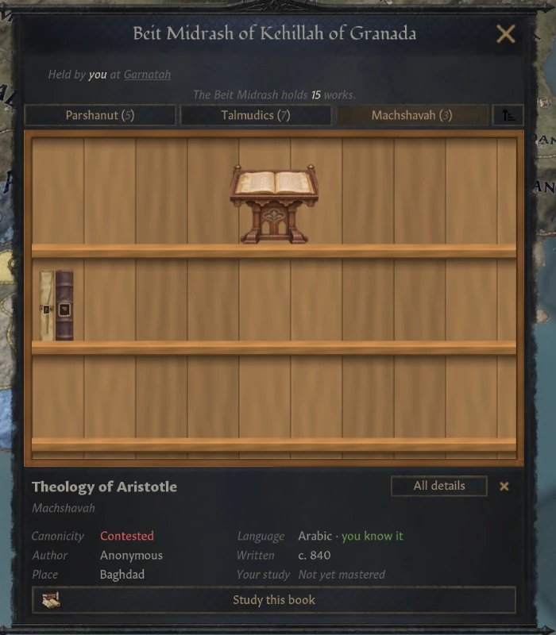
  <figcaption><strong>Machshavah.</strong> Philosophy, including the contested Theology of Aristotle.</figcaption>
</figure>

### Building a library

<figure class="shot">
  
  <figcaption><strong>A gap on the shelf.</strong> Every library is built on its rite's foundational works. Troyes lacks Talmud Bavli: Tahorot, and its Greatness suffers until it is found.</figcaption>
</figure>

<figure class="shot">
  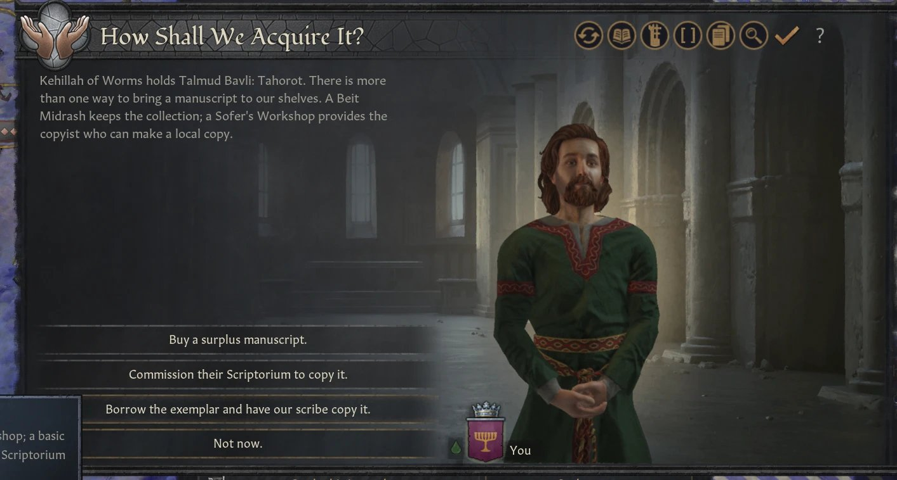
  <figcaption><strong>How Shall We Acquire It?</strong> Worms holds the missing order. Buy a surplus copy, commission their scriptorium, or borrow the exemplar for your own scribe.</figcaption>
</figure>

<figure class="shot">
  
  <figcaption><strong>Copying under way.</strong> The shelf shows the copy in progress.</figcaption>
</figure>

<figure class="shot shot--narrow-wide">
  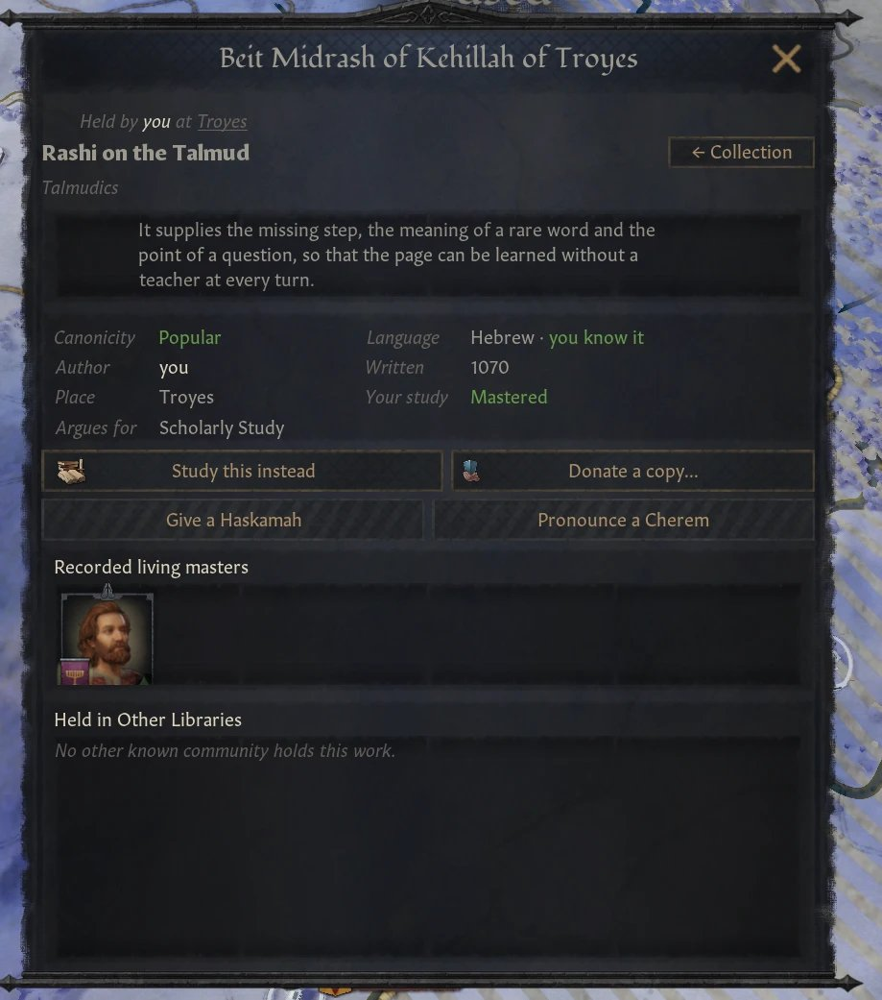
  <figcaption><strong>A new work on the shelf.</strong> Rashi on the Talmud, written at Troyes in 1070. From here a scholar can give it a haskamah or pronounce a cherem, and see who has mastered it and which libraries hold it.</figcaption>
</figure>

<figure class="shot">
  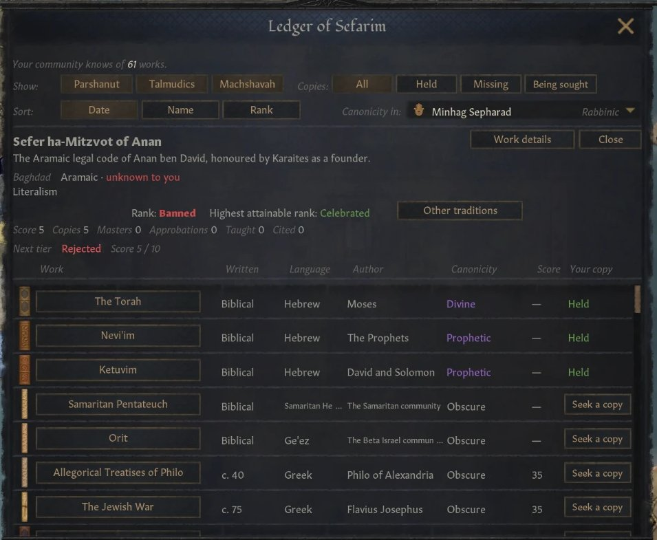
  <figcaption><strong>The Sefarim Ledger.</strong> Every work your community knows, ranked for your rite. Under Minhag Sepharad, Anan's Karaite code is Banned.</figcaption>
</figure>

<figure class="shot">
  
  <figcaption><strong>Another tradition's view.</strong> Switch the ledger to Karaism and the same book is Authoritative.</figcaption>
</figure>

<figure class="shot">
  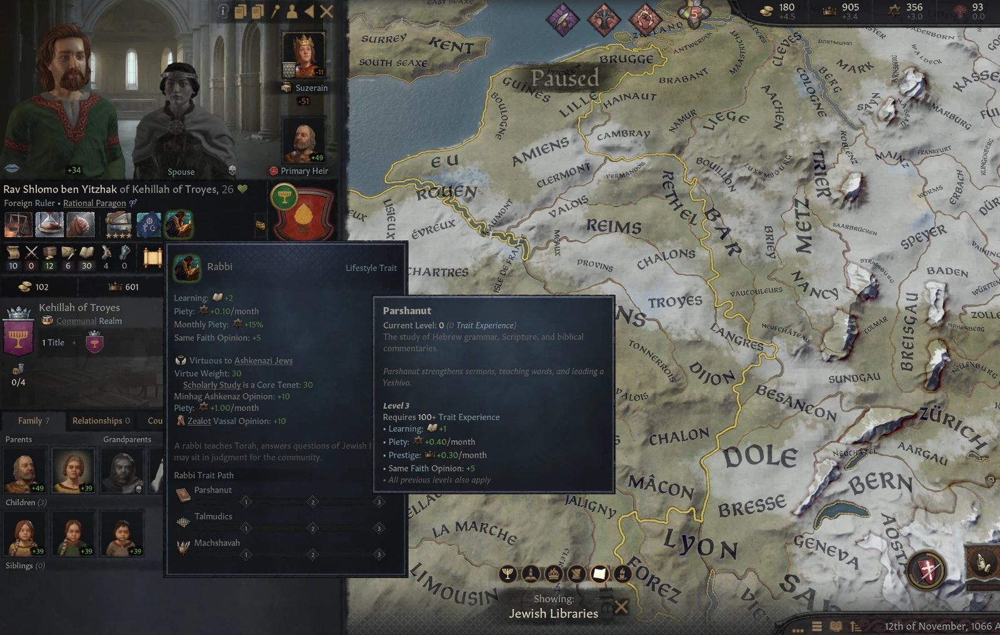
  <figcaption><strong>The Rabbi trait.</strong> Three tracks of study, Parshanut, Talmudics and Machshavah, each with its own levels and rewards.</figcaption>
</figure>

<figure class="shot">
  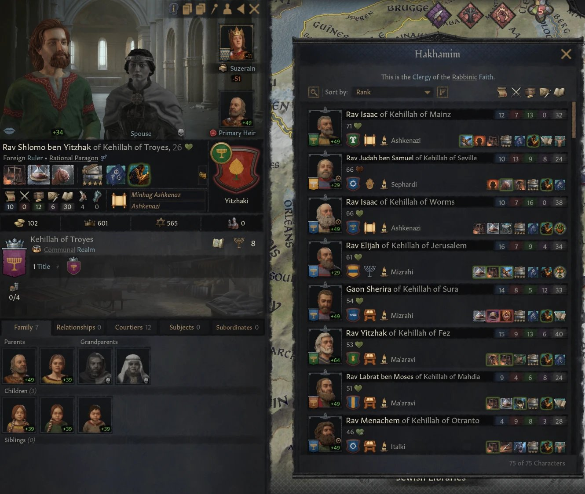
  <figcaption><strong>The Hakhamim.</strong> The Rabbinic faith's clergy: rabbis from Mainz to Sura, ranked side by side.</figcaption>
</figure>

<figure class="shot">
  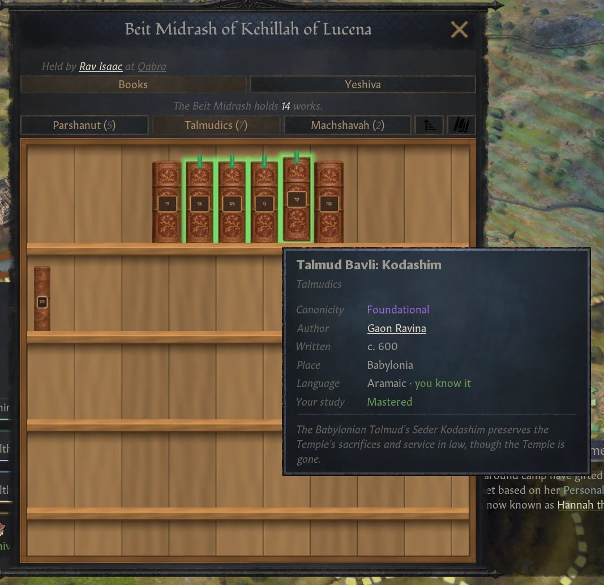
  <figcaption><strong>What you have mastered.</strong> In Lucena's Beit Midrash, the books you have mastered glow on the shelf.</figcaption>
</figure>

<figure class="shot">
  
  <figcaption><strong>Languages of learning.</strong> Hebrew and Aramaic open the books written in them.</figcaption>
</figure>

<figure class="shot">
  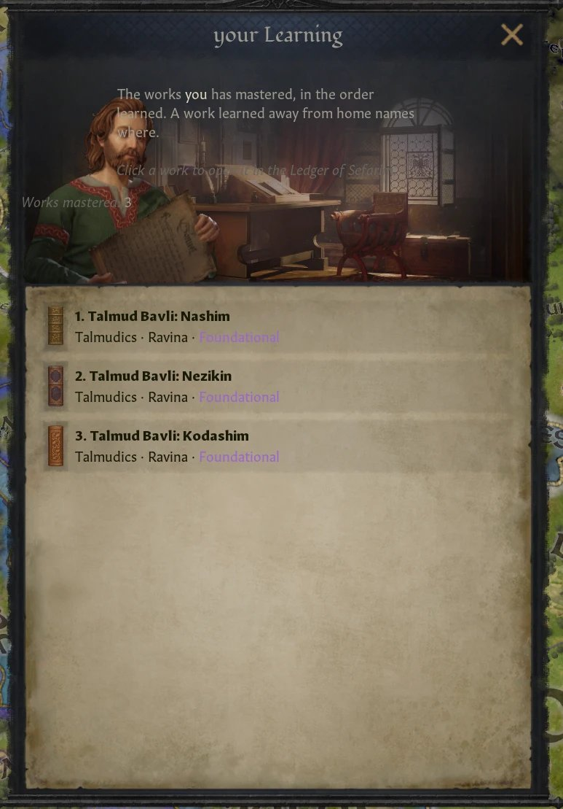
  <figcaption><strong>A scholar's learning.</strong> Every work a character has mastered, in the order learned. Rashi has three orders of the Talmud.</figcaption>
</figure>

<figure class="shot shot--todo">
  
Screenshot needed<code>study-library-decision.jpg</code>Decisions · study from the library

  <figcaption><strong>Choosing what to study.</strong> Capture: open the study decision so its custom book picker is visible.</figcaption>
</figure>

<figure class="shot">
  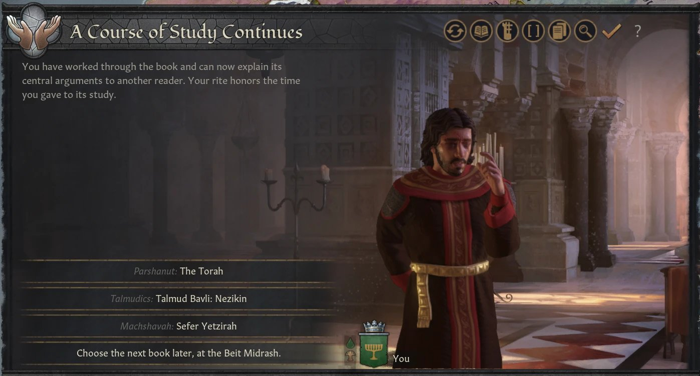
  <figcaption><strong>The next book.</strong> Finishing a book offers the next one in each field, or a return to the Beit Midrash to choose.</figcaption>
</figure>

<figure class="shot">
  
  <figcaption><strong>The Book Persuades.</strong> A book can change your mind: the Theology of Aristotle argues for Reasoned Theology as a personal tenet.</figcaption>
</figure>

<figure class="shot shot--narrow-wide">
  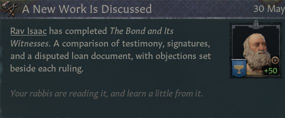
  <figcaption><strong>A New Work Is Discussed.</strong> When a rabbi finishes a sefer, the community's scholars read it and learn from it.</figcaption>
</figure>

<figure class="shot shot--narrow-wide">
  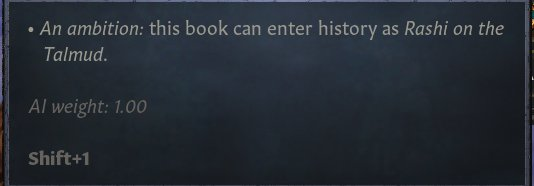
  <figcaption><strong>A historical ambition.</strong> Some choices let a book become the famous work it was in history.</figcaption>
</figure>

<figure class="shot">
  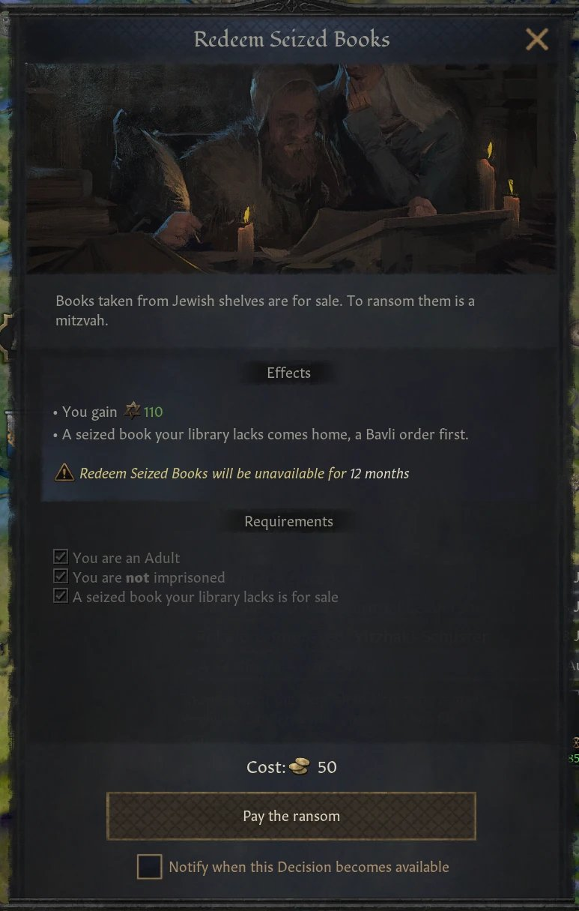
  <figcaption><strong>Redeem Seized Books.</strong> Books taken from Jewish shelves come up for sale; ransoming one is a mitzvah.</figcaption>
</figure>

<figure class="shot">
  
  <figcaption><strong>Books Redeemed.</strong> The Mishnah comes home to a Jewish shelf.</figcaption>
</figure>

<figure class="shot">
  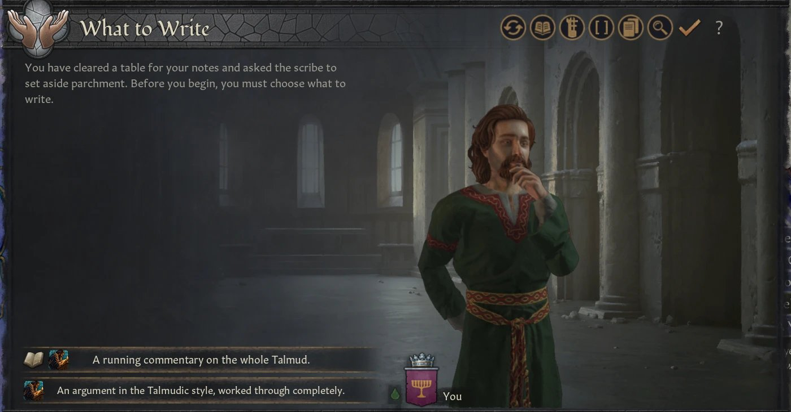
  <figcaption><strong>Writing a sefer.</strong> Rashi chooses what to write. A running commentary on the whole Talmud can enter history as <em>Rashi on the Talmud</em>.</figcaption>
</figure>

<figure class="shot shot--todo">
  
Screenshot needed<code>event-approbation.jpg</code>Event · “A Request for an Approbation”

  <figcaption><strong>Approbations and bans.</strong> Another scholar asks you to endorse his book. Capture: console <code>event kehillah_sefer.0301</code>.</figcaption>
</figure>

<figure class="shot">
  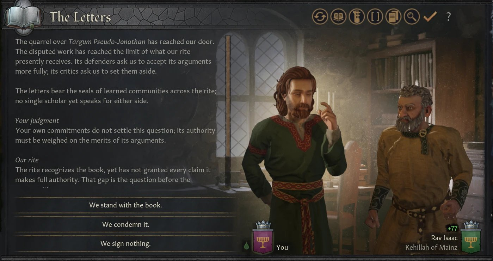
  <figcaption><strong>The Letters.</strong> A quarrel over a disputed book reaches your door. Stand with it, condemn it, or sign nothing.</figcaption>
</figure>

## Council, succession and decisions

<figure class="shot">
  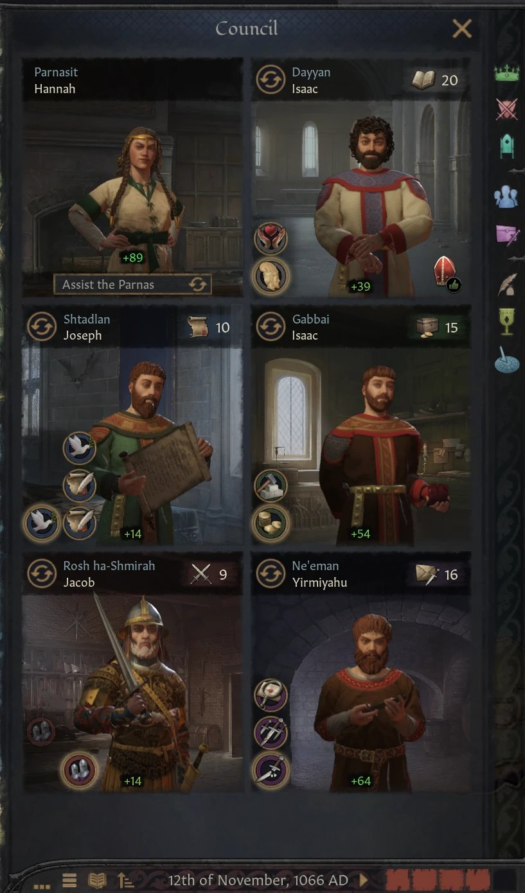
  <figcaption><strong>The council.</strong> The Parnasit beside the Dayyan, Shtadlan, Gabbai, Rosh ha-Shmirah and Ne'eman, each with a task.</figcaption>
</figure>

<figure class="shot shot--old">
  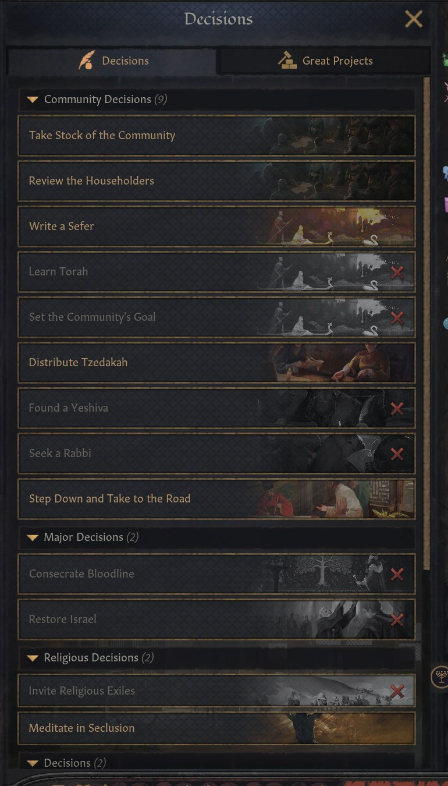
  <figcaption>Earlier build <strong>Community decisions.</strong> Write a sefer, send out settlers, learn Torah, convene the Bet Din and more.</figcaption>
</figure>

<figure class="shot">
  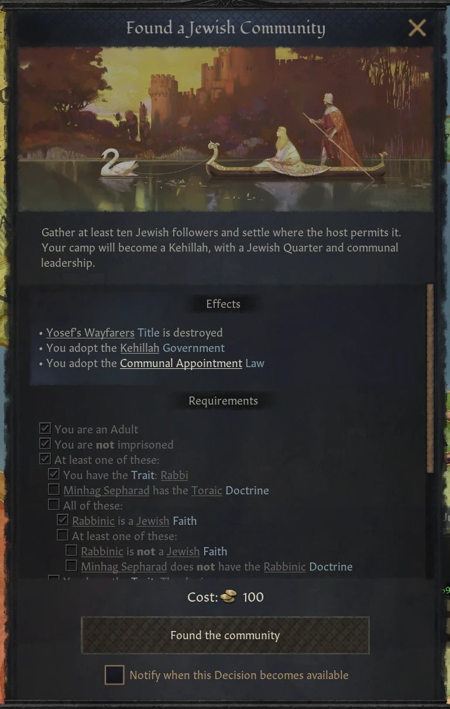
  <figcaption><strong>Found a Jewish Community.</strong> An adventurer with ten Jewish followers can settle, and the camp becomes a Kehillah.</figcaption>
</figure>

<figure class="shot">
  
  <figcaption><strong>Preach as a Maggid.</strong> A wandering preacher may speak in any synagogue, for a name or for alms.</figcaption>
</figure>

<figure class="shot">
  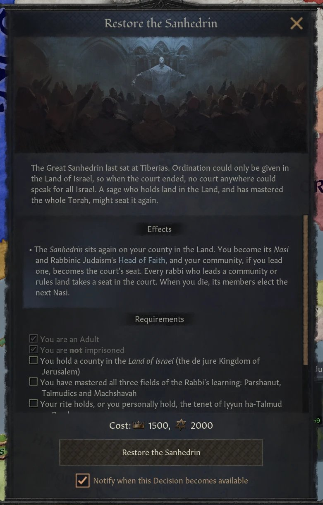
  <figcaption><strong>Restore the Sanhedrin.</strong> A sage who holds land in the Land of Israel and has mastered all three fields may seat the court again.</figcaption>
</figure>

<figure class="shot shot--narrow-wide">
  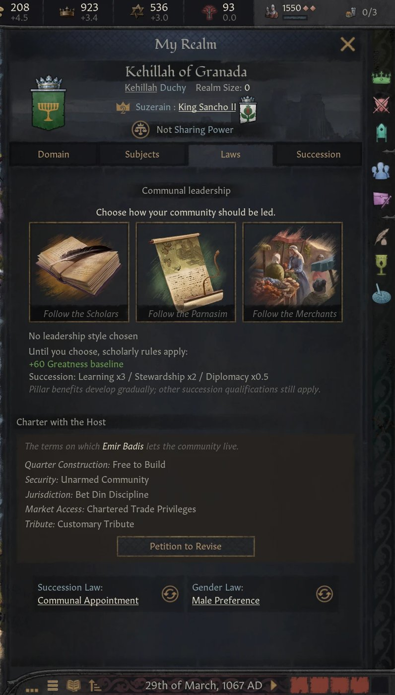
  <figcaption><strong>Laws of the community.</strong> Choose whom the community follows (scholars, parnasim or merchants), read the charter's terms and petition the host to revise them.</figcaption>
</figure>

<figure class="shot">
  
  <figcaption><strong>Choosing the next leader.</strong> Candidates are ranked by score. Hover one to see how learning, stewardship, kinship, the board's regard and being one of the community's own add up.</figcaption>
</figure>

<figure class="shot shot--old">
  
  <figcaption>Earlier build <strong>Leadership passes.</strong> Rav Isaac dies and the council's appointee, Parnas Netaniel, takes office.</figcaption>
</figure>

<figure class="shot">
  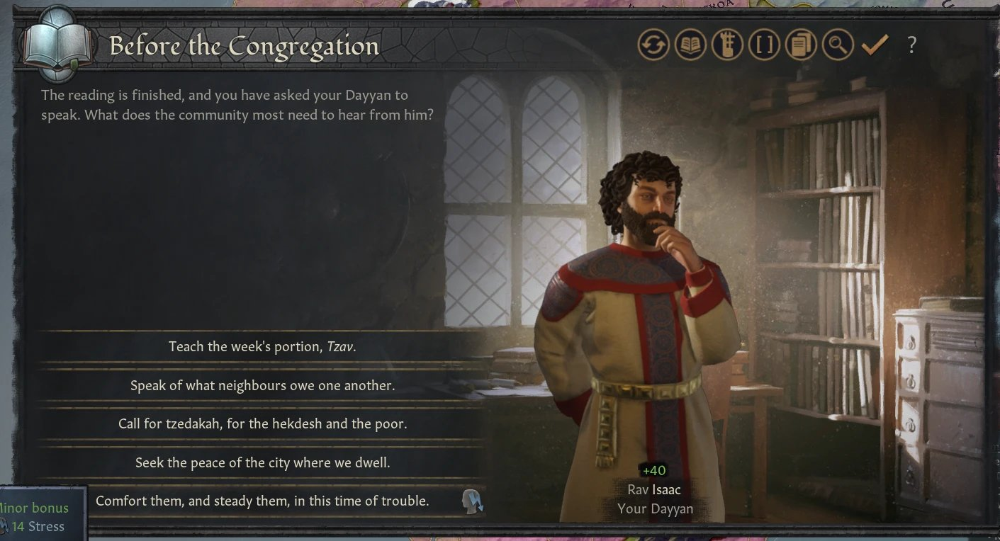
  <figcaption><strong>Before the Congregation.</strong> Ask your Dayyan to preach: the week's portion, neighbourly duty, tzedakah, peace with the city, or comfort in hard times.</figcaption>
</figure>

<figure class="shot">
  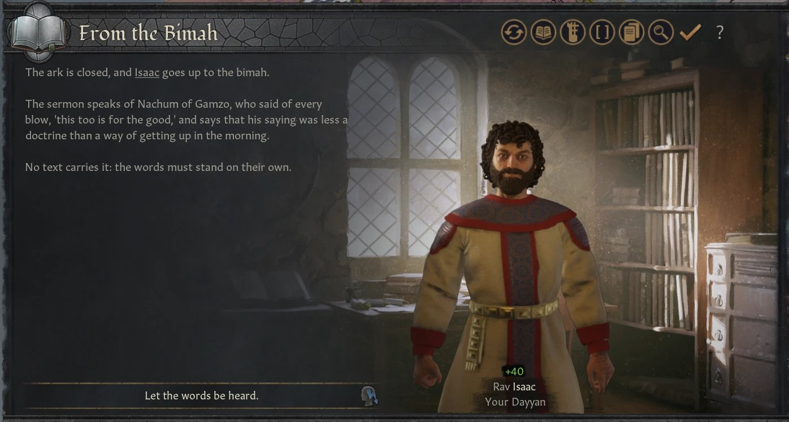
  <figcaption><strong>From the Bimah.</strong> Rav Isaac preaches on Nachum of Gamzo's "this too is for the good".</figcaption>
</figure>

<figure class="shot shot--narrow-wide">
  
  <figcaption><strong>Not every sermon lands.</strong> A poor sermon costs the preacher stress.</figcaption>
</figure>

<figure class="shot shot--narrow-wide">
  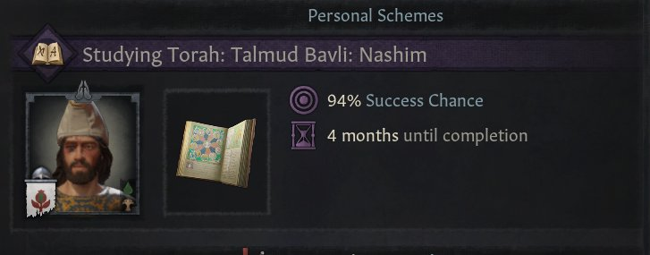
  <figcaption><strong>Studying as a scheme.</strong> Studying a book runs as a personal scheme, with its own book art, success chance and time to completion.</figcaption>
</figure>

## Activities

<figure class="shot shot--old">
  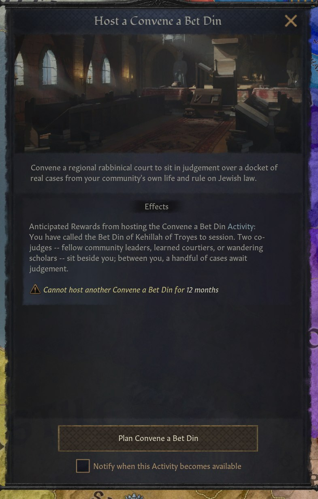
  <figcaption>Earlier build <strong>Convening a Bet Din.</strong> The planning window for a regional rabbinical court.</figcaption>
</figure>

<figure class="shot">
  
  <figcaption><strong>A case before the court.</strong> Is a goose that grew on driftwood a fowl? Review the evidence, or cite <em>Simanei ha-of</em> and require shechita.</figcaption>
</figure>

<figure class="shot">
  
  <figcaption><strong>Knowing the sources.</strong> Each case lists the works that bear on it and which judges on the bench have mastered them. Hear it yourselves, or ask a scholar outside the panel.</figcaption>
</figure>

<figure class="shot">
  
  <figcaption><strong>The ruling.</strong> Divide the cost, agree a cheaper screen, require nothing, or cite <em>Hezek reiyah</em> for the privacy claim.</figcaption>
</figure>

<figure class="shot">
  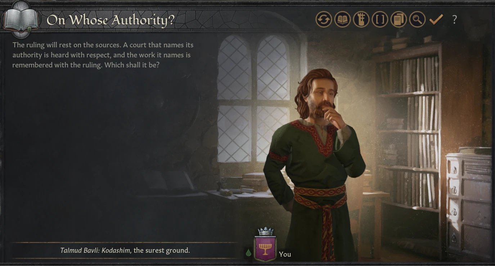
  <figcaption><strong>On Whose Authority?</strong> A ruling names its source, and the work it names is remembered with it.</figcaption>
</figure>

<figure class="shot">
  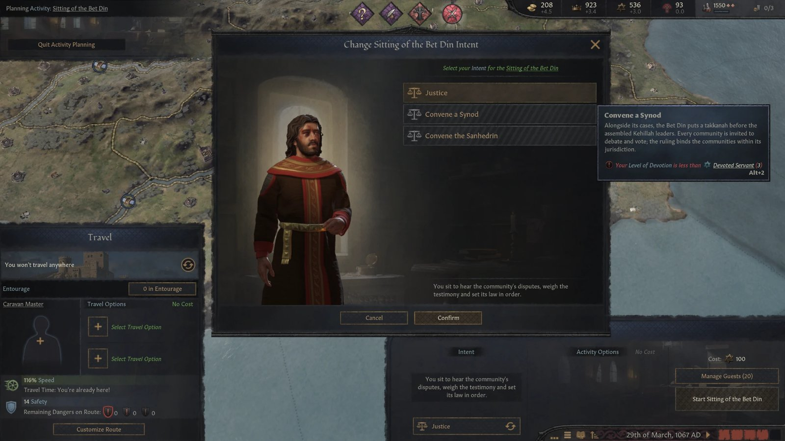
  <figcaption><strong>Why the court sits.</strong> A sitting can hear the community's disputes, convene a synod to vote on a takkanah, or, for a rabbi at the height of learning and devotion, restore the Sanhedrin.</figcaption>
</figure>

<figure class="shot shot--narrow-wide">
  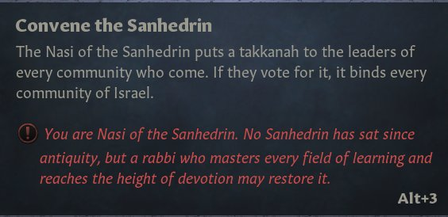
  <figcaption><strong>The Sanhedrin.</strong> No Sanhedrin has sat since antiquity.</figcaption>
</figure>

<figure class="shot">
  
  <figcaption><strong>A Bet Din sitting.</strong> The conclusion of a sitting, with the host and two guest judges.</figcaption>
</figure>

<figure class="shot">
  
  <figcaption><strong>A citation offered.</strong> Rav Yaakov's sitting ends with a Justice intent fulfilled and a citation for one of his scholars.</figcaption>
</figure>

<figure class="shot">
  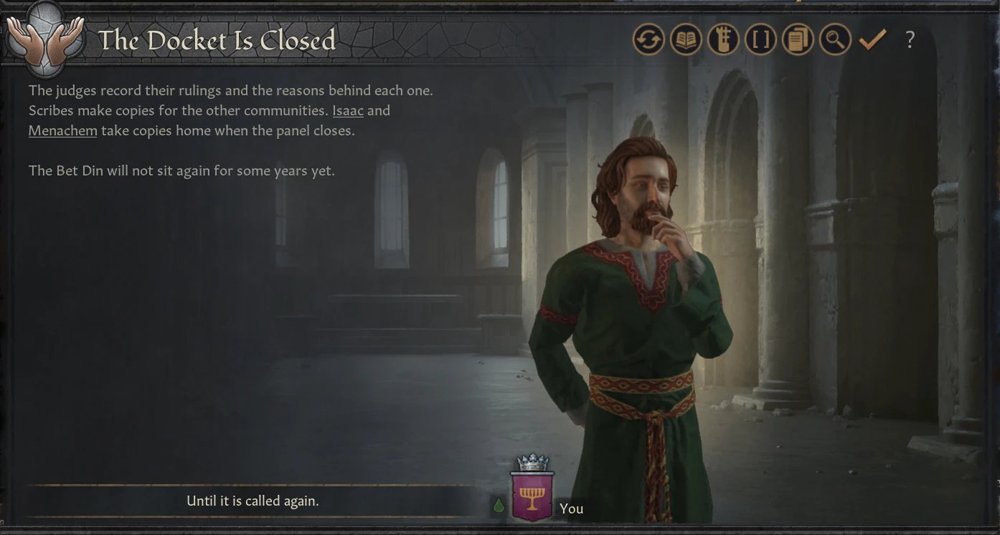
  <figcaption><strong>The Docket Is Closed.</strong> Rulings are recorded and copied for the other communities, and the court will not sit again for some years.</figcaption>
</figure>

<figure class="shot">
  
  <figcaption><strong>Your own sitting.</strong> Rashi hosts Rav Isaac and Parnas Menachem at Troyes.</figcaption>
</figure>

<figure class="shot">
  
  <figcaption><strong>An invitation to sit.</strong> Other communities invite you to their Bet Din. Parnas Isaac of Burgos writes to Nagid Yosef of Granada.</figcaption>
</figure>

### Study at a Yeshiva

<figure class="shot">
  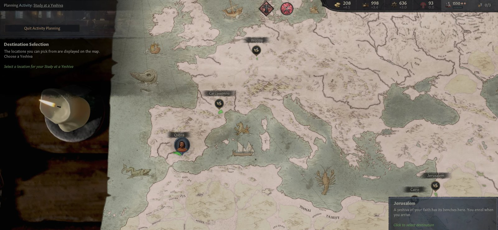
  <figcaption><strong>Choosing a yeshiva.</strong> Yeshivot of your faith are marked on the map. You enrol when you arrive.</figcaption>
</figure>

<figure class="shot">
  
  <figcaption><strong>Before the Rosh Yeshiva.</strong> The head of the yeshiva asks where you studied and what you came to learn, then hands you your first book.</figcaption>
</figure>

<figure class="shot">
  
  <figcaption><strong>On the benches.</strong> A student and his chavruta study toward semicha.</figcaption>
</figure>

<figure class="shot">
  
  <figcaption><strong>The Examination.</strong> Halfway to mastery, the Rosh Yeshiva opens the book before everyone and waits for an answer.</figcaption>
</figure>

<figure class="shot">
  
  <figcaption><strong>Semicha.</strong> "Yoreh yoreh. Yadin yadin." The student is ordained and gains the Rabbi trait.</figcaption>
</figure>

<figure class="shot shot--todo">
  
Screenshot needed<code>learn-torah-journey-plan.jpg</code>Activity planner · Journey to Learn Torah

  <figcaption><strong>A journey to learn Torah.</strong> A student travels to a foreign Beit Midrash. Capture: the activity planner with its custom header art and destination chosen.</figcaption>
</figure>

<figure class="shot shot--todo">
  
Screenshot needed<code>event-foreign-beit-midrash.jpg</code>Event · “A Foreign Beit Midrash”

  <figcaption><strong>Arriving to study.</strong> Capture: during the journey, or console <code>event kehillah_learn_torah_journey.0001</code>.</figcaption>
</figure>

<figure class="shot shot--todo">
  
Screenshot needed<code>event-synod.jpg</code>Event · “The Voice of the Generation”

  <figcaption><strong>A synod of rabbis.</strong> Capture: console <code>event kehillah_synod.0005</code>, if the synod is reachable in this build.</figcaption>
</figure>

## The Jewish year

Holidays follow the Hebrew calendar and arrive as household events, with different stories for different rites and seasons.

<figure class="shot shot--old">
  
  <figcaption>Earlier build <strong>Rosh Hashanah: An Omen in the Honey.</strong> At the New Year's meal a candle gutters, and the household wonders what it means.</figcaption>
</figure>

<figure class="shot shot--todo">
  
Screenshot needed<code>holiday-yom-kippur.jpg</code>Yom Kippur · “The Last Hour”

  <figcaption><strong>Yom Kippur.</strong> The closing hour of the fast. Capture: console <code>event jewish_holidays.0010</code>.</figcaption>
</figure>

<figure class="shot shot--todo">
  
Screenshot needed<code>holiday-sukkot.jpg</code>Sukkot · “A Gap in the Roof”

  <figcaption><strong>Sukkot.</strong> A family's sukkah. Capture: console <code>event jewish_holidays.0011</code>.</figcaption>
</figure>

<figure class="shot shot--todo">
  
Screenshot needed<code>holiday-hanukkah.jpg</code>Hanukkah · “Light in the Window”

  <figcaption><strong>Hanukkah.</strong> Lamps set where the street can see them. Capture: console <code>event jewish_holidays.0006</code>.</figcaption>
</figure>

<figure class="shot shot--todo">
  
Screenshot needed<code>holiday-purim.jpg</code>Purim · “Ad Lo Yada”

  <figcaption><strong>Purim.</strong> A festival of masks and wine. Capture: console <code>event jewish_holidays.0007</code>.</figcaption>
</figure>

<figure class="shot shot--todo">
  
Screenshot needed<code>holiday-pesach.jpg</code>Pesach · “The Four Questions”

  <figcaption><strong>Pesach.</strong> The youngest at the table asks the Four Questions. Capture: console <code>event jewish_holidays.0003</code>.</figcaption>
</figure>

<figure class="shot shot--todo">
  
Screenshot needed<code>holiday-feast-pesach.jpg</code>Holiday feast activity · Pesach variant

  <figcaption><strong>A festival feast.</strong> Hosting a holiday feast swaps in Pesach, Shavuot or Sukkot dishes and stories. Capture: host a feast during Pesach and screenshot its Pesach-specific event.</figcaption>
</figure>

## Host politics and crisis

<figure class="shot shot--old">
  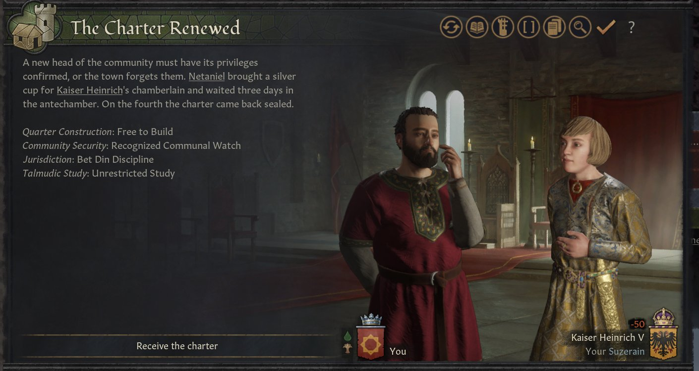
  <figcaption>Earlier build <strong>The Charter Renewed.</strong> The host confirms the community's terms for building, protection, jurisdiction and study.</figcaption>
</figure>

<figure class="shot">
  
  <figcaption><strong>Negotiating the charter.</strong> Tribute, building rights, security, jurisdiction and market access are terms you can ask the host to change.</figcaption>
</figure>

<figure class="shot">
  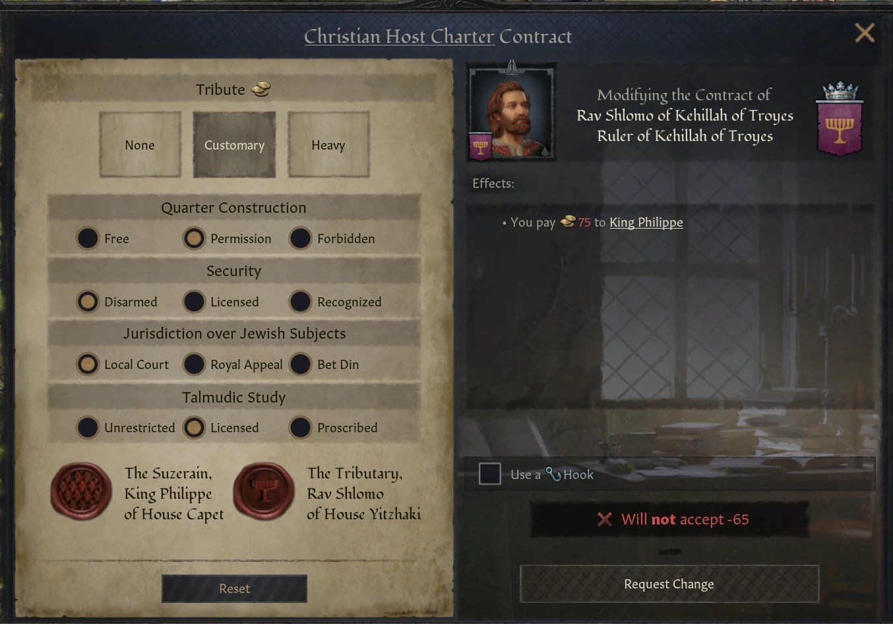
  <figcaption><strong>A Christian host's charter.</strong> Under King Philippe, Troyes negotiates different terms, including whether Talmudic study is unrestricted, licensed or proscribed.</figcaption>
</figure>

<figure class="shot shot--todo">
  
Screenshot needed<code>settlement-policy.jpg</code>Realm laws · Jewish Settlement Policy

  <figcaption><strong>Jewish Settlement Policy.</strong> A realm-wide law from Banned to Encouraged. Capture: the host ruler's realm laws with the policy row and its tooltip visible.</figcaption>
</figure>

<figure class="shot shot--todo">
  
Screenshot needed<code>nagid-audience.jpg</code>Event · “An Audience: the Head of the Jews”

  <figcaption><strong>The Nagid.</strong> A Muslim ruler's office for the leader of his Jews. Capture: Granada 1066, or console <code>event kehillah_nagid.0001</code>.</figcaption>
</figure>

<figure class="shot shot--old">
  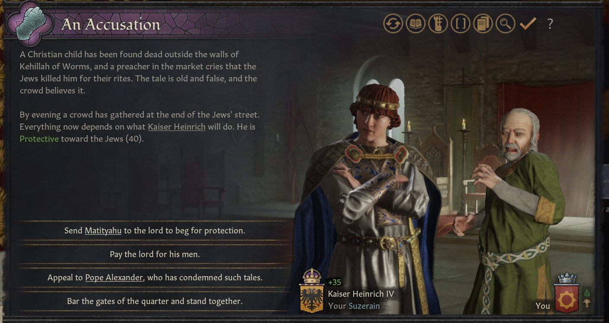
  <figcaption>Earlier build <strong>An Accusation.</strong> A false charge spreads, and the community must choose how to answer it.</figcaption>
</figure>

<figure class="shot">
  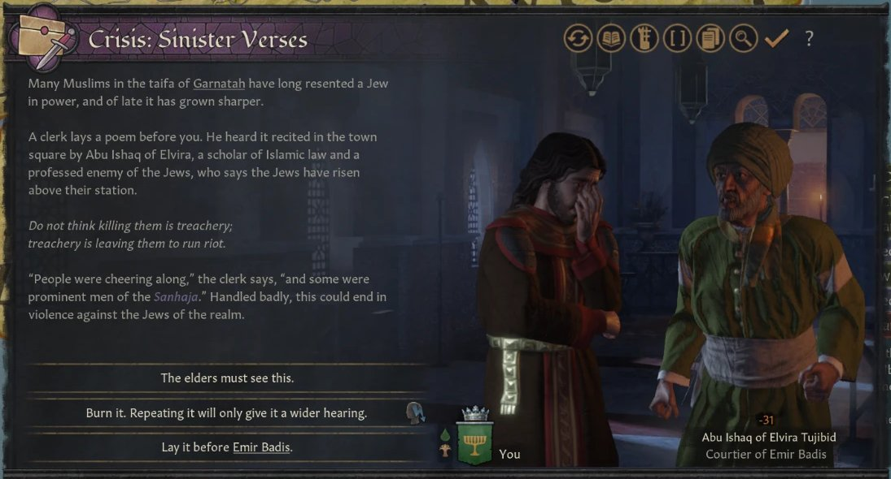
  <figcaption><strong>Sinister Verses.</strong> In Granada, a hostile poem by Abu Ishaq of Elvira reaches the Nagid, and how he answers it shapes the crisis.</figcaption>
</figure>

<figure class="shot">
  
  <figcaption><strong>A community threat.</strong> Armed host and Spared race toward 100 while catalysts push the totals and the window offers responses.</figcaption>
</figure>

<figure class="shot shot--narrow">
  
  <figcaption><strong>Community Safety.</strong> The Military window lists crises under way, the yearly danger, its sources and what protects the community.</figcaption>
</figure>

<figure class="shot">
  
  <figcaption><strong>Holding the Quarter.</strong> When the armed host gathers, war is declared and a second race begins: Quarter held against Quarter struck, with three ways to respond.</figcaption>
</figure>

### How a crisis unfolds

Every community crisis moves through the same phases. If unrest is defused in Agitation, the community is spared. If not, an armed host gathers, and the Quarter either holds or is struck.

<figure class="shot crisis-flow">
<svg viewBox="0 0 880 610" role="img" aria-labelledby="crisis-flow-title" xmlns="http://www.w3.org/2000/svg">
<title id="crisis-flow-title">Crisis phases: Agitation leads to Spared or Armed Host; Armed Host leads to Quarter Held or Quarter Struck; Quarter Struck leads to Recovery; Spared, Quarter Held and Recovery all end in the Final chronicle and cooldown.</title>
<defs><marker id="cf-arrow" viewBox="0 0 10 10" refX="9" refY="5" markerWidth="7" markerHeight="7" orient="auto-start-reverse"><path d="M0,1 L9,5 L0,9" fill="none" stroke="#8a7a72" stroke-width="1.6"/></marker></defs>
<g fill="none" stroke="#8a7a72" stroke-width="1.6" marker-end="url(#cf-arrow)">
<path d="M190,94 V396"/><path d="M282,94 V118 H411 V140"/><path d="M366,221 V268"/><path d="M457,221 V246 H678 V268"/><path d="M678,349 V396"/><path d="M191,469 V494 H290 V516"/><path d="M366,349 V516"/><path d="M678,469 V494 H441 V516"/>
</g>
<g fill="#f5f0ed" stroke="#d9c3b5" stroke-width="1.5">
<rect x="100" y="22" width="272" height="72" rx="16"/><rect x="275" y="142" width="273" height="79" rx="16"/><rect x="248" y="270" width="236" height="79" rx="16"/><rect x="533" y="270" width="290" height="79" rx="16"/><rect x="41" y="398" width="301" height="71" rx="16"/><rect x="525" y="398" width="306" height="71" rx="16"/><rect x="211" y="518" width="310" height="71" rx="16"/>
</g>
<g fill="#603626" font-family="system-ui, -apple-system, 'Segoe UI', sans-serif" font-size="16" font-weight="600" text-anchor="middle">
<text x="236" y="63">Agitation: defuse unrest</text><text x="411" y="177">Armed Host: protect the</text><text x="411" y="197">quarter</text><text x="366" y="305">Quarter Held: settle</text><text x="366" y="325">consequences</text><text x="678" y="305">Quarter Struck: resolve the</text><text x="678" y="325">attack</text><text x="191" y="439">Spared: settle consequences</text><text x="678" y="439">Recovery: endure or collapse</text><text x="366" y="559">Final chronicle and cooldown</text>
</g>
</svg>
<figcaption><strong>Crisis phases.</strong> Every path ends in a final chronicle of what happened, followed by a cooldown before the next crisis.</figcaption>
</figure>

### Granada, 1066: one crisis start to finish

<figure class="shot">
  
  <figcaption><strong>Seek Protection.</strong> Your Shtadlan returns from the emir's court. Ask for men, refuge or a patrol at the gate.</figcaption>
</figure>

<figure class="shot">
  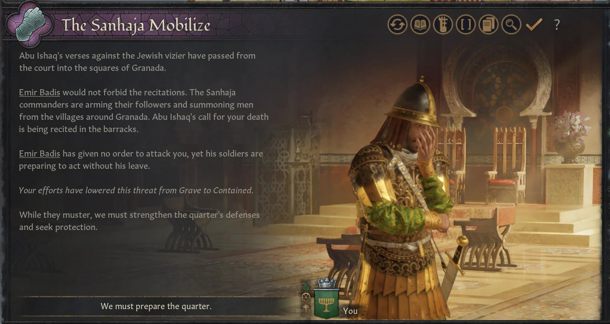
  <figcaption><strong>The Sanhaja Mobilize.</strong> The verses reach the barracks, and the emir's soldiers prepare to act without his leave.</figcaption>
</figure>

<figure class="shot">
  
  <figcaption><strong>At the Gates.</strong> The host stands before the town. Stand at the gate, plead, flee or bar the synagogue doors.</figcaption>
</figure>

<figure class="shot">
  
  <figcaption><strong>The Quarter Is Breached.</strong> With no preparations made, the attackers walk in, but the attack is contained.</figcaption>
</figure>

<figure class="shot">
  
  <figcaption><strong>After the Attack.</strong> The elders go house to house, counting those who returned.</figcaption>
</figure>

<figure class="shot">
  
  <figcaption><strong>The Burial.</strong> Who will say Kaddish for those with no one left to say it?</figcaption>
</figure>

<figure class="shot">
  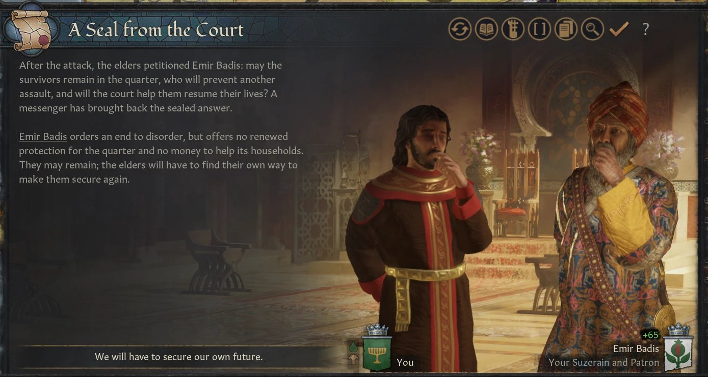
  <figcaption><strong>A Seal from the Court.</strong> The emir orders an end to disorder, but offers no new protection.</figcaption>
</figure>

<figure class="shot shot--narrow-wide">
  
  <figcaption><strong>Status of the Jews Lowered.</strong> Afterwards, Emir Badis restricts Jewish settlement in Garnatah. The charter stands, but anything beyond the new law survives only on sufferance.</figcaption>
</figure>

<figure class="shot">
  
  <figcaption><strong>The lord grows colder.</strong> Violence leaves a mark on the host too: Emir Badis's outlook on the Jews falls for ten years, and the notification breaks down why.</figcaption>
</figure>

<figure class="shot">
  
  <figcaption><strong>The End of the Kehillah.</strong> In this playthrough, no help came, and the community scattered.</figcaption>
</figure>

<figure class="shot">
  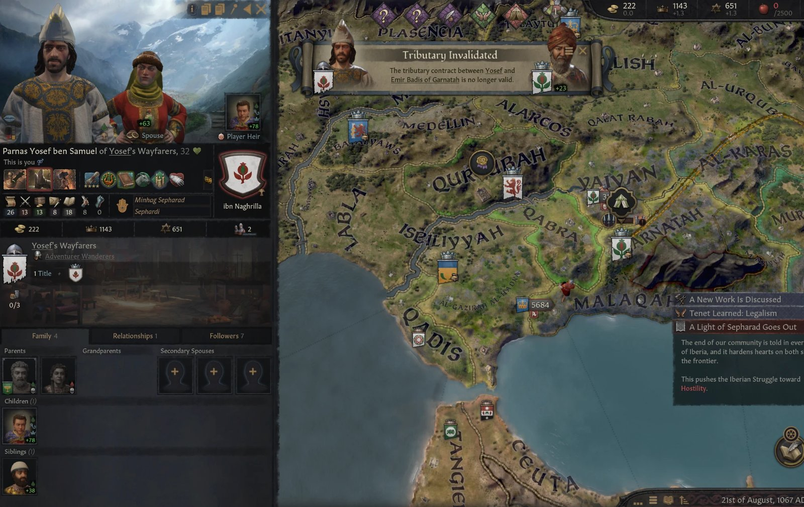
  <figcaption><strong>After the end.</strong> Yosef leads his followers on as adventurers, and the fall of Granada pushes the Iberian Struggle toward Hostility.</figcaption>
</figure>

<figure class="shot">
  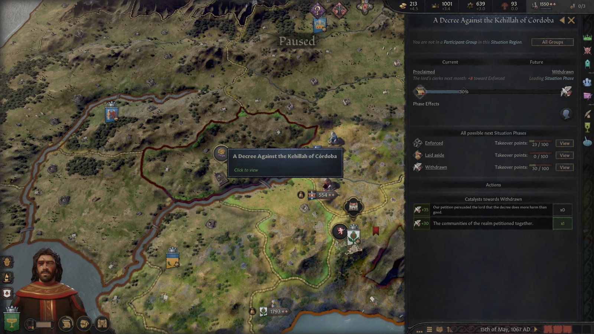
  <figcaption><strong>A decree against a community.</strong> A lord's decree against Córdoba can be enforced, laid aside or withdrawn. Here the realm's communities petitioned together.</figcaption>
</figure>

<figure class="shot">
  
  <figcaption><strong>Another community's crisis.</strong> Crises strike AI communities too. In Burgos, an accusation of mocking the cross pushes toward an armed host.</figcaption>
</figure>

<figure class="shot">
  
  <figcaption><strong>The map remembers.</strong> Where a community was destroyed, the county says so.</figcaption>
</figure>

<figure class="shot shot--todo">
  
Screenshot needed<code>event-gate-held.jpg</code>Event · “The Gate Held”

  <figcaption><strong>The gate held.</strong> Console <code>event kehillah_crisis_held.0001</code>.</figcaption>
</figure>

<figure class="shot shot--todo">
  
Screenshot needed<code>event-rebuilding.jpg</code>Event · “Rebuilding”

  <figcaption><strong>Aftermath.</strong> Console <code>event kehillah_aftermath.0003</code>.</figcaption>
</figure>

<figure class="shot shot--todo">
  
Screenshot needed<code>event-expulsion.jpg</code>Event · “The Edict of Expulsion”

  <figcaption><strong>Expulsion.</strong> Negotiate, leave or face removal. Console <code>event kehillah_expulsion.0001</code>.</figcaption>
</figure>

<figure class="shot shot--todo">
  
Screenshot needed<code>event-talmud-trial.jpg</code>Event · “The Talmud Denounced”

  <figcaption><strong>The Talmud on trial.</strong> Console <code>event kehillah_talmud_trial.0001</code>.</figcaption>
</figure>

## Art and icons

Custom art made for the mod. Composite sheets work well here: crop several icons onto one plain background.

<figure class="shot shot--todo">
  
Screenshot needed<code>art-bookmark-1066.jpg</code>Bookmark art · the 1066 start illustration

  <figcaption><strong>Bookmark art.</strong> Capture: the 1066 bookmark screen with no character selected, so the full illustration shows.</figcaption>
</figure>

<figure class="shot shot--todo">
  
Screenshot needed<code>art-activity-headers.jpg</code>Activity header art · Bet Din and Torah journey

  <figcaption><strong>Activity art.</strong> Composite of the two activity header illustrations.</figcaption>
</figure>

<figure class="shot shot--todo">
  
Screenshot needed<code>art-icons.png</code>Icons · traits, council offices, government

  <figcaption><strong>Traits and offices.</strong> Composite of trait, court-position and government icons.</figcaption>
</figure>

<figure class="shot shot--todo">
  
Screenshot needed<code>art-community-arms.jpg</code>Coats of arms · community emblems

  <figcaption><strong>Community emblems.</strong> Composite of three or four Kehillah coats of arms.</figcaption>
</figure>

### Rites and tenets

Each rite of the Rabbinic faith has its own icon, tenets, sins and virtues.

<figure class="shot">
  
  <figcaption><strong>Minhag Bavli.</strong> The mainline rite.</figcaption>
</figure>

<figure class="shot">
  
  <figcaption><strong>Minhag Ashkenaz.</strong></figcaption>
</figure>

<figure class="shot">
  
  <figcaption><strong>Minhag Sepharad.</strong></figcaption>
</figure>

<figure class="shot">
  
  <figcaption><strong>Minhag Yerushalmi.</strong></figcaption>
</figure>

<figure class="shot">
  
  <figcaption><strong>Yordei Merkavah.</strong> The mystics.</figcaption>
</figure>

### Other Jewish faiths

Beyond the Rabbinic rites, other Jewish faiths each have their own tenets and their own view of the others.

<figure class="shot">
  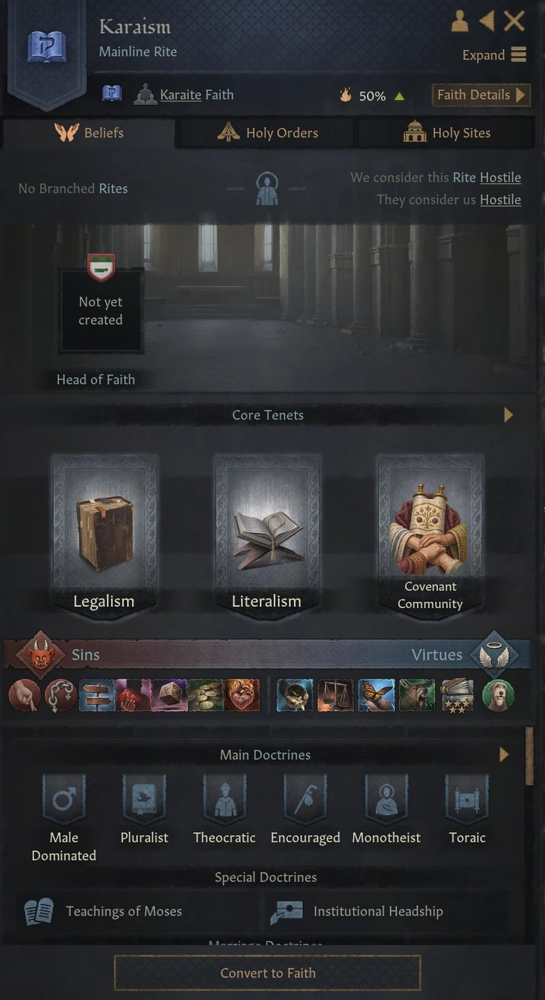
  <figcaption><strong>Karaism.</strong> Scripture alone.</figcaption>
</figure>

<figure class="shot">
  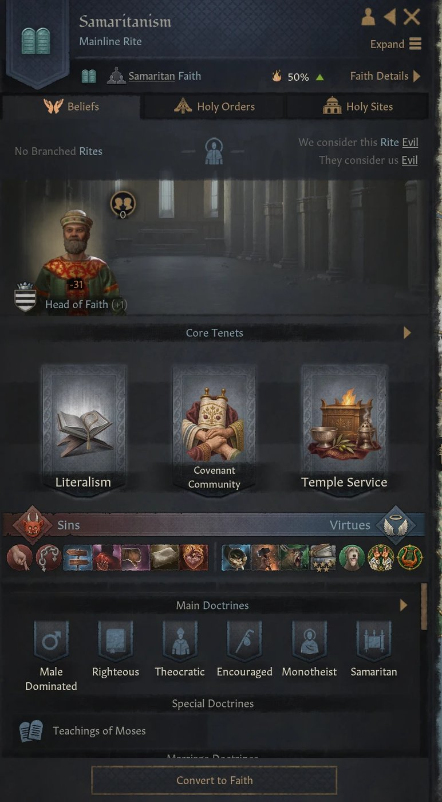
  <figcaption><strong>Samaritanism.</strong> Led by its High Priest.</figcaption>
</figure>

<figure class="shot">
  
  <figcaption><strong>The Kohen trait.</strong> Kohen Gadol Simeon, of the priestly line of Aaron.</figcaption>
</figure>

<figure class="shot">
  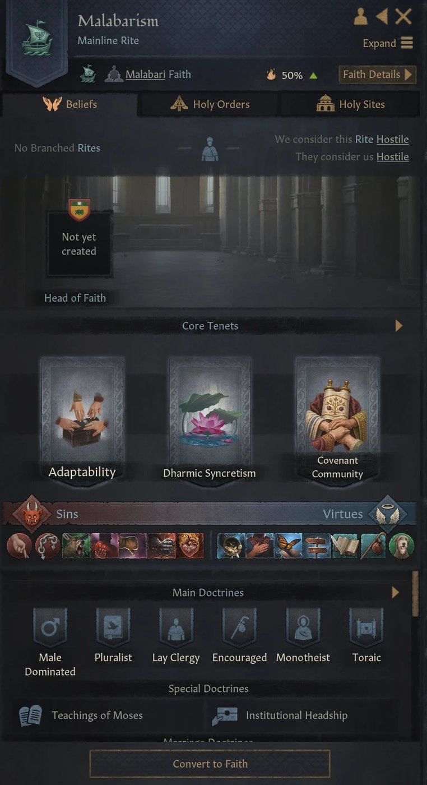
  <figcaption><strong>Malabarism.</strong> The Jews of the Malabar coast.</figcaption>
</figure>

<figure class="shot">
  
  <figcaption><strong>Haymanot.</strong> The faith of the Beta Israel.</figcaption>
</figure>

<figure class="shot">
  
  <figcaption><strong>Kuzarism.</strong> The Khazars' Judaism.</figcaption>
</figure>

### Lineages and doctrines

<figure class="shot">
  
  <figcaption><strong>Ben David.</strong> A lineage claiming descent from King David, which raises a ruler's initial legitimacy.</figcaption>
</figure>

<figure class="shot">
  
  <figcaption><strong>Levite.</strong> An inherited trait for descendants of the tribe of Levi.</figcaption>
</figure>

<figure class="shot">
  
  <figcaption><strong>Recognition of the Sages.</strong> A rite with no appointed head may acclaim a great sage as its highest voice in law.</figcaption>
</figure>

<figure class="shot">
  
  <figcaption><strong>Doctrines of the people.</strong> Marriage, descent, proselytism and peoplehood each have a Jewish doctrine.</figcaption>
</figure>

<figure class="shot shot--todo">
  
Screenshot needed<code>art-portrait-clothing.jpg</code>Portraits · community leaders in period dress

  <figcaption><strong>Period dress.</strong> Capture: two or three community leaders side by side (Ashkenazi and Sephardi) showing the custom clothing and hair.</figcaption>
</figure>

## Other centuries

<figure class="shot">
  
  <figcaption><strong>867 · Age of the Geonim.</strong> Amram Gaon leads Sura among scholars and travellers across the Jewish world.</figcaption>
</figure>

<figure class="shot">
  
  <figcaption><strong>1178 · The Paths of Torah.</strong> Moshe ben Maimon, the Rambam, writes in Fustat while other communities follow their own teachers.</figcaption>
</figure>

<figure class="shot shot--todo">
  
Screenshot needed<code>kalonymus-lucca-867.jpg</code>867 bookmark · Kalonymus of Lucca selected

  <figcaption><strong>867 · Kalonymus of Lucca.</strong> Capture: 867 bookmark, select Lucca.</figcaption>
</figure>

<figure class="shot shot--todo">
  
Screenshot needed<code>ri-troyes-1178.jpg</code>1178 bookmark · the Ri of Troyes selected

  <figcaption><strong>1178 · The Ri of Troyes.</strong> Capture: 1178 bookmark, select Troyes.</figcaption>
</figure>

The [feature guide](features.md) explains these screens. The [pre-alpha test log](https://github.com/Steinbeard/jewishcommunities/blob/master/docs/testing/2026-11-16-prealpha-screenshot-and-ui-log.md) records how the images were captured.
