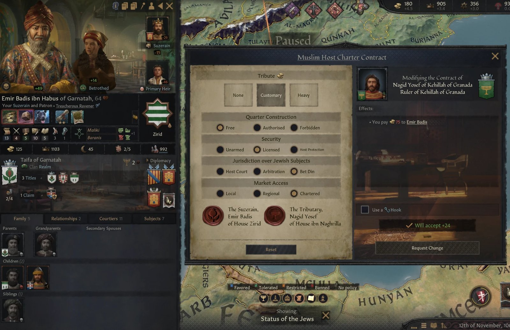
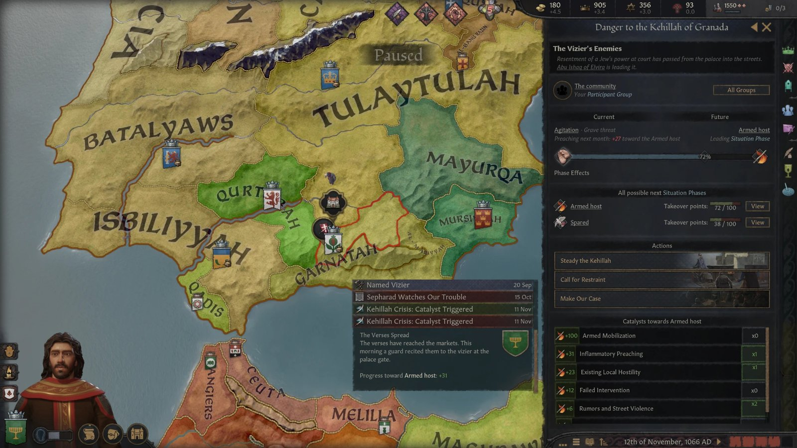
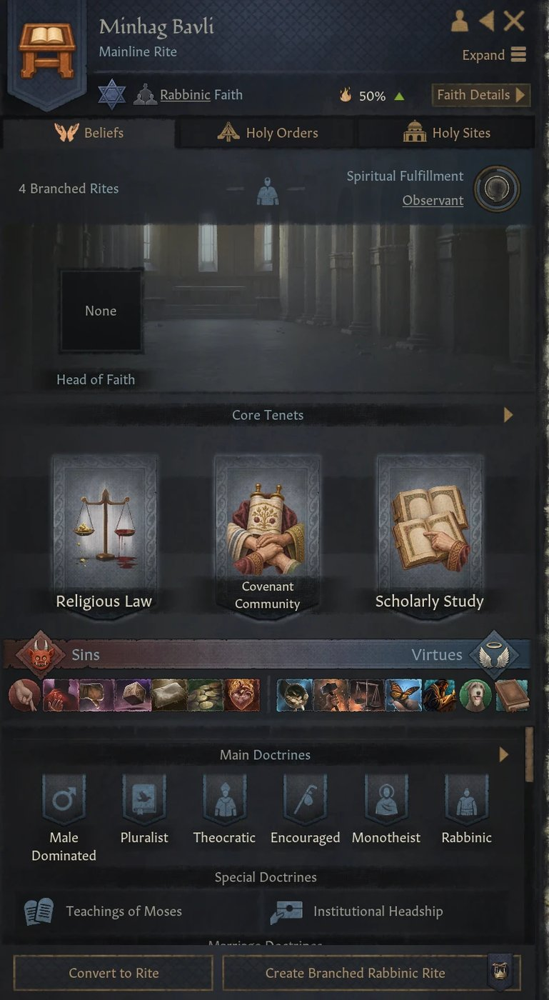
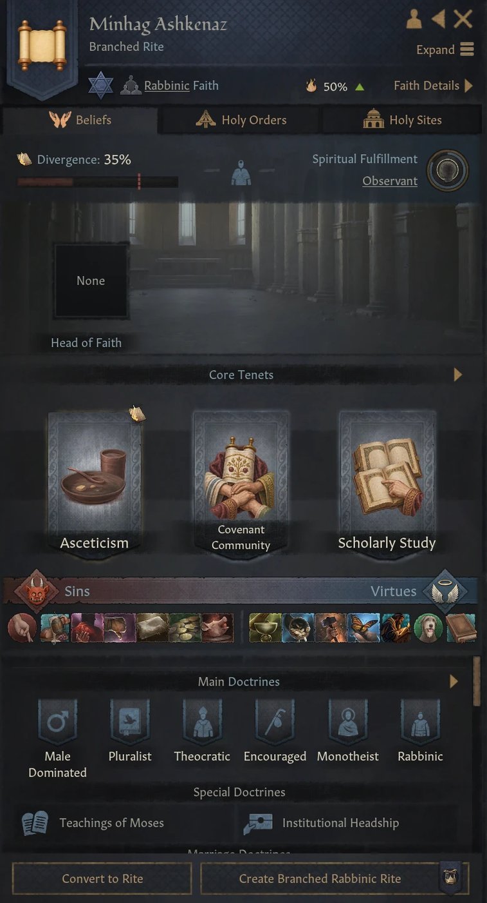
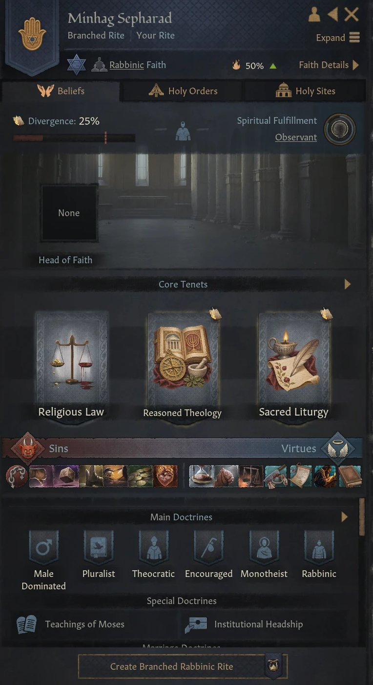
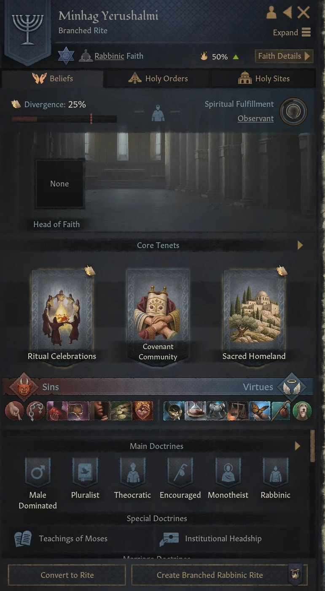
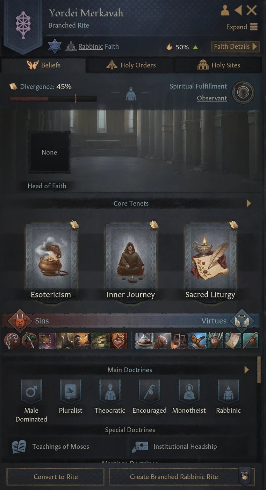

<!--
  HOW TO FILL A PLACEHOLDER
  Every dashed frame below is a <figure class="shot shot--todo"> with the target file name in it.
  1. Save the capture as docs/images/<that file name> (full-window JPG, ~1936×1119, quality ~85;
     crop out debug map-mode buttons and ID hovers; downscale tall panels to ≤1400px high).
  2. Replace the whole 
…
 with:
       " alt="<one plain sentence describing the screen>" loading="lazy">
  3. Change class="shot shot--todo" to class="shot", and delete the ….
  Figures marked shot--old show real captures from an earlier build; swap the file if you reshoot.
  Search this file for "shot--todo" to see what is still open.
-->

# In-game gallery

**Status:** pre-alpha gallery, revised 2026-11-17. Images are real game captures; exact values, portraits and layouts may change in a later build. Frames marked **Earlier build** come from older live play and still show the Kehillah of Worms era UI. Dashed frames are screens still waiting for a capture.

<nav class="gallery-index" aria-label="Gallery sections">
  <a href="#the-1066-starts">1066 starts</a>
  <a href="#a-community-you-can-see">Domain &amp; Quarter</a>
  <a href="#books-and-learning">Books &amp; learning</a>
  <a href="#council-succession-and-decisions">Council &amp; succession</a>
  <a href="#activities">Activities</a>
  <a href="#the-jewish-year">Holidays</a>
  <a href="#host-politics-and-crisis">Host politics &amp; crisis</a>
  <a href="#art-and-icons">Art &amp; icons</a>
  <a href="#other-centuries">Other centuries</a>
</nav>

## The 1066 starts

Each 1066 seat begins a different story. See the [quick starts](three-starts.md) for how to play them.

<figure class="shot">
  
  <figcaption><strong>Rashi of Troyes.</strong> A young scholar returns to a modest community. <a href="three-starts.html#rashi-of-troyes--build-a-school">Quick start</a></figcaption>
</figure>

<figure class="shot">
  
  <figcaption><strong>Joseph ibn Naghrilla of Granada.</strong> Vizier and Nagid, with a threatened Quarter to protect. <a href="three-starts.html#joseph-ibn-naghrilla-of-granada--hold-the-quarter">Quick start</a></figcaption>
</figure>

<figure class="shot">
  
  <figcaption><strong>David ben Hezekiah.</strong> An adventurer with a claim to Baghdad and a separate path to Exilarch recognition. <a href="three-starts.html#david-ben-hezekiah--reclaim-a-seat">Quick start</a></figcaption>
</figure>

<figure class="shot shot--todo">
  
Screenshot needed<code>isaac-worms-start.jpg</code>1066 bookmark · Kehillah of Worms selected

  <figcaption><strong>Isaac ben Eliezer ha-Levi of Worms.</strong> The original playable Kehillah, on the Rhine. Capture: 1066 bookmark, select the Worms seat, full window.</figcaption>
</figure>

<figure class="shot shot--todo">
  
Screenshot needed<code>rif-fez-start.jpg</code>1066 bookmark · Yitzhak Alfasi at Fez selected

  <figcaption><strong>Yitzhak Alfasi, the Rif, of Fez.</strong> He leads a North African community of legal scholarship. Capture: 1066 bookmark, select the Fez seat, full window.</figcaption>
</figure>

## A community you can see

<figure class="shot">
  
  <figcaption><strong>Troyes Domain.</strong> Rashi chooses whom his community follows: three illustrated leadership tiles sit beside the Quarter card.</figcaption>
</figure>

<figure class="shot">
  
  <figcaption><strong>The three pillars.</strong> The same Domain view shows where Troyes stands in Prosperity, Stability and Greatness.</figcaption>
</figure>

<figure class="shot">
  
  <figcaption><strong>Granada under pressure.</strong> Nagid Yosef's community is prosperous and learned, but its Domain view flags it as Dangerous and in crisis. Income shows what the Quarter, Prosperity and tribute to the host each add or take.</figcaption>
</figure>

<figure class="shot">
  
  <figcaption><strong>Granada's Jewish Quarter.</strong> Synagogue, house of debate, ledger room, market and other buildings each have an illustrated place. Cropped to remove debug map controls.</figcaption>
</figure>

<figure class="shot shot--todo">
  
Screenshot needed<code>quarter-building-tooltip.jpg</code>Quarter · hover a locked building tier

  <figcaption><strong>What a building needs.</strong> A higher tier's tooltip shows its cost and the pillar band it requires. Capture: open the Quarter, hover a tier that is gated by a pillar band; crop to the Quarter and tooltip.</figcaption>
</figure>

<figure class="shot">
  
  <figcaption><strong>Córdoba on the map.</strong> A community card names its leader, age, pillar standings and danger, and links to its host, Quarter and library.</figcaption>
</figure>

<figure class="shot shot--todo">
  
Screenshot needed<code>jewish-map-mode.jpg</code>Map · Jewish map-mode category, zoomed out

  <figcaption><strong>The Jewish world map.</strong> The map mode colours where communities live, from Iberia to the Rhineland and the Near East. Capture: Jewish category in the map-mode bar, zoomed out over Europe and the Mediterranean, with no debug ID hovers.</figcaption>
</figure>

<figure class="shot">
  
  <figcaption><strong>A realm's communities together.</strong> Garnatah's view shows Emir Badis, his policy and outlook, both of his communities (most endangered first), Granada's charter terms and ten years of realm news.</figcaption>
</figure>

<figure class="shot shot--todo">
  
Screenshot needed<code>world-ledger.jpg</code>Domain → Standing · World Ledger

  <figcaption><strong>The World Ledger.</strong> Every led community ranked by Standing or by any pillar. Capture: click the Standing line on the Domain tab; sort by one pillar so the column header is visibly active.</figcaption>
</figure>

<figure class="shot shot--todo">
  
Screenshot needed<code>danger-breakdown.jpg</code>Tooltip · community danger breakdown

  <figcaption><strong>Why a community is in danger.</strong> Capture: hover the danger value on a community card; crop tightly to the tooltip.</figcaption>
</figure>

<figure class="shot shot--todo">
  
Screenshot needed<code>language-breakdown.jpg</code>Tooltip · languages of the community

  <figcaption><strong>Languages spoken.</strong> Capture: hover the language line on the community view; crop tightly to the tooltip.</figcaption>
</figure>

## Books and learning

<figure class="shot">
  
  <figcaption><strong>The library shelf.</strong> Granada's Beit Midrash holds its physical copies, sorted by subject. Each book shows its canonicity, author, language and whether you have mastered it.</figcaption>
</figure>

<figure class="shot">
  
  <figcaption><strong>Parshanut.</strong> The Torah sits in its ark among the commentaries.</figcaption>
</figure>

<figure class="shot">
  
  <figcaption><strong>Machshavah.</strong> Philosophy, including the contested Theology of Aristotle.</figcaption>
</figure>

<figure class="shot">
  
  <figcaption><strong>The Sefarim Ledger.</strong> Every work your community knows, ranked for your rite. Under Minhag Sepharad, Anan's Karaite code is Banned.</figcaption>
</figure>

<figure class="shot">
  
  <figcaption><strong>Another tradition's view.</strong> Switch the ledger to Karaism and the same book is Authoritative.</figcaption>
</figure>

<figure class="shot">
  
  <figcaption><strong>The Rabbi trait.</strong> Three tracks of study, Parshanut, Talmudics and Machshavah, each with its own levels and rewards.</figcaption>
</figure>

<figure class="shot">
  
  <figcaption><strong>The Hakhamim.</strong> The Rabbinic faith's clergy: rabbis from Mainz to Sura, ranked side by side.</figcaption>
</figure>

<figure class="shot shot--todo">
  
Screenshot needed<code>learning-window.jpg</code>Character · list of books read

  <figcaption><strong>A scholar's learning.</strong> Every book a character has studied, like a list of memories. Capture: a well-read rabbi (Rashi or the Rambam); open the learning list from the character window.</figcaption>
</figure>

<figure class="shot shot--todo">
  
Screenshot needed<code>study-library-decision.jpg</code>Decisions · study from the library

  <figcaption><strong>Choosing what to study.</strong> Capture: open the study decision so its custom book picker is visible.</figcaption>
</figure>

<figure class="shot shot--todo">
  
Screenshot needed<code>event-writing-a-sefer.jpg</code>Event · “What to Write”

  <figcaption><strong>Writing a sefer.</strong> A scholar decides what his book will argue. Capture: start writing a book, or console <code>event kehillah_book.0001</code>.</figcaption>
</figure>

<figure class="shot shot--todo">
  
Screenshot needed<code>event-approbation.jpg</code>Event · “A Request for an Approbation”

  <figcaption><strong>Approbations and bans.</strong> Another scholar asks you to endorse his book. Capture: console <code>event kehillah_sefer.0301</code>.</figcaption>
</figure>

## Council, succession and decisions

<figure class="shot">
  
  <figcaption><strong>The council.</strong> The Parnasit beside the Dayyan, Shtadlan, Gabbai, Rosh ha-Shmirah and Ne'eman, each with a task.</figcaption>
</figure>

<figure class="shot shot--old">
  
  <figcaption>Earlier build <strong>Community decisions.</strong> Write a sefer, send out settlers, learn Torah, convene the Bet Din and more.</figcaption>
</figure>

<figure class="shot shot--todo">
  
Screenshot needed<code>succession-candidates.jpg</code>My Realm → Succession · candidate scores

  <figcaption><strong>Choosing the next leader.</strong> Candidates, their scores and any endorsement. Capture: My Realm → Succession with at least three candidates listed.</figcaption>
</figure>

<figure class="shot shot--old">
  
  <figcaption>Earlier build <strong>Leadership passes.</strong> Rav Isaac dies and the council's appointee, Parnas Netaniel, takes office.</figcaption>
</figure>

<figure class="shot shot--todo">
  
Screenshot needed<code>community-scheme.jpg</code>Scheme window · community scheme widget

  <figcaption><strong>Community schemes.</strong> Capture: start a community scheme and open its window so the custom widget is visible.</figcaption>
</figure>

## Activities

<figure class="shot shot--old">
  
  <figcaption>Earlier build <strong>Convening a Bet Din.</strong> The planning window for a regional rabbinical court.</figcaption>
</figure>

<figure class="shot shot--todo">
  
Screenshot needed<code>bet-din-case.jpg</code>Bet Din · a case or responsum event mid-sitting

  <figcaption><strong>A case before the court.</strong> Three judges weigh learned sources, or write to another rabbi for a responsum. Capture: any case event during a Bet Din sitting.</figcaption>
</figure>

<figure class="shot">
  
  <figcaption><strong>A Bet Din sitting.</strong> The conclusion of a sitting, with the host and two guest judges.</figcaption>
</figure>

<figure class="shot">
  
  <figcaption><strong>An invitation to sit.</strong> Other communities invite you to their Bet Din. Parnas Isaac of Burgos writes to Nagid Yosef of Granada.</figcaption>
</figure>

<figure class="shot shot--todo">
  
Screenshot needed<code>learn-torah-journey-plan.jpg</code>Activity planner · Journey to Learn Torah

  <figcaption><strong>A journey to learn Torah.</strong> A student travels to a foreign Beit Midrash. Capture: the activity planner with its custom header art and destination chosen.</figcaption>
</figure>

<figure class="shot shot--todo">
  
Screenshot needed<code>event-foreign-beit-midrash.jpg</code>Event · “A Foreign Beit Midrash”

  <figcaption><strong>Arriving to study.</strong> Capture: during the journey, or console <code>event kehillah_learn_torah_journey.0001</code>.</figcaption>
</figure>

<figure class="shot shot--todo">
  
Screenshot needed<code>event-synod.jpg</code>Event · “The Voice of the Generation”

  <figcaption><strong>A synod of rabbis.</strong> Capture: console <code>event kehillah_synod.0005</code>, if the synod is reachable in this build.</figcaption>
</figure>

## The Jewish year

Holidays follow the Hebrew calendar and arrive as household events, with different stories for different rites and seasons.

<figure class="shot shot--old">
  
  <figcaption>Earlier build <strong>Rosh Hashanah: An Omen in the Honey.</strong> At the New Year's meal a candle gutters, and the household wonders what it means.</figcaption>
</figure>

<figure class="shot shot--todo">
  
Screenshot needed<code>holiday-yom-kippur.jpg</code>Yom Kippur · “The Last Hour”

  <figcaption><strong>Yom Kippur.</strong> The closing hour of the fast. Capture: console <code>event jewish_holidays.0010</code>.</figcaption>
</figure>

<figure class="shot shot--todo">
  
Screenshot needed<code>holiday-sukkot.jpg</code>Sukkot · “A Gap in the Roof”

  <figcaption><strong>Sukkot.</strong> A family's sukkah. Capture: console <code>event jewish_holidays.0011</code>.</figcaption>
</figure>

<figure class="shot shot--todo">
  
Screenshot needed<code>holiday-hanukkah.jpg</code>Hanukkah · “Light in the Window”

  <figcaption><strong>Hanukkah.</strong> Lamps set where the street can see them. Capture: console <code>event jewish_holidays.0006</code>.</figcaption>
</figure>

<figure class="shot shot--todo">
  
Screenshot needed<code>holiday-purim.jpg</code>Purim · “Ad Lo Yada”

  <figcaption><strong>Purim.</strong> A festival of masks and wine. Capture: console <code>event jewish_holidays.0007</code>.</figcaption>
</figure>

<figure class="shot shot--todo">
  
Screenshot needed<code>holiday-pesach.jpg</code>Pesach · “The Four Questions”

  <figcaption><strong>Pesach.</strong> The youngest at the table asks the Four Questions. Capture: console <code>event jewish_holidays.0003</code>.</figcaption>
</figure>

<figure class="shot shot--todo">
  
Screenshot needed<code>holiday-feast-pesach.jpg</code>Holiday feast activity · Pesach variant

  <figcaption><strong>A festival feast.</strong> Hosting a holiday feast swaps in Pesach, Shavuot or Sukkot dishes and stories. Capture: host a feast during Pesach and screenshot its Pesach-specific event.</figcaption>
</figure>

## Host politics and crisis

<figure class="shot shot--old">
  
  <figcaption>Earlier build <strong>The Charter Renewed.</strong> The host confirms the community's terms for building, protection, jurisdiction and study.</figcaption>
</figure>

<figure class="shot">
  
  <figcaption><strong>Negotiating the charter.</strong> Tribute, building rights, security, jurisdiction and market access are terms you can ask the host to change.</figcaption>
</figure>

<figure class="shot shot--todo">
  
Screenshot needed<code>settlement-policy.jpg</code>Realm laws · Jewish Settlement Policy

  <figcaption><strong>Jewish Settlement Policy.</strong> A realm-wide law from Banned to Encouraged. Capture: the host ruler's realm laws with the policy row and its tooltip visible.</figcaption>
</figure>

<figure class="shot shot--todo">
  
Screenshot needed<code>nagid-audience.jpg</code>Event · “An Audience: the Head of the Jews”

  <figcaption><strong>The Nagid.</strong> A Muslim ruler's office for the leader of his Jews. Capture: Granada 1066, or console <code>event kehillah_nagid.0001</code>.</figcaption>
</figure>

<figure class="shot shot--old">
  
  <figcaption>Earlier build <strong>An Accusation.</strong> A false charge spreads, and the community must choose how to answer it.</figcaption>
</figure>

<figure class="shot">
  
  <figcaption><strong>Sinister Verses.</strong> In Granada, a hostile poem by Abu Ishaq of Elvira reaches the Nagid, and how he answers it shapes the crisis.</figcaption>
</figure>

<figure class="shot">
  
  <figcaption><strong>A community threat.</strong> Armed host and Spared race toward 100 while catalysts push the totals and the window offers responses.</figcaption>
</figure>

<figure class="shot shot--narrow">
  
  <figcaption><strong>Community Safety.</strong> The Military window lists crises under way, the yearly danger, its sources and what protects the community.</figcaption>
</figure>

<figure class="shot shot--todo">
  
Screenshot needed<code>crisis-defence.jpg</code>Military view · defending the Quarter

  <figcaption><strong>Holding the Quarter.</strong> If violence begins, a second race decides whether the Quarter is held. Capture: the crisis military panel during the violence phase.</figcaption>
</figure>

<figure class="shot shot--todo">
  
Screenshot needed<code>event-gate-held.jpg</code>Event · “The Gate Held”

  <figcaption><strong>The gate held.</strong> Console <code>event kehillah_crisis_held.0001</code>.</figcaption>
</figure>

<figure class="shot shot--todo">
  
Screenshot needed<code>event-rebuilding.jpg</code>Event · “Rebuilding”

  <figcaption><strong>Aftermath.</strong> Console <code>event kehillah_aftermath.0003</code>.</figcaption>
</figure>

<figure class="shot shot--todo">
  
Screenshot needed<code>event-expulsion.jpg</code>Event · “The Edict of Expulsion”

  <figcaption><strong>Expulsion.</strong> Negotiate, leave or face removal. Console <code>event kehillah_expulsion.0001</code>.</figcaption>
</figure>

<figure class="shot shot--todo">
  
Screenshot needed<code>event-talmud-trial.jpg</code>Event · “The Talmud Denounced”

  <figcaption><strong>The Talmud on trial.</strong> Console <code>event kehillah_talmud_trial.0001</code>.</figcaption>
</figure>

## Art and icons

Custom art made for the mod. Composite sheets work well here: crop several icons onto one plain background.

<figure class="shot shot--todo">
  
Screenshot needed<code>art-bookmark-1066.jpg</code>Bookmark art · the 1066 start illustration

  <figcaption><strong>Bookmark art.</strong> Capture: the 1066 bookmark screen with no character selected, so the full illustration shows.</figcaption>
</figure>

<figure class="shot shot--todo">
  
Screenshot needed<code>art-activity-headers.jpg</code>Activity header art · Bet Din and Torah journey

  <figcaption><strong>Activity art.</strong> Composite of the two activity header illustrations.</figcaption>
</figure>

<figure class="shot shot--todo">
  
Screenshot needed<code>art-icons.png</code>Icons · traits, council offices, government

  <figcaption><strong>Traits and offices.</strong> Composite of trait, court-position and government icons.</figcaption>
</figure>

<figure class="shot shot--todo">
  
Screenshot needed<code>art-community-arms.jpg</code>Coats of arms · community emblems

  <figcaption><strong>Community emblems.</strong> Composite of three or four Kehillah coats of arms.</figcaption>
</figure>

### Rites and tenets

Each rite of the Rabbinic faith has its own icon, tenets, sins and virtues.

<figure class="shot">
  
  <figcaption><strong>Minhag Bavli.</strong> The mainline rite.</figcaption>
</figure>

<figure class="shot">
  
  <figcaption><strong>Minhag Ashkenaz.</strong></figcaption>
</figure>

<figure class="shot">
  
  <figcaption><strong>Minhag Sepharad.</strong></figcaption>
</figure>

<figure class="shot">
  
  <figcaption><strong>Minhag Yerushalmi.</strong></figcaption>
</figure>

<figure class="shot">
  
  <figcaption><strong>Yordei Merkavah.</strong> The mystics.</figcaption>
</figure>

<figure class="shot shot--todo">
  
Screenshot needed<code>art-portrait-clothing.jpg</code>Portraits · community leaders in period dress

  <figcaption><strong>Period dress.</strong> Capture: two or three community leaders side by side (Ashkenazi and Sephardi) showing the custom clothing and hair.</figcaption>
</figure>

## Other centuries

<figure class="shot">
  
  <figcaption><strong>867 · Age of the Geonim.</strong> Amram Gaon leads Sura among scholars and travellers across the Jewish world.</figcaption>
</figure>

<figure class="shot">
  
  <figcaption><strong>1178 · The Paths of Torah.</strong> Moshe ben Maimon, the Rambam, writes in Fustat while other communities follow their own teachers.</figcaption>
</figure>

<figure class="shot shot--todo">
  
Screenshot needed<code>kalonymus-lucca-867.jpg</code>867 bookmark · Kalonymus of Lucca selected

  <figcaption><strong>867 · Kalonymus of Lucca.</strong> Capture: 867 bookmark, select Lucca.</figcaption>
</figure>

<figure class="shot shot--todo">
  
Screenshot needed<code>ri-troyes-1178.jpg</code>1178 bookmark · the Ri of Troyes selected

  <figcaption><strong>1178 · The Ri of Troyes.</strong> Capture: 1178 bookmark, select Troyes.</figcaption>
</figure>

The [feature guide](features.md) explains these screens. The [pre-alpha test log](https://github.com/Steinbeard/jewishcommunities/blob/master/docs/testing/2026-11-16-prealpha-screenshot-and-ui-log.md) records how the images were captured.
