# In-game gallery

**Status:** pre-alpha gallery, revised 2026-11-17. Every image is a real game capture; exact values, portraits and layouts may change in a later build. Frames marked **Earlier build** come from older live play and still show the Kehillah of Worms era UI.

The gallery follows a community's life: choosing a start, running the community, learning and writing, the Bet Din, relations with the host, and the crises that can end it all.

<nav class="gallery-index" aria-label="Gallery sections">
  <a href="#starts">Starts</a>
  <a href="#your-community">Your community</a>
  <a href="#the-jewish-world">The Jewish world</a>
  <a href="#books-and-learning">Books &amp; learning</a>
  <a href="#study-at-a-yeshiva">Yeshiva</a>
  <a href="#the-bet-din">Bet Din</a>
  <a href="#the-host-and-the-charter">Host &amp; charter</a>
  <a href="#crises">Crises</a>
  <a href="#faiths-and-lineages">Faiths &amp; lineages</a>
</nav>

## Starts

Each 1066 seat begins a different story. See the [quick starts](three-starts.md) for how to play them.

<figure class="shot">
  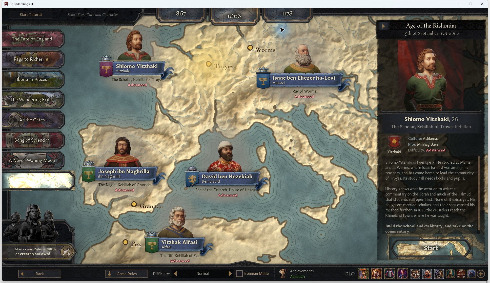
  <figcaption><strong>Rashi of Troyes.</strong> A young scholar returns to a modest community. <a href="three-starts.html#rashi-of-troyes--build-a-school">Quick start</a></figcaption>
</figure>

<figure class="shot">
  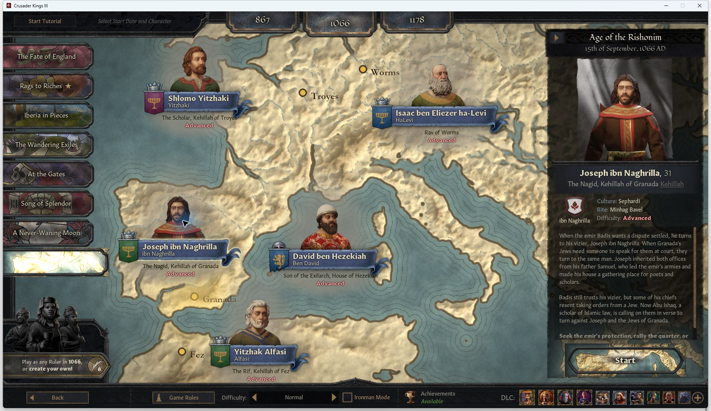
  <figcaption><strong>Joseph ibn Naghrilla of Granada.</strong> Vizier and Nagid, with a threatened Quarter to protect. <a href="three-starts.html#joseph-ibn-naghrilla-of-granada--hold-the-quarter">Quick start</a></figcaption>
</figure>

<figure class="shot">
  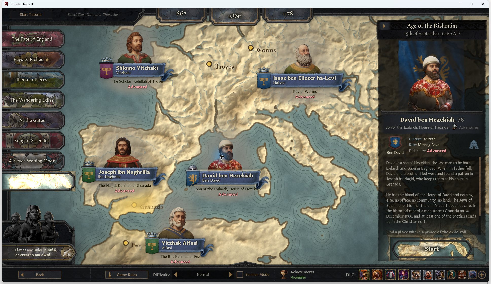
  <figcaption><strong>David ben Hezekiah.</strong> An adventurer with a claim to Baghdad and a separate path to Exilarch recognition. <a href="three-starts.html#david-ben-hezekiah--reclaim-a-seat">Quick start</a></figcaption>
</figure>

<figure class="shot">
  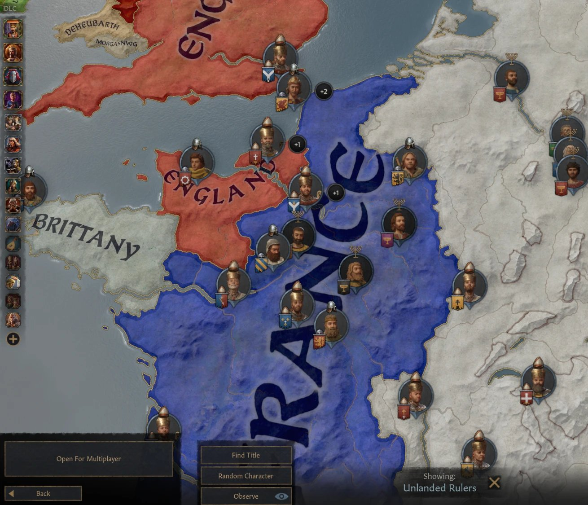
  <figcaption><strong>Any community leader.</strong> Beyond the featured seats, the Unlanded Rulers view in character selection marks community leaders with menorah banners.</figcaption>
</figure>

### Other centuries

<figure class="shot">
  
  <figcaption><strong>867 · Age of the Geonim.</strong> Amram Gaon leads Sura among scholars and travellers across the Jewish world.</figcaption>
</figure>

<figure class="shot">
  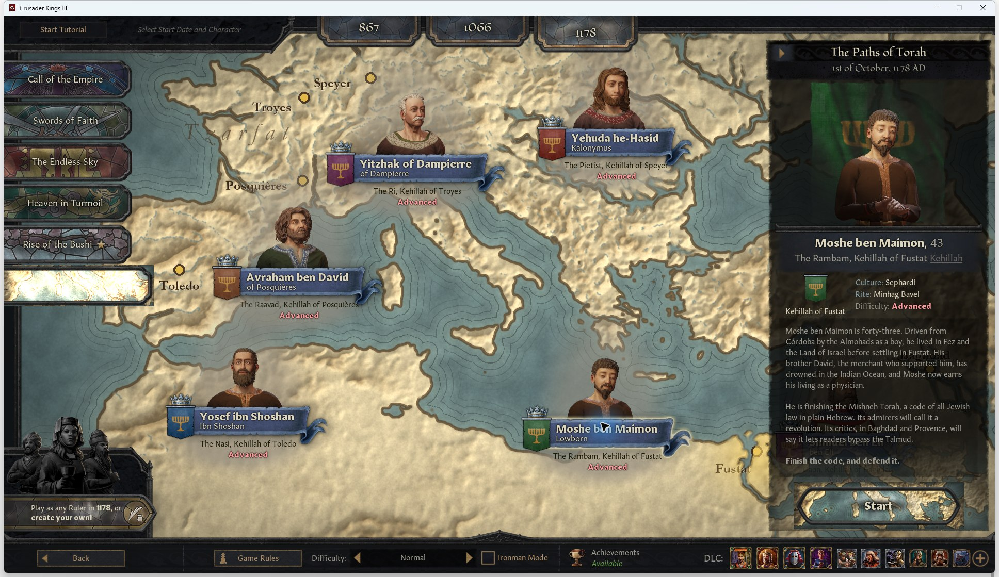
  <figcaption><strong>1178 · The Paths of Torah.</strong> Moshe ben Maimon, the Rambam, writes in Fustat while other communities follow their own teachers.</figcaption>
</figure>

## Your community

A Kehillah has no land of its own. It lives in a host's county, measured by three pillars: Prosperity, Stability and Greatness.

### The Domain and the Quarter

<figure class="shot">
  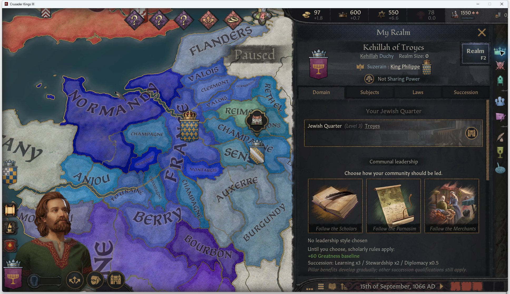
  <figcaption><strong>The Domain.</strong> Rashi chooses whom his community follows: three illustrated leadership tiles sit beside the Quarter card.</figcaption>
</figure>

<figure class="shot">
  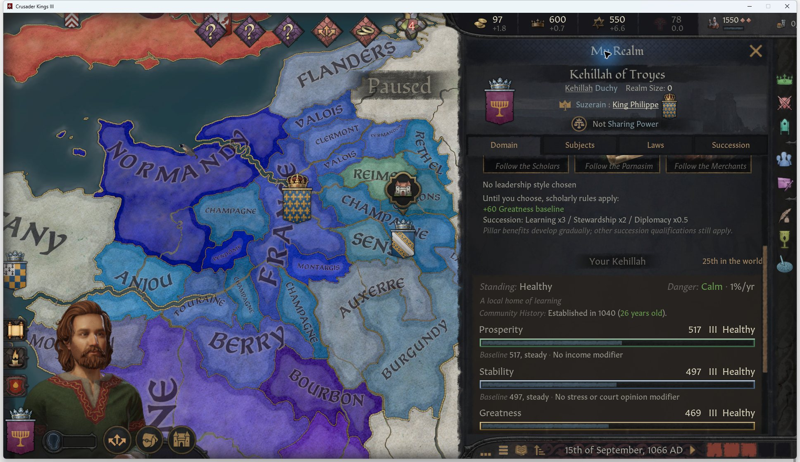
  <figcaption><strong>The three pillars.</strong> The same view shows where Troyes stands in Prosperity, Stability and Greatness.</figcaption>
</figure>

<figure class="shot">
  
  <figcaption><strong>Granada under pressure.</strong> Nagid Yosef's community is prosperous and learned, but the Domain flags it as Dangerous and in crisis. Income shows what the Quarter, Prosperity and tribute to the host each add or take.</figcaption>
</figure>

<figure class="shot">
  
  <figcaption><strong>The Jewish Quarter.</strong> Synagogue, house of debate, ledger room, market and other buildings each have an illustrated place in Granada's Quarter.</figcaption>
</figure>

<figure class="shot shot--narrow-wide">
  
  <figcaption><strong>Laws of the community.</strong> Choose whom the community follows (scholars, parnasim or merchants), read the charter's terms and petition the host to revise them.</figcaption>
</figure>

### Council and succession

<figure class="shot">
  
  <figcaption><strong>The council.</strong> The Parnasit beside the Dayyan, Shtadlan, Gabbai, Rosh ha-Shmirah and Ne'eman, each with a task.</figcaption>
</figure>

<figure class="shot shot--old">
  
  <figcaption>Earlier build <strong>Community decisions.</strong> Write a sefer, send out settlers, learn Torah, convene the Bet Din and more.</figcaption>
</figure>

<figure class="shot">
  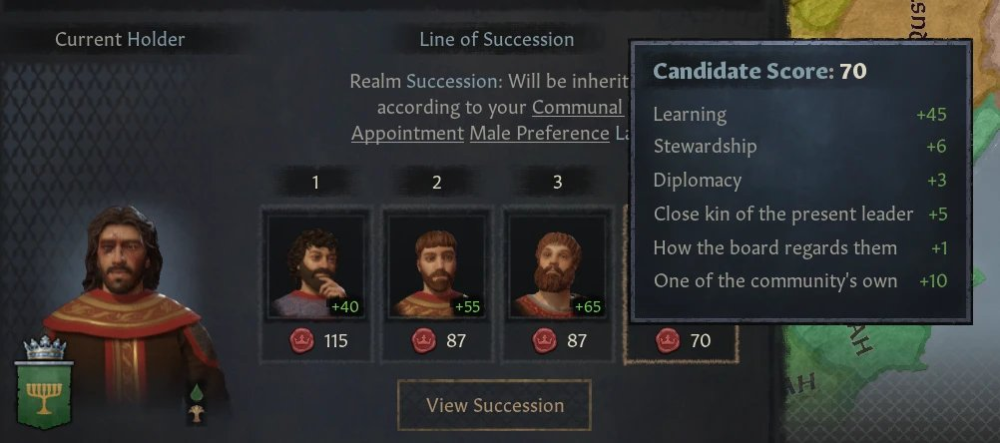
  <figcaption><strong>Choosing the next leader.</strong> Candidates are ranked by score. Hover one to see how learning, stewardship, kinship, the board's regard and being one of the community's own add up.</figcaption>
</figure>

<figure class="shot shot--old">
  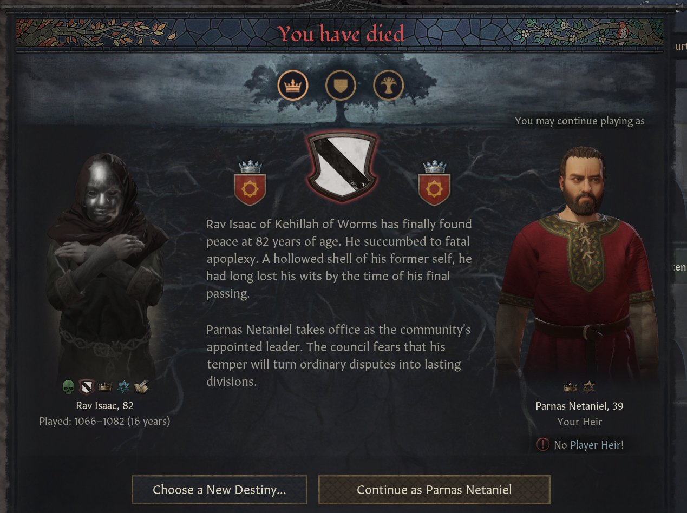
  <figcaption>Earlier build <strong>Leadership passes.</strong> Rav Isaac dies and the council's appointee, Parnas Netaniel, takes office.</figcaption>
</figure>

### Community life

<figure class="shot">
  
  <figcaption><strong>Before the Congregation.</strong> Ask your Dayyan to preach: the week's portion, neighbourly duty, tzedakah, peace with the city, or comfort in hard times.</figcaption>
</figure>

<figure class="shot">
  
  <figcaption><strong>From the Bimah.</strong> Rav Isaac preaches on Nachum of Gamzo's "this too is for the good".</figcaption>
</figure>

<figure class="shot shot--narrow-wide">
  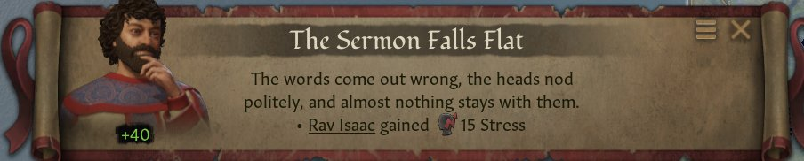
  <figcaption><strong>Not every sermon lands.</strong> A poor sermon costs the preacher stress.</figcaption>
</figure>

<figure class="shot">
  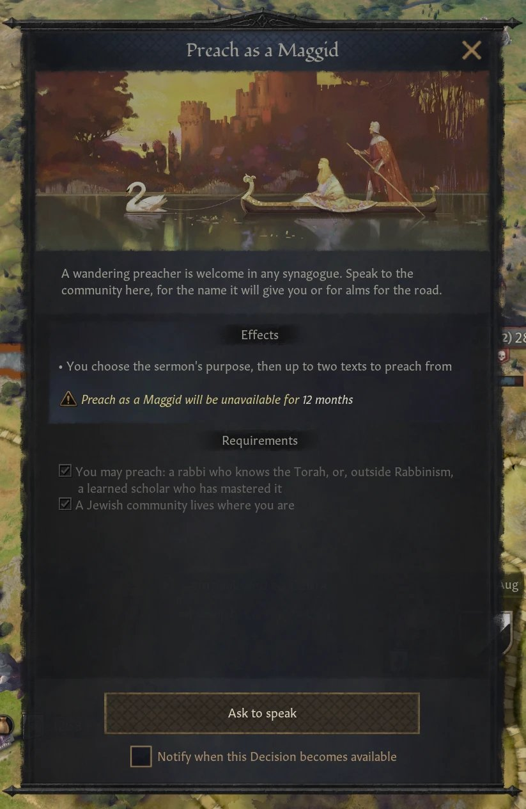
  <figcaption><strong>Preach as a Maggid.</strong> A wandering preacher may speak in any synagogue, for a name or for alms.</figcaption>
</figure>

<figure class="shot">
  
  <figcaption><strong>Found a Jewish Community.</strong> An adventurer with ten Jewish followers can settle, and the camp becomes a Kehillah.</figcaption>
</figure>

<figure class="shot shot--old">
  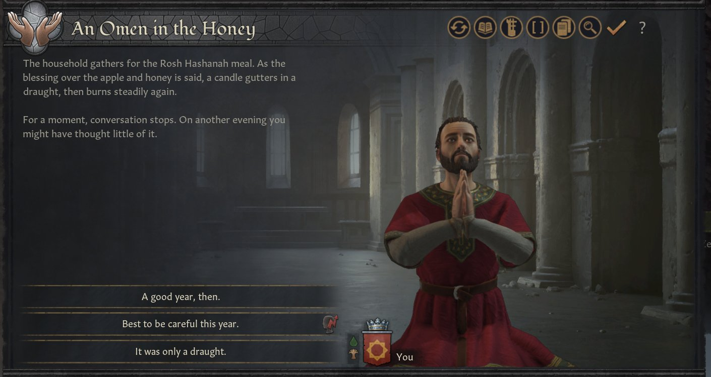
  <figcaption>Earlier build <strong>The Jewish year.</strong> Holidays follow the Hebrew calendar and arrive as household events. At this Rosh Hashanah meal a candle gutters, and the household wonders what it means.</figcaption>
</figure>

## The Jewish world

Communities live across Europe, North Africa and the Near East. Six Jewish map modes show where they are and what they face, and each host realm has a view of the communities it hears.

<figure class="shot">
  
  <figcaption><strong>Community Rites.</strong> Each quarter is coloured by the rite its leader follows. The other map modes show communities, crises, each realm's law on its Jews, libraries and native Jewish cultures.</figcaption>
</figure>

<figure class="shot">
  
  <figcaption><strong>Status of the Jews.</strong> Each realm's law on its Jews, set by its top liege, from favored to banned.</figcaption>
</figure>

<figure class="shot">
  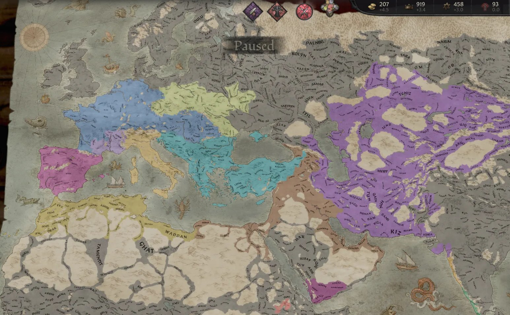
  <figcaption><strong>Jewish Cultures.</strong> Each land is coloured by its native Jewish culture, from Iberia and the Rhineland to Central Asia.</figcaption>
</figure>

<figure class="shot">
  
  <figcaption><strong>Community Crises.</strong> Hover a community to see its crisis, its cause and its danger of violence.</figcaption>
</figure>

<figure class="shot">
  
  <figcaption><strong>A community card.</strong> Select a county to see its community: Toledo's leader, founding date, pillars, yearly danger, and links to its host, Quarter and library.</figcaption>
</figure>

<figure class="shot">
  
  <figcaption><strong>Córdoba.</strong> The same card for another Iberian community.</figcaption>
</figure>

### Host realms

<figure class="shot">
  
  <figcaption><strong>The Empire's communities.</strong> Kaiser Heinrich IV hears six communities, from Worms to Praha, all calm in 1066. Each realm's view shows its policy, its ruler's outlook, every community (most endangered first) and ten years of news.</figcaption>
</figure>

<figure class="shot">
  
  <figcaption><strong>Garnatah.</strong> Emir Badis favours his Jews, but Granada is already in danger.</figcaption>
</figure>

<figure class="shot">
  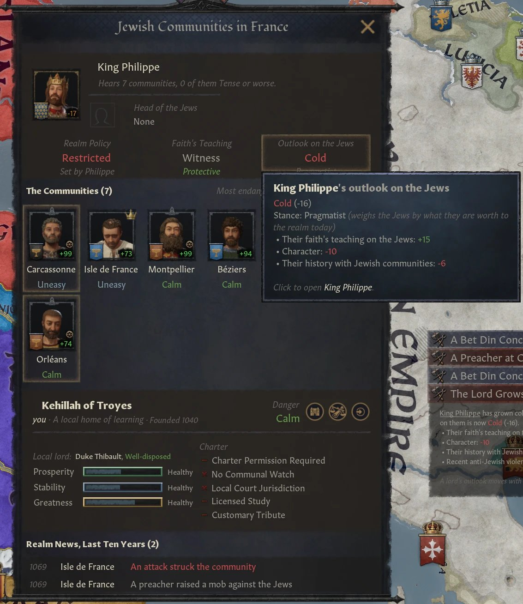
  <figcaption><strong>France.</strong> By 1069 King Philippe restricts his Jews and his outlook has turned Cold. Hover it to see why.</figcaption>
</figure>

## Books and learning

Every community keeps a library in its Beit Midrash. Its leaders study the books, write new ones, and argue over which deserve authority.

### The library

<figure class="shot">
  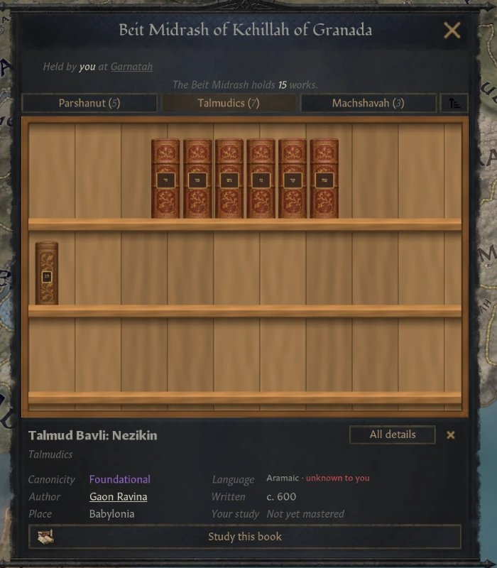
  <figcaption><strong>The shelf.</strong> Granada's Beit Midrash holds its physical copies, sorted into Parshanut, Talmudics and Machshavah. Each book shows its canonicity, author, language and whether you have mastered it.</figcaption>
</figure>

<figure class="shot">
  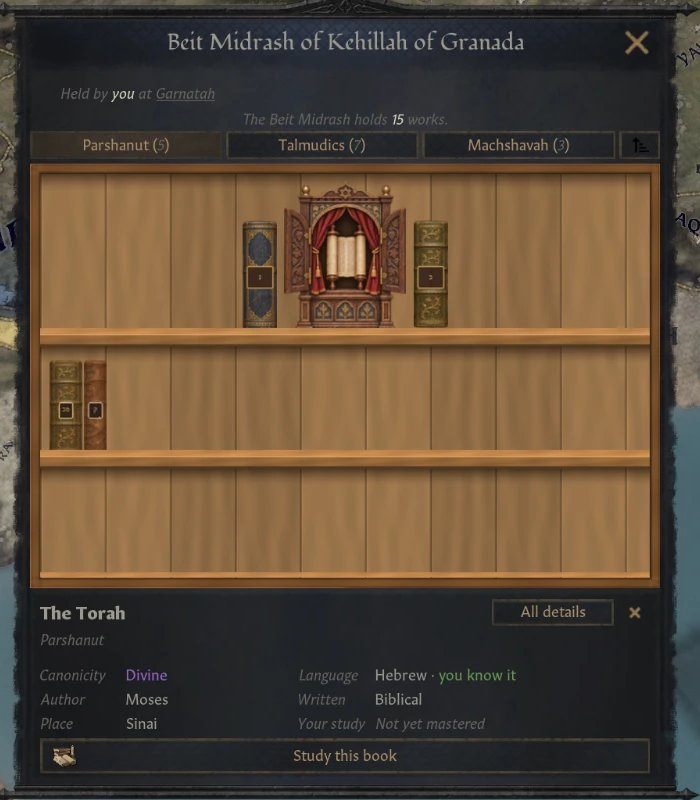
  <figcaption><strong>Parshanut.</strong> The Torah sits in its ark among the commentaries.</figcaption>
</figure>

<figure class="shot">
  
  <figcaption><strong>Machshavah.</strong> Philosophy, including the contested Theology of Aristotle.</figcaption>
</figure>

<figure class="shot">
  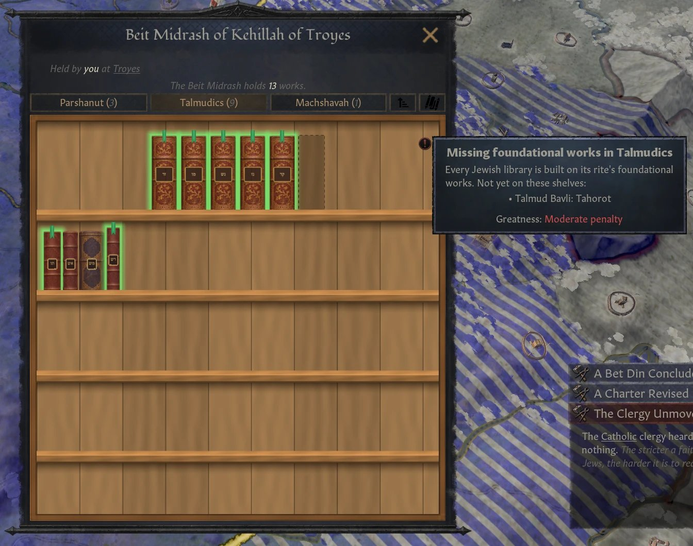
  <figcaption><strong>A gap on the shelf.</strong> Every library is built on its rite's foundational works. Troyes lacks Talmud Bavli: Tahorot, and its Greatness suffers until it is found.</figcaption>
</figure>

<figure class="shot">
  
  <figcaption><strong>How Shall We Acquire It?</strong> Worms holds the missing order. Buy a surplus copy, commission their scriptorium, or borrow the exemplar for your own scribe.</figcaption>
</figure>

<figure class="shot">
  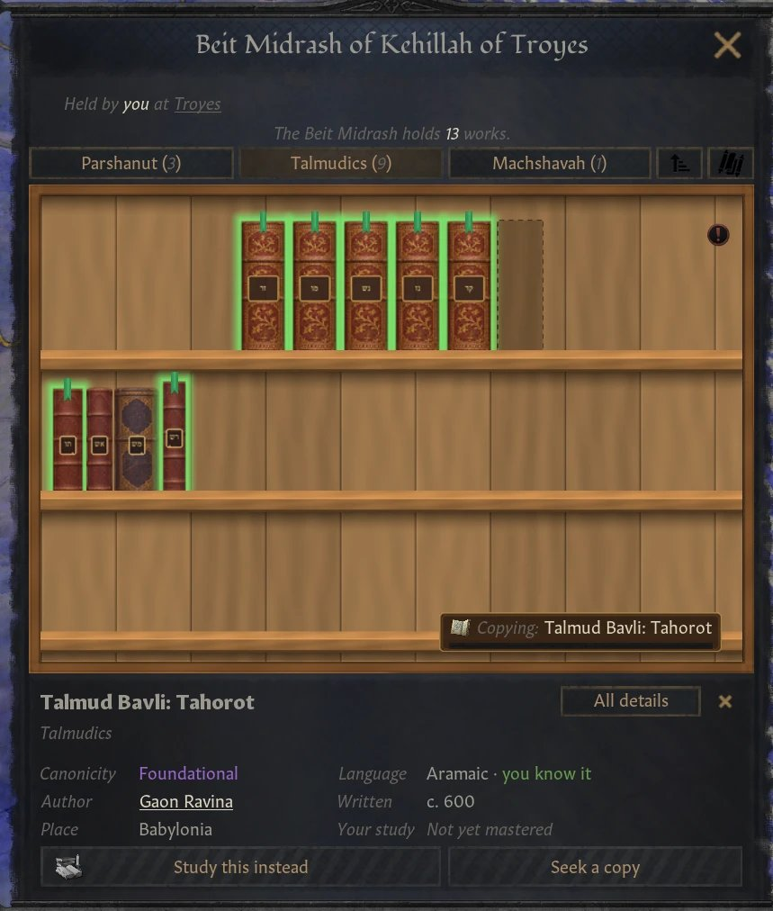
  <figcaption><strong>Copying under way.</strong> The shelf shows the copy in progress.</figcaption>
</figure>

<figure class="shot">
  
  <figcaption><strong>Redeem Seized Books.</strong> Books taken from Jewish shelves come up for sale; ransoming one is a mitzvah.</figcaption>
</figure>

<figure class="shot">
  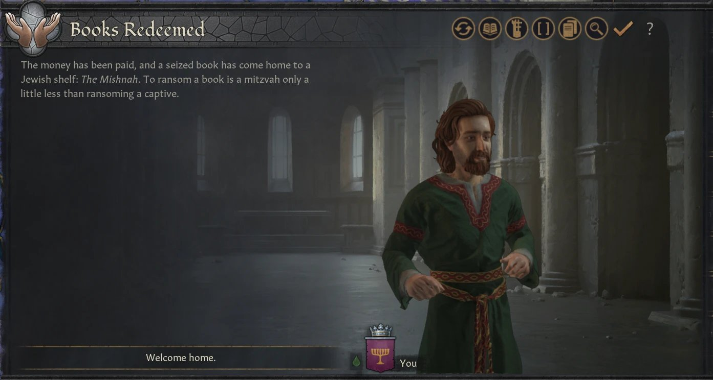
  <figcaption><strong>Books Redeemed.</strong> The Mishnah comes home to a Jewish shelf.</figcaption>
</figure>

<figure class="shot">
  
  <figcaption><strong>The Sefarim Ledger.</strong> Every work your community knows, ranked for your rite. Under Minhag Sepharad, Anan's Karaite code is Banned.</figcaption>
</figure>

<figure class="shot">
  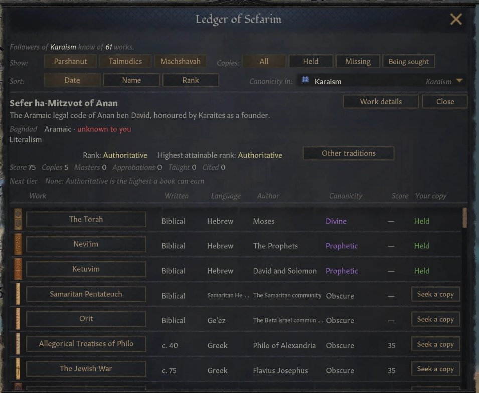
  <figcaption><strong>Another tradition's view.</strong> Switch the ledger to Karaism and the same book is Authoritative.</figcaption>
</figure>

### Study

<figure class="shot shot--narrow-wide">
  
  <figcaption><strong>Studying a book.</strong> Study runs as a personal scheme, with its own book art, success chance and time to completion.</figcaption>
</figure>

<figure class="shot">
  
  <figcaption><strong>The next book.</strong> Finishing a book offers the next one in each field, or a return to the Beit Midrash to choose.</figcaption>
</figure>

<figure class="shot">
  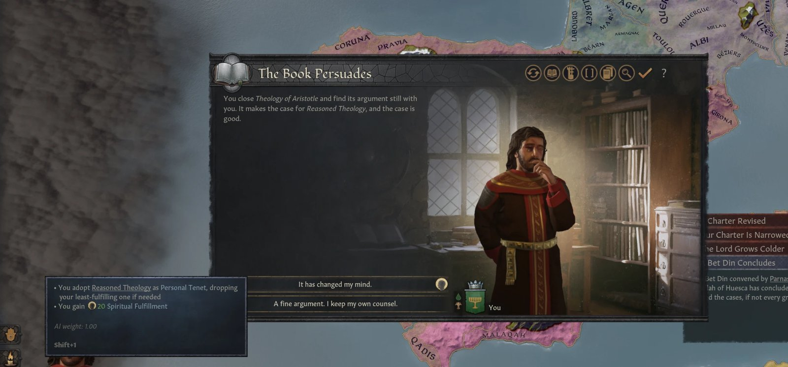
  <figcaption><strong>The Book Persuades.</strong> A book can change your mind. The Theology of Aristotle argues for Reasoned Theology as a personal tenet.</figcaption>
</figure>

<figure class="shot">
  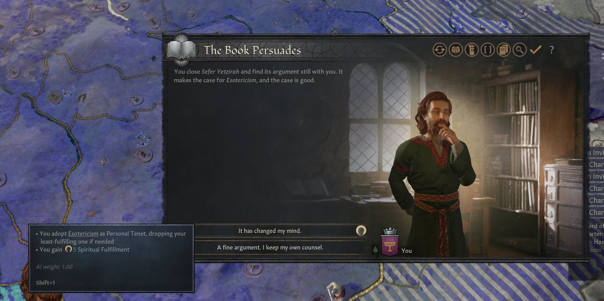
  <figcaption><strong>A different book, a different case.</strong> Sefer Yetzirah argues instead for Esotericism.</figcaption>
</figure>

<figure class="shot">
  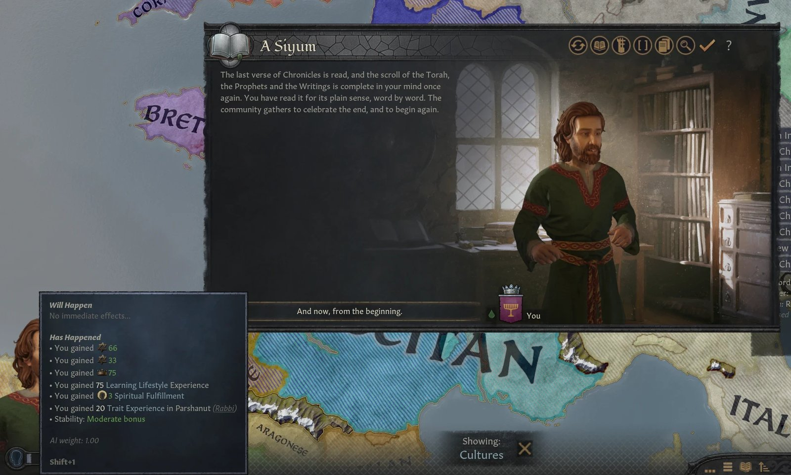
  <figcaption><strong>A Siyum.</strong> Finishing the whole of Scripture, the community gathers to celebrate the end and to begin again.</figcaption>
</figure>

<figure class="shot">
  
  <figcaption><strong>A scholar's learning.</strong> Every work a character has mastered, in the order learned.</figcaption>
</figure>

<figure class="shot">
  
  <figcaption><strong>What you have mastered.</strong> Mastered books glow on the shelf.</figcaption>
</figure>

<figure class="shot">
  
  <figcaption><strong>The Rabbi trait.</strong> Three tracks of study, Parshanut, Talmudics and Machshavah, each with its own levels and rewards.</figcaption>
</figure>

<figure class="shot">
  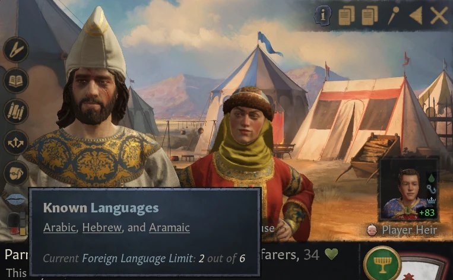
  <figcaption><strong>Languages of learning.</strong> Hebrew and Aramaic open the books written in them.</figcaption>
</figure>

<figure class="shot">
  
  <figcaption><strong>The Hakhamim.</strong> The Rabbinic faith's clergy: rabbis from Mainz to Sura, ranked side by side.</figcaption>
</figure>

### Writing

<figure class="shot">
  
  <figcaption><strong>What to write.</strong> Rashi chooses between a running commentary on the whole Talmud and a Talmudic argument.</figcaption>
</figure>

<figure class="shot shot--narrow-wide">
  
  <figcaption><strong>A historical ambition.</strong> Some choices let a book become the famous work it was in history, here <em>Rashi on the Talmud</em>.</figcaption>
</figure>

<figure class="shot shot--narrow-wide">
  
  <figcaption><strong>The finished work.</strong> Rashi on the Talmud, written at Troyes in 1070. From here a scholar can give it a haskamah or pronounce a cherem, and see who has mastered it and which libraries hold it.</figcaption>
</figure>

<figure class="shot shot--narrow-wide">
  
  <figcaption><strong>Other scholars write too.</strong> When a rabbi finishes a sefer, the community's scholars read it and learn from it.</figcaption>
</figure>

<figure class="shot">
  
  <figcaption><strong>The Letters.</strong> A quarrel over a disputed book reaches your door. Stand with it, condemn it, or sign nothing.</figcaption>
</figure>

## Study at a Yeshiva

A student travels to a yeshiva of their faith and studies there toward semicha, ordination as a rabbi.

<figure class="shot">
  
  <figcaption><strong>Choosing a yeshiva.</strong> Yeshivot of your faith are marked on the map. You enrol when you arrive.</figcaption>
</figure>

<figure class="shot">
  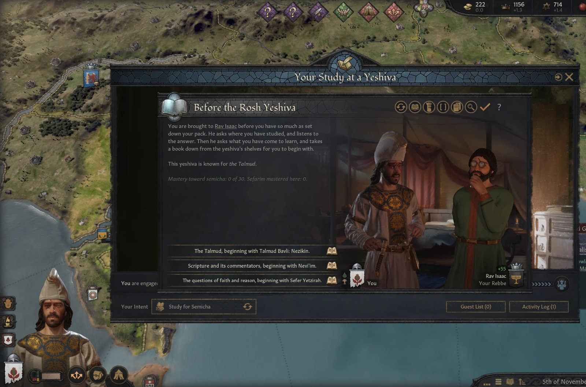
  <figcaption><strong>Before the Rosh Yeshiva.</strong> The head of the yeshiva asks where you studied and what you came to learn, then hands you your first book.</figcaption>
</figure>

<figure class="shot">
  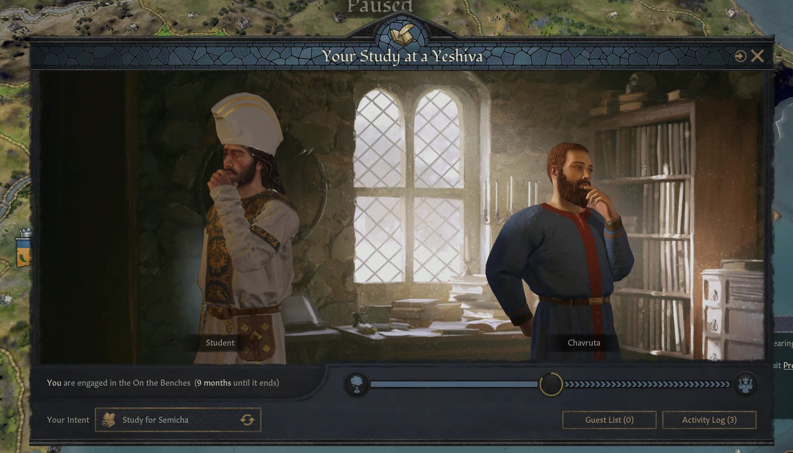
  <figcaption><strong>On the benches.</strong> A student and his chavruta study toward semicha.</figcaption>
</figure>

<figure class="shot">
  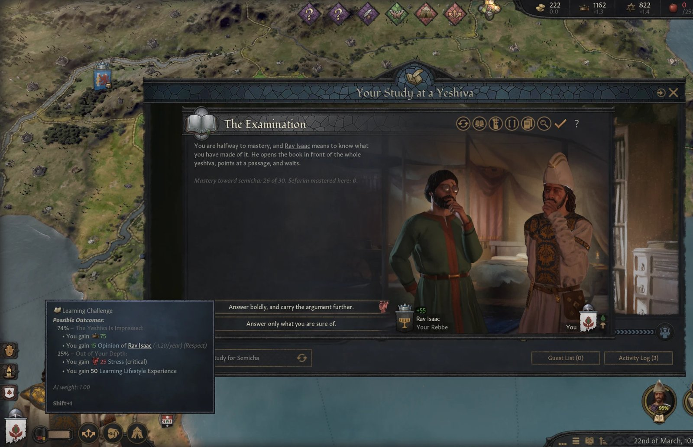
  <figcaption><strong>The Examination.</strong> Halfway to mastery, the Rosh Yeshiva opens the book before everyone and waits for an answer.</figcaption>
</figure>

<figure class="shot">
  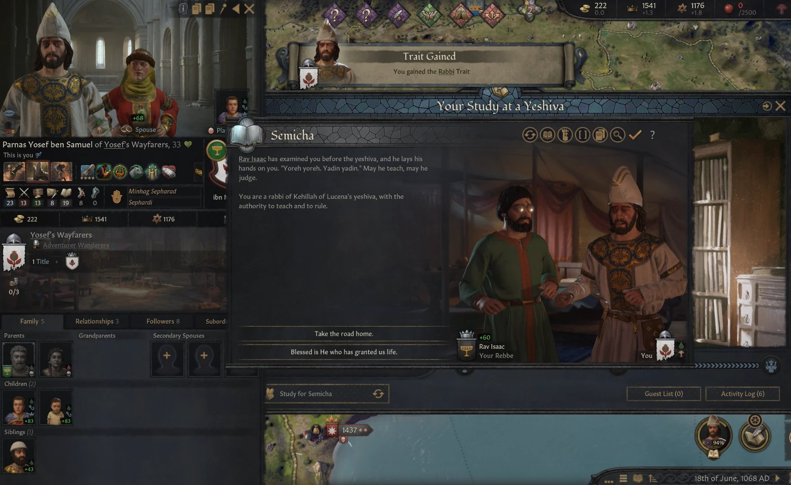
  <figcaption><strong>Semicha.</strong> "Yoreh yoreh. Yadin yadin." The student is ordained and gains the Rabbi trait.</figcaption>
</figure>

## The Bet Din

A community convenes a Bet Din, a rabbinical court, and invites judges from other communities. The judges hear cases, cite the books they know, and send their rulings home.

<figure class="shot">
  
  <figcaption><strong>Why the court sits.</strong> A sitting can hear the community's disputes, convene a synod to vote on a takkanah, or, for a rabbi at the height of learning and devotion, restore the Sanhedrin.</figcaption>
</figure>

<figure class="shot shot--old">
  
  <figcaption>Earlier build <strong>Planning the sitting.</strong> The planning window for a regional rabbinical court.</figcaption>
</figure>

<figure class="shot">
  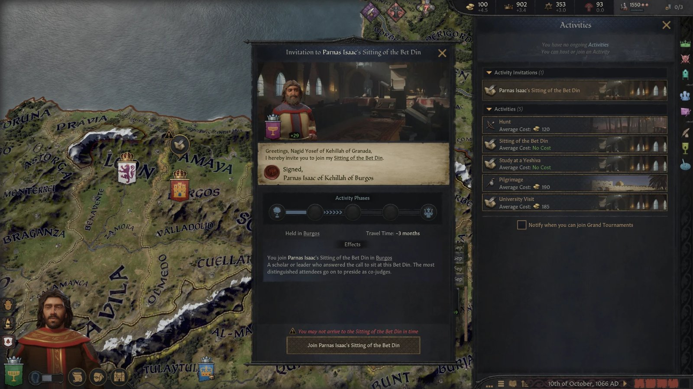
  <figcaption><strong>An invitation to sit.</strong> Other communities invite you to their Bet Din. Parnas Isaac of Burgos writes to Nagid Yosef of Granada.</figcaption>
</figure>

### A case before the court

<figure class="shot">
  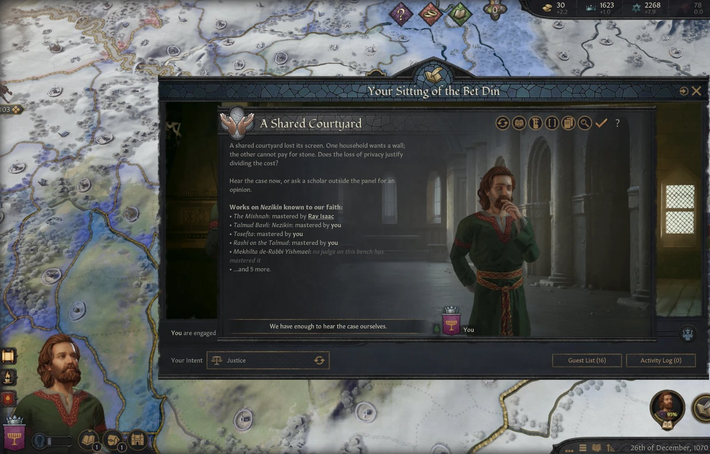
  <figcaption><strong>Knowing the sources.</strong> Each case lists the works that bear on it and which judges on the bench have mastered them. Hear it yourselves, or ask a scholar outside the panel.</figcaption>
</figure>

<figure class="shot">
  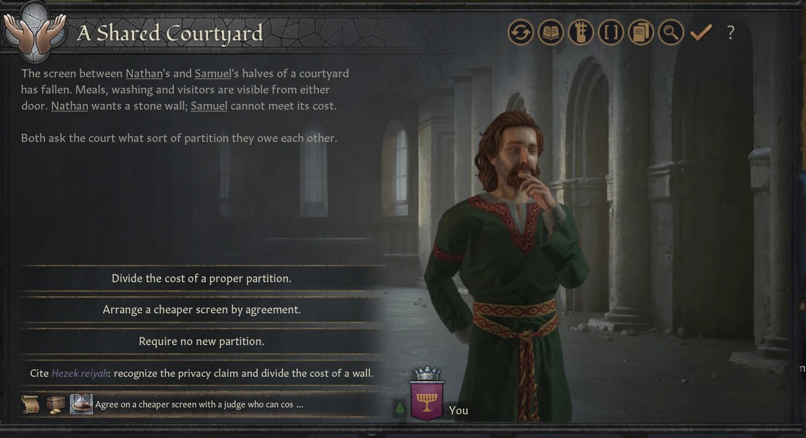
  <figcaption><strong>The ruling.</strong> Divide the cost, agree a cheaper screen, require nothing, or cite <em>Hezek reiyah</em> for the privacy claim.</figcaption>
</figure>

<figure class="shot">
  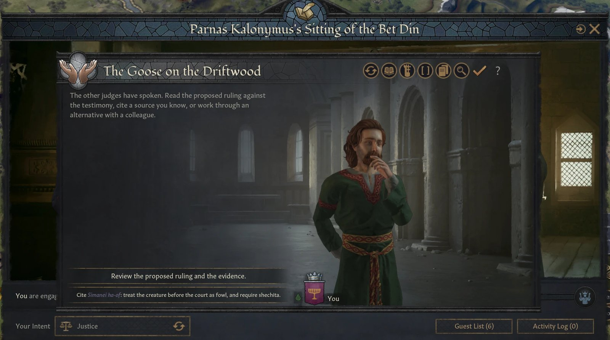
  <figcaption><strong>Another case.</strong> Is a goose that grew on driftwood a fowl? Review the evidence, or cite <em>Simanei ha-of</em> and require shechita.</figcaption>
</figure>

<figure class="shot">
  
  <figcaption><strong>On Whose Authority?</strong> A ruling names its source, and the work it names is remembered with it.</figcaption>
</figure>

### The court rises

<figure class="shot">
  
  <figcaption><strong>The Docket Is Closed.</strong> Rulings are recorded and copied for the other communities, and the court will not sit again for some years.</figcaption>
</figure>

<figure class="shot">
  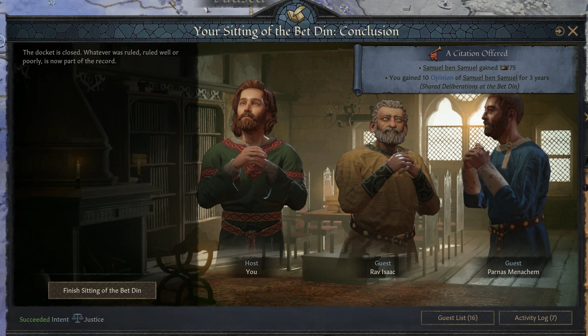
  <figcaption><strong>The conclusion.</strong> Rashi's sitting at Troyes ends with its Justice intent fulfilled and a citation for one of the scholars.</figcaption>
</figure>

<figure class="shot">
  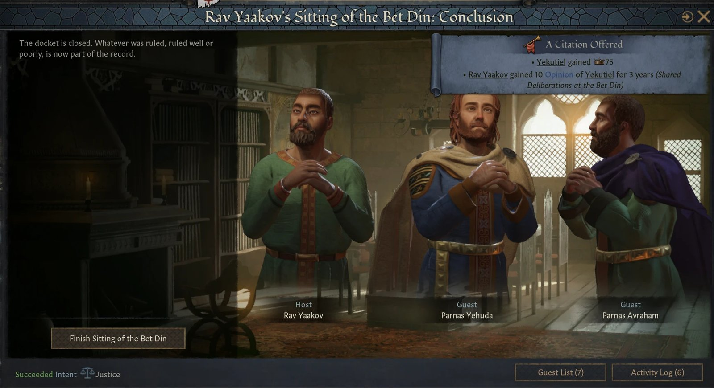
  <figcaption><strong>Rav Yaakov's sitting.</strong> Another host, another bench of judges.</figcaption>
</figure>

<figure class="shot">
  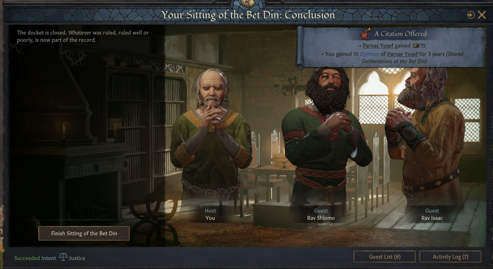
  <figcaption><strong>A third sitting.</strong> The host and two guest judges at the close.</figcaption>
</figure>

### The Sanhedrin

<figure class="shot">
  
  <figcaption><strong>Restore the Sanhedrin.</strong> A sage who holds land in the Land of Israel and has mastered all three fields may seat the court again.</figcaption>
</figure>

<figure class="shot">
  
  <figcaption><strong>Convening it.</strong> Its Nasi puts a takkanah to every community's leaders; if they vote for it, it binds all Israel.</figcaption>
</figure>

## The host and the charter

Every community lives on terms set by its host: what it may build, who protects it, which court judges its people, and what it pays.

<figure class="shot">
  
  <figcaption><strong>A Muslim host's charter.</strong> Emir Badis and Nagid Yosef negotiate tribute, building rights, security, jurisdiction and market access.</figcaption>
</figure>

<figure class="shot">
  
  <figcaption><strong>A Christian host's charter.</strong> Under King Philippe the terms differ, including whether Talmudic study is unrestricted, licensed or proscribed.</figcaption>
</figure>

<figure class="shot shot--old">
  
  <figcaption>Earlier build <strong>The Charter Renewed.</strong> The host confirms the community's terms for building, protection, jurisdiction and study.</figcaption>
</figure>

<figure class="shot">
  
  <figcaption><strong>A decree against a community.</strong> A lord's decree against Córdoba can be enforced, laid aside or withdrawn. Here the realm's communities petitioned together.</figcaption>
</figure>

## Crises

When hostility builds, a community can face violence. Every crisis moves through the same phases.

<figure class="shot crisis-flow">
<svg viewBox="0 0 880 610" role="img" aria-labelledby="crisis-flow-title" xmlns="http://www.w3.org/2000/svg">
<title id="crisis-flow-title">Crisis phases: Agitation leads to Spared or Armed Host; Armed Host leads to Quarter Held or Quarter Struck; Quarter Struck leads to Recovery; Spared, Quarter Held and Recovery all end in the Final chronicle and cooldown.</title>
<defs><marker id="cf-arrow" viewBox="0 0 10 10" refX="9" refY="5" markerWidth="7" markerHeight="7" orient="auto-start-reverse"><path d="M0,1 L9,5 L0,9" fill="none" stroke="#8a7a72" stroke-width="1.6"/></marker></defs>
<g fill="none" stroke="#8a7a72" stroke-width="1.6" marker-end="url(#cf-arrow)">
<path d="M190,94 V396"/><path d="M282,94 V118 H411 V140"/><path d="M366,221 V268"/><path d="M457,221 V246 H678 V268"/><path d="M678,349 V396"/><path d="M191,469 V494 H290 V516"/><path d="M366,349 V516"/><path d="M678,469 V494 H441 V516"/>
</g>
<g fill="#f5f0ed" stroke="#d9c3b5" stroke-width="1.5">
<rect x="100" y="22" width="272" height="72" rx="16"/><rect x="275" y="142" width="273" height="79" rx="16"/><rect x="248" y="270" width="236" height="79" rx="16"/><rect x="533" y="270" width="290" height="79" rx="16"/><rect x="41" y="398" width="301" height="71" rx="16"/><rect x="525" y="398" width="306" height="71" rx="16"/><rect x="211" y="518" width="310" height="71" rx="16"/>
</g>
<g fill="#603626" font-family="system-ui, -apple-system, 'Segoe UI', sans-serif" font-size="16" font-weight="600" text-anchor="middle">
<text x="236" y="63">Agitation: defuse unrest</text><text x="411" y="177">Armed Host: protect the</text><text x="411" y="197">quarter</text><text x="366" y="305">Quarter Held: settle</text><text x="366" y="325">consequences</text><text x="678" y="305">Quarter Struck: resolve the</text><text x="678" y="325">attack</text><text x="191" y="439">Spared: settle consequences</text><text x="678" y="439">Recovery: endure or collapse</text><text x="366" y="559">Final chronicle and cooldown</text>
</g>
</svg>
<figcaption><strong>Crisis phases.</strong> If unrest is defused in Agitation, the community is spared. If not, an armed host gathers, and the Quarter either holds or is struck. Every path ends in a final chronicle, followed by a cooldown before the next crisis.</figcaption>
</figure>

### Granada, 1066: one crisis start to finish

<figure class="shot">
  
  <figcaption><strong>1. Sinister Verses.</strong> A hostile poem by Abu Ishaq of Elvira reaches the Nagid, and how he answers it shapes the crisis.</figcaption>
</figure>

<figure class="shot">
  
  <figcaption><strong>2. Agitation.</strong> Armed host and Spared race toward 100 while catalysts push the totals and the window offers responses.</figcaption>
</figure>

<figure class="shot shot--narrow">
  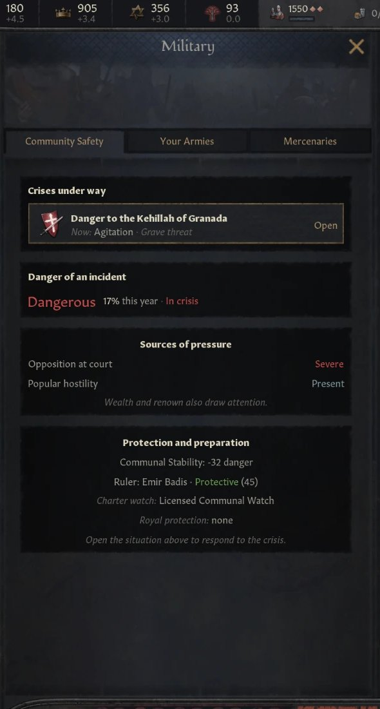
  <figcaption><strong>Community Safety.</strong> The Military window lists crises under way, the yearly danger, its sources and what protects the community.</figcaption>
</figure>

<figure class="shot">
  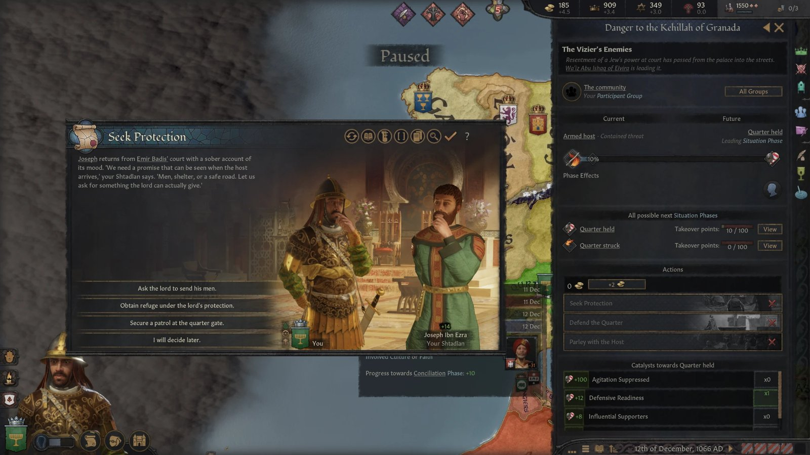
  <figcaption><strong>3. Seek Protection.</strong> Your Shtadlan returns from the emir's court. Ask for men, refuge or a patrol at the gate.</figcaption>
</figure>

<figure class="shot">
  
  <figcaption><strong>4. The Sanhaja Mobilize.</strong> The verses reach the barracks, and the emir's soldiers prepare to act without his leave.</figcaption>
</figure>

<figure class="shot">
  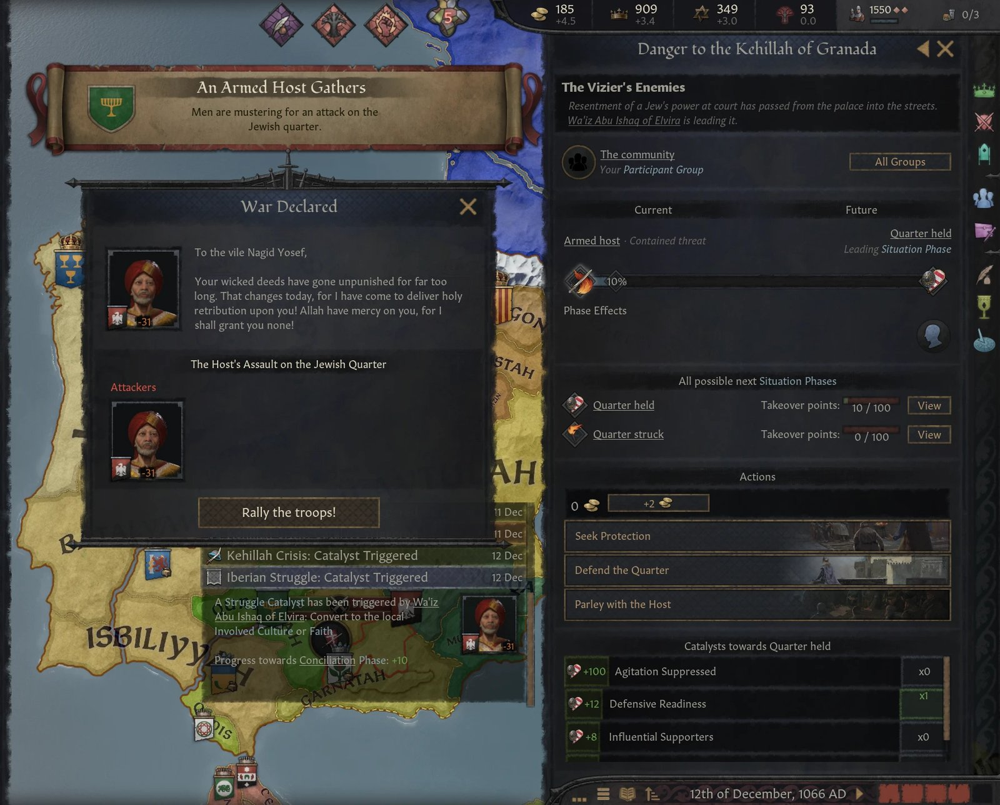
  <figcaption><strong>5. An Armed Host Gathers.</strong> War is declared and a second race begins: Quarter held against Quarter struck, with three ways to respond.</figcaption>
</figure>

<figure class="shot">
  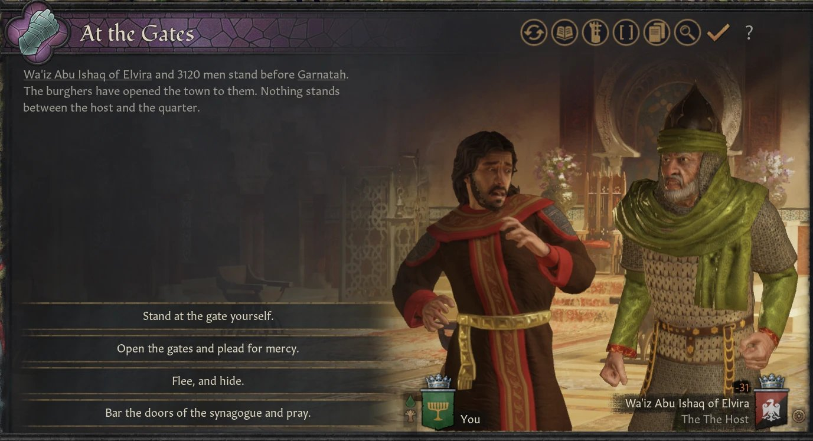
  <figcaption><strong>6. At the Gates.</strong> The host stands before the town. Stand at the gate, plead, flee or bar the synagogue doors.</figcaption>
</figure>

<figure class="shot">
  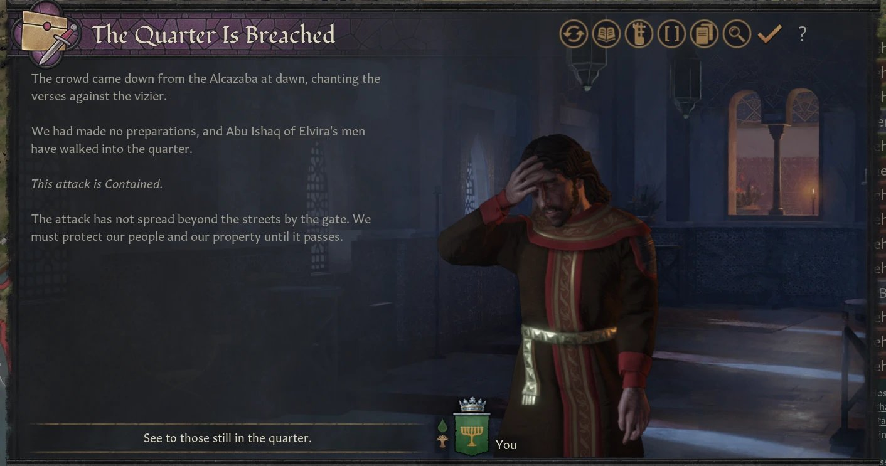
  <figcaption><strong>7. The Quarter Is Breached.</strong> With no preparations made, the attackers walk in, but the attack is contained.</figcaption>
</figure>

<figure class="shot">
  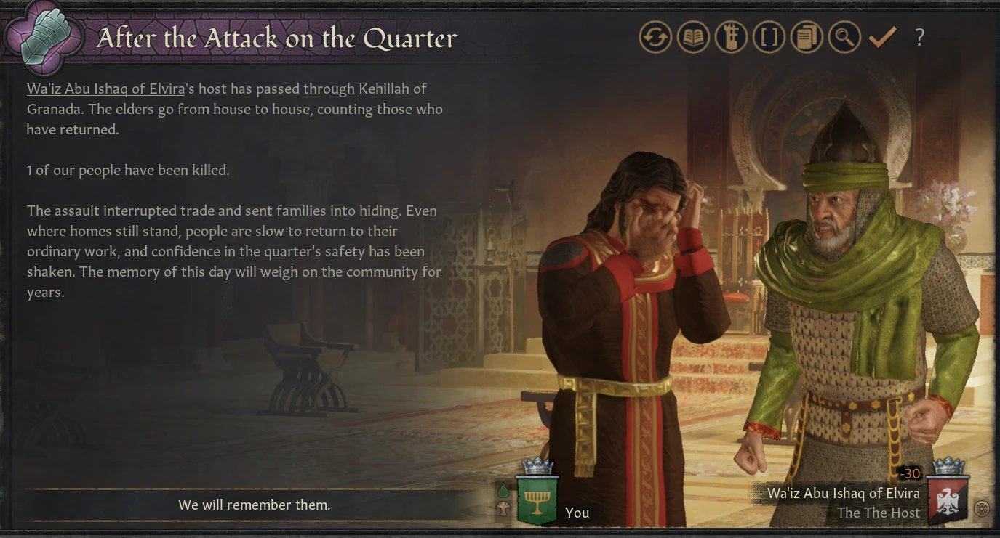
  <figcaption><strong>8. After the Attack.</strong> The elders go house to house, counting those who returned.</figcaption>
</figure>

<figure class="shot">
  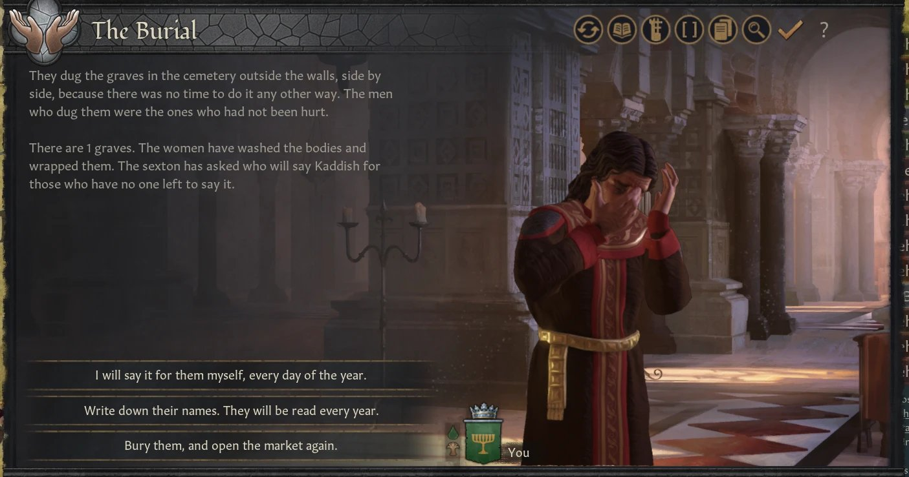
  <figcaption><strong>9. The Burial.</strong> Who will say Kaddish for those with no one left to say it?</figcaption>
</figure>

<figure class="shot">
  
  <figcaption><strong>10. A Seal from the Court.</strong> The emir orders an end to disorder, but offers no new protection.</figcaption>
</figure>

<figure class="shot">
  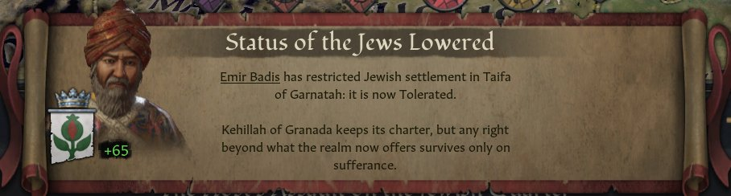
  <figcaption><strong>11. Status of the Jews Lowered.</strong> Emir Badis restricts Jewish settlement. The charter stands, but anything beyond the new law survives only on sufferance.</figcaption>
</figure>

<figure class="shot">
  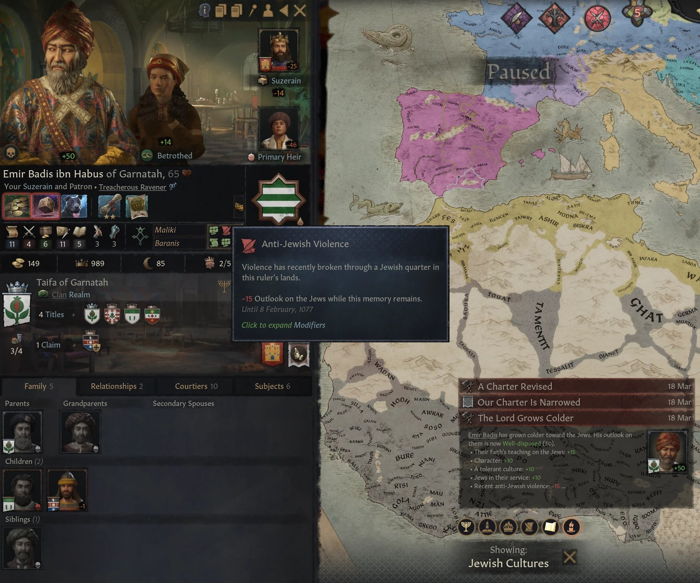
  <figcaption><strong>12. The Lord Grows Colder.</strong> Violence marks the host too: Emir Badis's outlook on the Jews falls for ten years, and the notification breaks down why.</figcaption>
</figure>

<figure class="shot">
  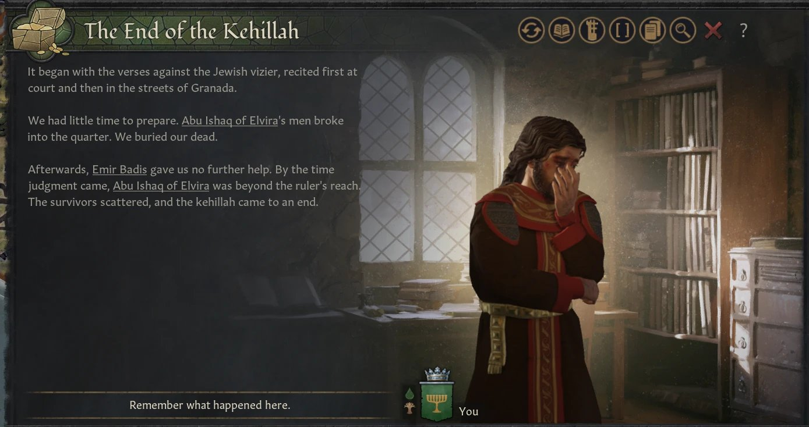
  <figcaption><strong>13. The End of the Kehillah.</strong> In this playthrough no help came, and the community scattered.</figcaption>
</figure>

<figure class="shot">
  
  <figcaption><strong>14. After the end.</strong> Yosef leads his followers on as adventurers, and the fall of Granada pushes the Iberian Struggle toward Hostility.</figcaption>
</figure>

<figure class="shot">
  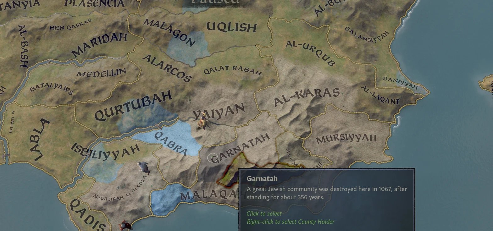
  <figcaption><strong>15. The map remembers.</strong> Where a community was destroyed, the county says so.</figcaption>
</figure>

### Elsewhere

<figure class="shot shot--old">
  
  <figcaption>Earlier build <strong>An Accusation.</strong> A false charge spreads, and the community must choose how to answer it.</figcaption>
</figure>

<figure class="shot">
  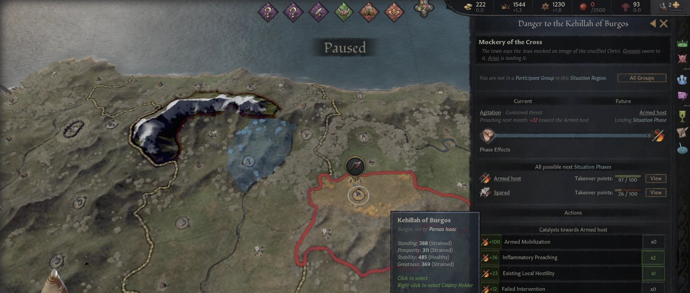
  <figcaption><strong>Burgos.</strong> Crises strike AI communities too. An accusation of mocking the cross pushes Burgos toward an armed host.</figcaption>
</figure>

## Faiths and lineages

### Rites of the Rabbinic faith

Each rite has its own icon, tenets, sins and virtues.

<figure class="shot">
  
  <figcaption><strong>Minhag Bavli.</strong> The mainline rite.</figcaption>
</figure>

<figure class="shot">
  
  <figcaption><strong>Minhag Ashkenaz.</strong></figcaption>
</figure>

<figure class="shot">
  
  <figcaption><strong>Minhag Sepharad.</strong></figcaption>
</figure>

<figure class="shot">
  
  <figcaption><strong>Minhag Yerushalmi.</strong></figcaption>
</figure>

<figure class="shot">
  
  <figcaption><strong>Yordei Merkavah.</strong> The mystics.</figcaption>
</figure>

### Other Jewish faiths

Beyond the Rabbinic rites, other Jewish faiths each have their own tenets and their own view of the others.

<figure class="shot">
  
  <figcaption><strong>Karaism.</strong> Scripture alone.</figcaption>
</figure>

<figure class="shot">
  
  <figcaption><strong>Samaritanism.</strong> Led by its High Priest.</figcaption>
</figure>

<figure class="shot">
  
  <figcaption><strong>Malabarism.</strong> The Jews of the Malabar coast.</figcaption>
</figure>

<figure class="shot">
  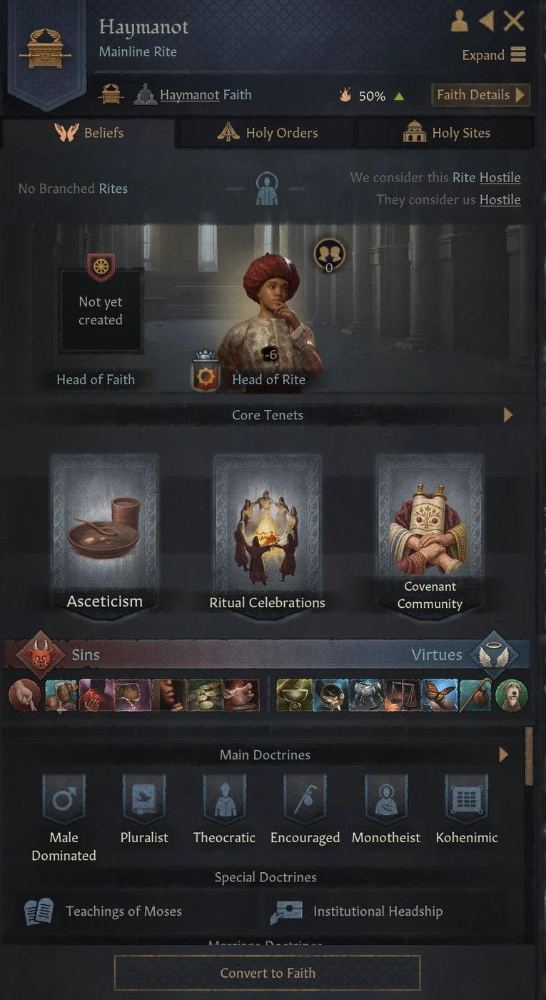
  <figcaption><strong>Haymanot.</strong> The faith of the Beta Israel.</figcaption>
</figure>

<figure class="shot">
  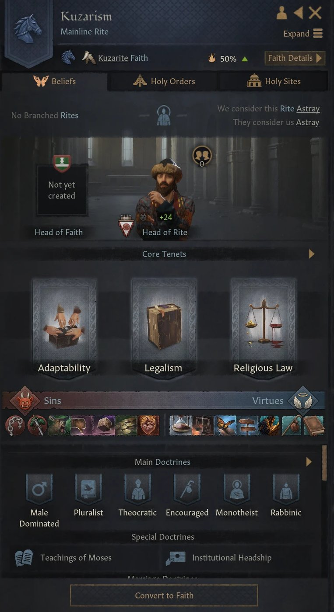
  <figcaption><strong>Kuzarism.</strong> The Khazars' Judaism.</figcaption>
</figure>

<figure class="shot">
  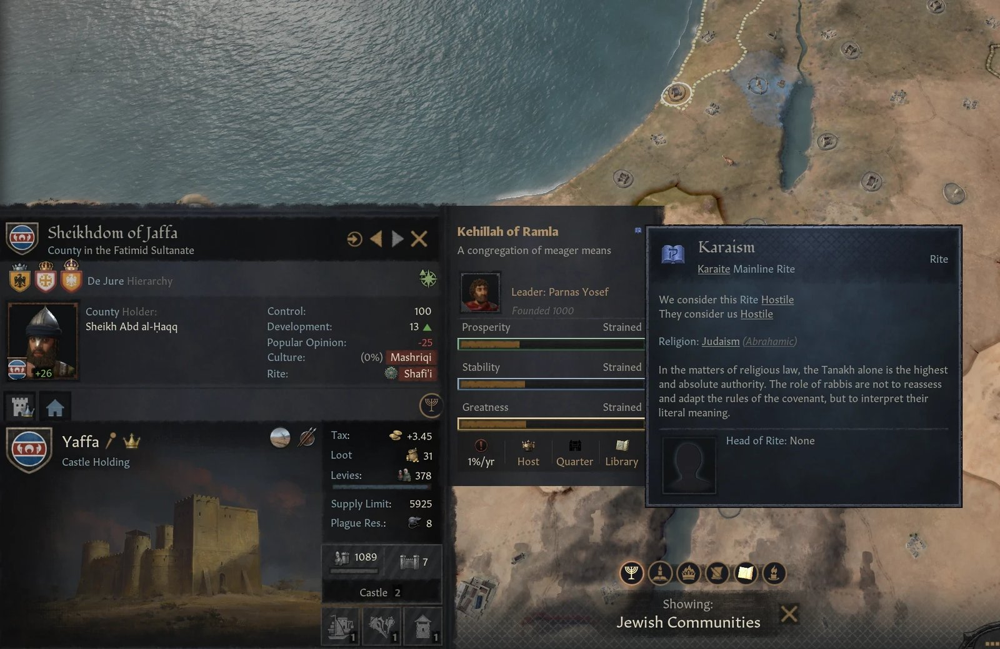
  <figcaption><strong>A Karaite community.</strong> The Kehillah of Ramla, under the Fatimids, follows Karaism: the Tanakh alone is the highest authority.</figcaption>
</figure>

### Lineages and doctrines

<figure class="shot">
  
  <figcaption><strong>Ben David.</strong> A lineage claiming descent from King David, which raises a ruler's initial legitimacy.</figcaption>
</figure>

<figure class="shot">
  
  <figcaption><strong>Kohen.</strong> Kohen Gadol Simeon, of the priestly line of Aaron.</figcaption>
</figure>

<figure class="shot">
  
  <figcaption><strong>Levite.</strong> An inherited trait for descendants of the tribe of Levi.</figcaption>
</figure>

<figure class="shot">
  
  <figcaption><strong>Recognition of the Sages.</strong> A rite with no appointed head may acclaim a great sage as its highest voice in law.</figcaption>
</figure>

<figure class="shot shot--narrow-wide">
  
  <figcaption><strong>Doctrines of the people.</strong> Marriage, descent, proselytism and peoplehood each have a Jewish doctrine.</figcaption>
</figure>

The [feature guide](features.md) explains these screens. The [pre-alpha test log](https://github.com/Steinbeard/jewishcommunities/blob/master/docs/testing/2026-11-16-prealpha-screenshot-and-ui-log.md) records how the images were captured.
