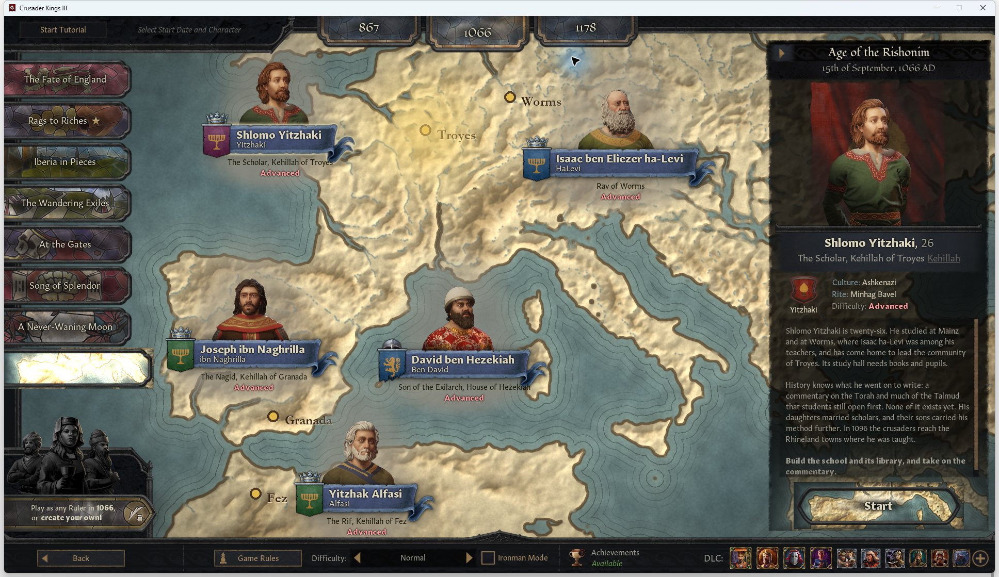
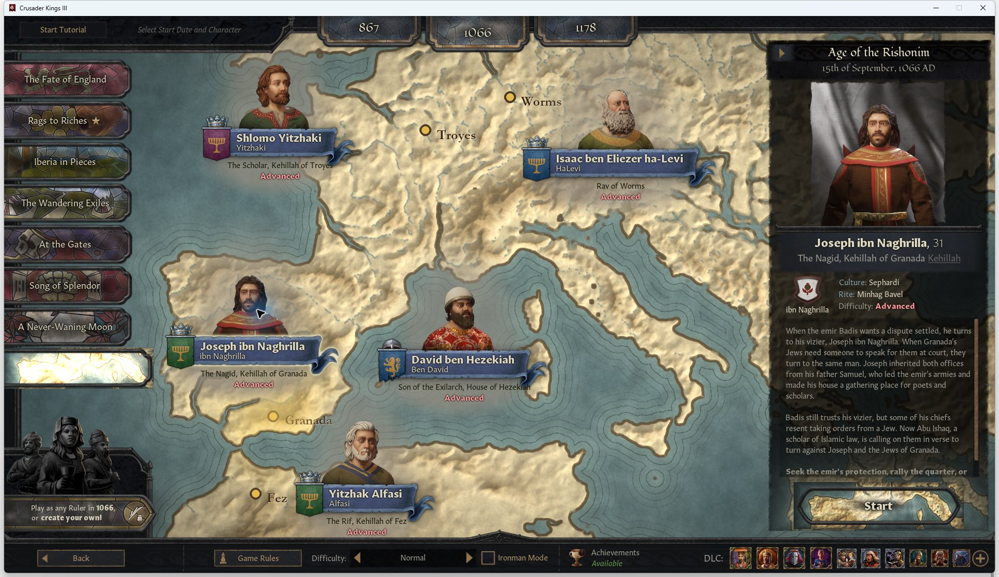
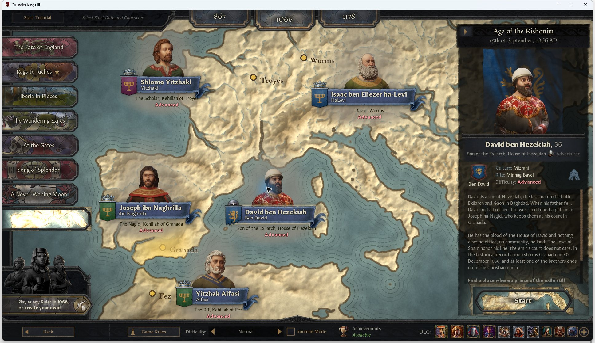

# Three ways into the Kehillah

**Status:** pre-alpha player guide, 2026-11-16. Describes the intended current 1066 build; balance and some newer UI still need wider playtesting. See [ROADMAP](../../ROADMAP.md) for verification.

All three characters appear on **1066 · Age of the Rishonim**. **Roads to Power** is required. On your first day, open **Domain** and hover Prosperity, Stability and Greatness to see what helps or hurts your community. Then inspect the Jewish Quarter and council.

## Rashi of Troyes — build a school

Shlomo Yitzhaki is twenty-six. He has studied in the Rhineland and returned to lead a modest community in Champagne. The works that will make him famous do not exist yet.

1. **Read Domain and Quarter.** Troyes has little money. Review the pillars and existing buildings before spending. Scholarly leadership leans into Greatness; Commercial helps Prosperity. A style lasts ten years.
2. **Give your council work.** Fill useful vacancies and assign tasks. The Gabbai helps revenue and construction; the Dayyan serves the community's legal and rabbinic life.
3. **Open the library.** Compare the shelf with the Sefarim Ledger. The Ledger ranks works for your rite and can show works available through wider scholarly networks. Build a useful collection, then study the books you own.
4. **Plan for Rashi's writing.** Learn Torah, develop the Beit Midrash, train students and use Write a Sefer when its conditions and resources make sense. His commentaries are a campaign goal, not starting books.
5. **Review succession.** Candidate scores and endorsements are visible. Rashi's family matters, but the community appoints its next leader.

**Screens to visit:** Rashi's portrait, [Troyes Domain and its leadership choices](../images/rashi-domain-leadership.jpg), Jewish Quarter, library shelf and Sefarim Ledger.

## Joseph ibn Naghrilla of Granada — hold the Quarter

Joseph serves the emir of Granada as vizier and leads the Jews of his realm as **Nagid**. His position is powerful and exposed. The historical violence of December 1066 shapes this opening, but your choices can change the outcome.

1. **Inspect your political position.** Open the realm/community views, read Joseph's Nagid office, the host charter and settlement policy, and check Community Safety.
2. **Prepare while there is time.** Seat capable councillors, review the Quarter's resources and consider watch and protection actions. Keep gold for urgent responses.
3. **When the crisis opens, read both bars.** The Armed Host and Spared totals are visible, with named sources of pressure. The threat grade and suggested responses explain what is happening. Hover a source before spending on an action.
4. **Choose how to answer.** Watch and provisions prepare for violence; appeals to the lord, religious authorities or neighbours may spare the Quarter. Public answers and political moves have costs and consequences. If the host rises, a second race decides whether the Quarter is held or struck.
5. **Follow the aftermath.** Look again at Stability, the charter and the host's outlook. A narrow survival can leave lasting damage.

**Screens to visit:** Granada community card, Nagid office, Community Safety and the crisis window with both bars and named sources.

## David ben Hezekiah — reclaim a seat

David is an exiled son of the Exilarch. He starts in Granada as a **landless adventurer**, with a camp, a Dayyan and a recorded claim to the Kehillah of Baghdad. The community claim and the Exilarchate are two separate goals.

1. **Meet the camp.** Inspect David, his brother and his Dayyan, Isaac ibn Sakri. Use adventurer work to build resources and standing for the journey.
2. **Travel to Baghdad.** Pressing a community claim requires David to be present in that community's county, at peace and free. He needs **100 gold and 150 prestige**, an opinion of at least **−10** from its leader and **−25** from its host ruler.
3. **Press the seat claim.** Select Baghdad's community leader and use the claim interaction when its conditions are met. A successful transfer makes David the Kehillah leader, ends his camp and can bring his Dayyan into the new council.
4. **Seek Exilarch recognition.** As a Ben David community leader, David may use the separate **Seek Recognition as Exilarch** decision while the office is vacant. He must be present at his own seat, at peace and free, have at least **−25** host opinion, and pay **100 gold and 150 prestige**. The Exilarchate is a lifetime dignity; taking Baghdad alone does not grant it.
5. **Build what follows.** Inspect Baghdad's Quarter and neighbouring communities. Turn a recovered title into a new centre of scholarship and politics.

**Screens to visit:** David's camp, the Baghdad claim interaction and the separate Exilarch title after recognition. A successful scripted transfer was checked live; a fresh full campaign and save/reload of the revised two-step route still deserve tester attention.

## If a control is missing

Hover disabled decisions and interactions for their requirements. Check location, peace, money, prestige, opinion and whether the office is vacant. If the requirements look met but the control still fails, send the start, date and a screenshot with your report. See [testing and feedback](testing-and-feedback.md).
